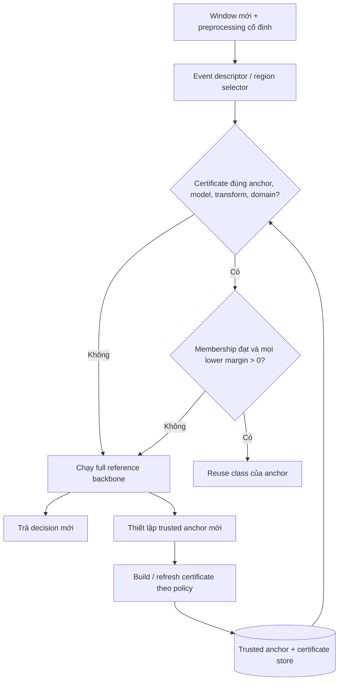

# PROJECT BRIEF

> **Historical snapshot:** dated 22 October 2026. The current Week 1 authority is [00_OVERVIEW/02_Week_1_Project_Brief.tex](00_OVERVIEW/02_Week_1_Project_Brief.tex) and [00_OVERVIEW/week1/](00_OVERVIEW/week1/).
## Event-Conditioned Certified Decision Reuse (ECDR)
**Tên tiếng Việt:** Tái sử dụng quyết định của mạng neural có chứng nhận theo cấu trúc sự kiện  
**Phiên bản:** 22/10/2026 — bản tổng hợp định hướng nghiên cứu  
**Lĩnh vực:** Efficient Neural Inference · Formal Neural Network Verification · Multivariate Time-Series · Systems Performance  
**Loại tài liệu:** Research Project Brief (định nghĩa vấn đề và phương pháp, không phải báo cáo kết quả hoàn tất)

> **Luận điểm trung tâm:** Có thể tồn tại phép tính dư thừa khi một neural classifier xử lý luồng dữ liệu liên tiếp. Tuy nhiên, sự giống nhau về dữ liệu không đủ để kết luận mô hình sẽ giữ nguyên quyết định. ECDR nghiên cứu cách chứng nhận trực tiếp rằng một quyết định đã tính vẫn hợp lệ cho đầu vào mới, rồi kiểm tra liệu lợi ích tránh chạy lại backbone có lớn hơn toàn bộ chi phí kiểm chứng và duy trì cache hay không.

## 1. Tóm tắt dự án (Project overview)

ECDR là đề tài nghiên cứu **cơ chế tái sử dụng quyết định của một mạng neural tham chiếu cố định** (*frozen reference classifier*) trên luồng dữ liệu nhiều biến. Thay vì chạy đầy đủ mạng cho mọi cửa sổ đầu vào, hệ thống lưu một **trusted anchor** (đầu vào đã thực sự chạy mạng cùng dự đoán của nó), thiết lập một **candidate region** (miền những đầu vào có thể được xét tái sử dụng), và chỉ trả lại quyết định cũ nếu một **sound certificate** chứng minh lớp dự đoán của mạng không đổi trên toàn miền chứa truy vấn mới. Mọi trường hợp không đủ điều kiện đều chạy lại mạng tham chiếu.

Đề tài **không đặt mục tiêu cải thiện accuracy bằng mô hình phân loại mới**, không nhằm chứng minh 90% trọng số là rác, và không chủ trương giảm FLOPs bằng mọi giá. Đối tượng nghiên cứu là **mối quan hệ giữa cấu trúc biến thiên của dữ liệu tuần tự, khả năng chứng nhận tính bất biến của quyết định, tỷ lệ tái sử dụng và chi phí inference thực tế**.

Kết quả mong đợi là một phương pháp/đánh giá có thể tái lập, chỉ ra rõ **khi nào được reuse, khi nào phải fallback và khi nào reuse thực sự đáng tiền**. Kết quả âm (certificate đúng nhưng quá đắt, hoặc miền được chứng nhận quá nhỏ) vẫn có giá trị nếu được đo và giải thích đúng.

## 2. Context: ý tưởng này xuất phát từ đâu?

### 2.1. Động cơ ban đầu: computation redundancy

Trong các trao đổi nghiên cứu trước đó, vấn đề xuất phát từ câu hỏi rộng: **mạng neural có thực hiện những phép tính không mang thêm giá trị cho kết quả cuối không, và có thể bỏ chúng mà không ảnh hưởng quyết định không?** Những hướng đã thảo luận gồm SPGR-Net/PulseGraphNet, tensor/graph, xử lý thưa theo xung, bỏ phép nhân với phần tử bằng 0, biểu diễn hạng thấp và khả năng thực thi trên thiết bị hạn chế tài nguyên. Với `y = Wx + b`, phép nhân với hệ số hoặc đầu vào bằng 0 có thể được lược bỏ trong những giả định số học thích hợp. Nhưng giảm số phép toán không tự suy ra giảm latency do chi phí điều phối, chỉ số thưa và truy cập bộ nhớ.

Giả thuyết mang tính trực giác **“10% trọng số hữu ích, 90% còn lại có thể bỏ”** thuộc nhóm *pruning/sparsity*, không phải phát biểu đã được xác nhận và không phải giả thuyết chính của ECDR. Cần phân biệt **trọng số dư thừa**, **phép toán dư thừa**, và **lượt suy luận dư thừa**; chúng không tương đương.

### 2.2. Từ routing/Decision Maker sang yêu cầu chứng nhận

Ý tưởng tiếp theo là dùng một Decision Maker nhỏ để chọn `CONTINUE`, `EXIT`, `ROUTE` hoặc cập nhật một phần mạng; đồng thời từng thảo luận trạng thái cân bằng, contraction/fixed point, tensor bậc bốn và góc giữa các không gian con. Các công cụ đó có thể hỗ trợ dự đoán độ ổn định hoặc định tuyến phép tính, nhưng **policy dự đoán “an toàn để bỏ” có thể sai**. Sự ổn định hình học, sự hội tụ trạng thái và độ tự tin của mô hình cũng không tự chứng minh rằng argmax của backbone không đổi.

Vì thế câu hỏi được chuyển thành: **có thể tính một giới hạn trên hợp lệ cho tác động của phần thay đổi/chưa tính đến các class-pair logits, đủ chặt để chứng minh quyết định cuối không đổi không?** Đây là nguồn gốc của certified adaptive inference, logit margin, Lipschitz/CROWN bounds và nhánh fallback.

### 2.3. Vì sao thêm yếu tố event và time-series?

Một ý tưởng sau đó là dữ liệu liên tục có cấu trúc: sóng, tính chu kỳ, thành phần động học hoặc những sự kiện biến thiên theo một số hướng hạn chế. Nếu đầu vào kế tiếp thuộc một miền thay đổi có cấu trúc, giới hạn ảnh hưởng lên quyết định **có thể** chặt hơn giới hạn toàn cục vốn xem mọi chiều biến thiên như nhau. Tuy nhiên, diễn tả tín hiệu bằng hàm sóng không đồng nghĩa bảo toàn logits; khả năng dự đoán cũng không tự cung cấp error bound hợp lệ.

Từ ba lớp câu hỏi **(i) computation dư thừa → (ii) ai quyết định bỏ? → (iii) làm sao chứng nhận quyết định đó?**, đề tài được thu hẹp thành **event-conditioned certified reuse trực tiếp cho frozen backbone trên dữ liệu tuần tự**. Đây là trình tự hình thành ý tưởng, không phải lịch sử thực nghiệm đã chứng minh từng phương án tốt hơn.

## 3. Problem statement: hiện tượng, vấn đề và research gap

**Hiện tượng:** trong xử lý cảm biến/video tuần tự, nhiều input gần nhau về thời gian hoặc có các thành phần trùng lặp; đường suy luận thường chạy full backbone trên mỗi input. Các công trình về sparse temporal updates và event-driven inference đã cho thấy có những dạng computation có thể tránh được trong một số workload [B2–B3].

**Vấn đề kỹ thuật:** hai cửa sổ tương tự, thậm chí chia sẻ dữ liệu, không đảm bảo `argmax f(x_t) = argmax f(x_{t+1})`. Với cửa sổ 128 mẫu và stride 64, 64 mẫu được chia sẻ nhưng chuyển sang vị trí tọa độ khác; overlap 50% không đồng nghĩa khoảng cách theo từng tọa độ nhỏ. Reuse chỉ dựa trên similarity/confidence có thể tạo những quyết định khác reference backbone.

**Vấn đề chứng nhận:** dùng bound Lipschitz toàn cục có thể quá bảo thủ; dùng verifier chặt hơn có thể tốn chi phí lớn. Mô hình hóa miền biến thiên theo sự kiện là một hướng được đề xuất để cải thiện trade-off, không phải bảo đảm luôn tốt hơn.

**Research gap ứng viên:** chưa xác nhận đầy đủ liệu **event-conditioned input sets + chứng nhận trực tiếp class-pair logits của backbone + trusted-anchor sequential reuse + đo toàn bộ chi phí runtime** có mang lại cải thiện có ý nghĩa so với các baseline phù hợp hay không. Gap này phải đối chiếu sát LipCache, CROWN/auto_LiRPA, STBP và công trình reuse trong online verification [B4–B8]. Không tuyên bố đây là phương pháp đầu tiên dùng class-pair bounds hoặc temporal information.

**Nghiên cứu tập trung vào:** *When can a frozen neural classifier safely skip an entire forward inference by reusing a previous decision, and when is proving that fact cheaper than recomputing it?*

## 4. Đối tượng, phạm vi và mục tiêu

**Research object (đối tượng nghiên cứu):** cơ chế bảo toàn và tái sử dụng **lớp dự đoán `argmax`** của một classifier cố định dưới biến thiên đầu vào có cấu trúc; không phải độ chính xác nhận diện hành động như một đề tài độc lập.

**Experimental subject/testbed (đối tượng thực nghiệm):** luồng cửa sổ cảm biến gia tốc kế và con quay hồi chuyển từ HAPT; baseline là một CNN 1D đã huấn luyện. HAPT là phương tiện kiểm nghiệm tính khả thi, không phải bản thân contribution.

**Mục tiêu O1 — Soundness:** xác định miền input, điều kiện membership, class-pair bound, model/preprocessing identity, numerical assumptions và hành vi fallback sao cho chỉ reuse khi bảo toàn quyết định của backbone được chứng nhận.

**Mục tiêu O2 — Scientific effectiveness:** kiểm tra event-conditioned regions có tăng **certified decision-reuse rate** hoặc cải thiện trade-off certificate–coverage so với global/diagonal controls dưới phép so sánh công bằng hay không.

**Mục tiêu O3 — Systems effectiveness:** kiểm tra có **net savings** sau khi tính event extraction, lookup/membership, certificate generation/refresh, fallback và bộ nhớ hay không. Báo cáo các miền điều kiện thành công lẫn thất bại, không đặt mức giảm latency 50% làm mặc định.

**Trong phạm vi:** frozen classifier; 6-channel multivariate time-series; direct class-pair margins; conservative membership/fallback; trusted-anchor lifecycle; proof-to-code validation; subject-disjoint streaming evaluation; paired runtime benchmark.

**Ngoài phạm vi hiện tại:** chứng minh backbone đúng ground truth; giữ nguyên mọi giá trị logits/probabilities; pruning 90%, huấn luyện Decision Maker/GRU, mạng phát xung, DEQ, tensor bậc bốn, wave/Fourier/Koopman surrogate, model compression, mobile/ESP32/energy deployment, và mở rộng K=12. Các hướng này là lịch sử ý tưởng hoặc nghiên cứu sau, không phải nghĩa vụ của đề tài hiện tại.

## 5. Khái niệm, dữ liệu và bằng chứng hiện có

### 5.1. Thuật ngữ cần cố định

| Thuật ngữ | Định nghĩa vận hành |
|---|---|
| Time-series window `x_t` | Một đầu vào có `6 × 128` giá trị; đây là **một điểm** trong không gian đầu vào, không phải context window của LLM. |
| Reference classifier `F` | Pipeline cố định gồm preprocessing và backbone, trả về `K` logits; `argmax` là quyết định tham chiếu. |
| Trusted anchor `x^r` | Input đã được chạy thật qua `F`, kèm dự đoán lớp `a`, checkpoint và metadata miền. |
| Event descriptor / selector | Thông tin biến thiên/heuristic để **đề xuất** loại miền và ngân sách; chưa phải bằng chứng reuse an toàn. |
| Candidate region `S_e(x^r)` | **Tập** input quanh anchor được mô tả bằng ràng buộc biến thiên. |
| Membership check | Kiểm input mới có thực sự thuộc đúng miền dùng để tính certificate không. |
| Certificate | Lower bound hợp lệ chứng minh lớp `a` thắng mọi lớp đối thủ trên **toàn miền**. |
| Certified hit | Query thỏa membership, certificate, identity và numerical checks, do đó được reuse. |
| Fallback | Chạy full reference classifier nếu bất kỳ điều kiện nào không đạt. |

### 5.2. Evidence register: phân biệt bốn loại kết luận

- **[A] Artifact/project evidence:** dự án đã có pipeline HAPT, dữ liệu split theo subject, source CNN 1D, config, checkpoint và JSON metrics được **bản brief snapshot 21/10 ghi nhận**. Các số dưới đây chưa được tái chạy/kiểm tra runtime trong lượt tổng hợp này.
- **[B] Published/official evidence:** nguồn về HAPT, temporal reuse, certified caching và verification có dẫn URL [B1–B8]; nó củng cố tính hợp lệ của bài toán, **không chứng minh ECDR hiệu quả**.
- **[C] Mathematical inference:** mệnh đề preservation nếu mọi class-pair lower margin dương là điều kiện đủ, với sound bounds và các giả định đã nêu.
- **[D] Proposal/hypothesis:** event region hữu ích hơn global bounds, certified reuse đáng kể và net saving là giả thuyết, chưa phải kết quả.

**Snapshot từ project artifacts [A]:** 30 subjects/61 recordings; 17.453 windows toàn dữ liệu; 10.017 pure K=6 windows; test stream gồm 5.053 windows, riêng pure test K=6 gồm 2.874 windows. Backbone SmallCNN1D có 282.918 tham số. Checkpoint được chọn (seed 44, epoch 25) có test accuracy 93,49% và macro-F1 93,54% **trên pure K=6 test**, không đại diện cho full-stream hay 12-class task. Mean CPU forward 0,2511 ms là **`model(x)` trên input đã normalize trong RAM**, không phải latency end-to-end. Các con số là kết quả lưu, không được xem là phép đo mới.

**Exploratory event-region audit [A]:** test adjacent-pair membership coverage: diagonal q90 = 31,94%; PCA candidate = 35,42%. Đây là **coverage miền trên adjacent pairs**, không phải certified reuse; hai miền chưa matched budget và trusted-anchor runtime có thể khác adjacent-pair scenario. Candidate PCA trong script và miền ghi trong theory hiện không hoàn toàn đồng nhất về centering/residual norm.

**Các thiếu hụt evidence hiện tại:** chưa có verifier tích hợp trên backbone đã freeze; chưa có lower-bound trace, certified reuse rate, tested anchor lifecycle, violation audit, end-to-end net saving hoặc energy benchmark. Con số 10%/90% và các simulation ban đầu không được nhập vào phần kết quả đo của ECDR.

## 6. Research questions và giả thuyết

**RQ chính.** *Can event-conditioned structured perturbation sets soundly certify the frozen reference classifier’s decision across sequential inputs and improve certified decision reuse and end-to-end inference cost relative to conventional baselines?*

**RQ1 — Correctness:** Điều kiện toán học, miền input, chuẩn sai số, membership và versioning nào đủ để mọi accepted reuse trả **đúng lớp của reference model**?

**RQ2 — Value of structure:** Khi giữ một budget hoặc coverage tương đương, miền theo event có cho chứng nhận nhiều hơn global-ball/global-Lipschitz hay diagonal bounds không? Hiệu quả thay đổi theo class, event và window-distance ra sao?

**RQ3 — Net performance:** Ở những mức reuse rate, certificate build/rebuild rate và inference cost nào hệ thống nhanh hơn full-reference inference? Có tăng peak/p95 latency hoặc memory đáng kể không?

**Giả thuyết H1 [C, điều kiện đủ]:** nếu `x_t ∈ S_e(x^r)`, metadata phù hợp và mọi class-pair lower bound là hợp lệ, nghiêm ngặt dương trên `S_e`, reused class bằng `argmax F(x_t)`.

**Giả thuyết H2 [D, thực nghiệm]:** trên một số workload/event regimes có thể xác định, event-conditioned bounds đạt certified-reuse/coverage–cost trade-off tốt hơn baseline global-bound. Không giả định thắng trong mọi sự kiện.

**Giả thuyết H3 [D, thực nghiệm]:** với cache/certificate lifecycle phù hợp, chi phí trung bình có thể thấp hơn full-reference inference trên một số operating regimes.

**Cách bác bỏ:** sai điều kiện chứng nhận hoặc implementation phản ví dụ hợp lệ → H1 không đạt; H2 bác bỏ nếu matched comparison không cải thiện; H3 bác bỏ nếu certificate/membership/rebuild luôn tốn hơn inference tránh được trong các chế độ đã thử. Không dùng “0 lỗi trên test” thay cho chứng minh soundness.

## 7. Mathematical foundation và proof obligation

Đặt `d = 6 × 128 = 768`, `F: R^d → R^K` là pipeline tham chiếu đã freeze, `x^r ∈ R^d` là trusted anchor, và `a = argmax_k F_k(x^r)` là lớp tham chiếu. Với mỗi lớp `j ≠ a`, đặt **class-pair logit gap**:

\[
g_{aj}(x) = F_a(x) - F_j(x).
\]

Miền đơn giản có thể viết:

\[
S_e(x^r) = \{ x^r + D_e u : \|u\|_\infty \le 1 \}.
\]

`D_e` chỉ ra các hướng/biên độ biến thiên. Trường hợp diagonal box có `D_e` là ma trận chéo; correlated affine region là hướng mở rộng có nhiều cột/hướng tương quan. **Miền phải được định nghĩa trong cùng hệ tọa độ với `F`** (hoặc biến đổi preprocessing một cách nhất quán). Một phép kiểm membership bảo thủ là đủ để an toàn nếu mọi query được chấp nhận thực sự nằm trong miền được chứng nhận.

Nếu verifier cung cấp, trên **toàn bộ `S_e`**, affine lower bound hợp lệ `g_{aj}(x) ≥ α_{aj}ᵀx + β_{aj}`, thì:

\[
\underline g_{aj}(S_e)
= \alpha_{aj}^{\top}x^r + \beta_{aj}
- \|D_e^{\top}\alpha_{aj}\|_1.
\]

Bởi vì cực tiểu `αᵀD_eu` trên `||u||∞≤1` bằng `-||D_eᵀα||₁`. Nếu `S_e` còn chứa residual độc lập, phải cộng phần bound residual đúng với chuẩn đã chọn; không lấy coverage PCA làm bằng chứng hỗ trợ công thức khác.

**Điều kiện chứng nhận:**

\[
x_t \in S_e(x^r)
\quad\text{và}\quad
\underline g_{aj}(S_e) > 0\quad\forall j\ne a
\;\Longrightarrow\;
\arg\max_k F_k(x_t) = a.
\]

Vì lớp `a` có logit lớn hơn **mọi** lớp `j` trên toàn miền, argmax giữ nguyên. Quy tắc logits bằng nhau, sai số số học, bound rounding và version consistency phải được định nghĩa; trường hợp không chắc chắn phải fallback. Đây là logic chuẩn của certificate, **không phải định lý mới độc lập của ECDR**. Đóng góp được thử nghiệm nằm ở `S_e`, cách xây/duy trì certificate và trade-off runtime.

## 8. Hệ thống đề xuất và state ownership

**Source of truth:** `F` và checkpoint/preprocessing bất biến quyết định reference semantics. **Anchor owner:** chỉ input đã chạy `F` mới tạo trusted anchor; cached result không tự biến một reused window thành anchor mới. **Certificate owner:** verifier sinh lower bounds cùng định danh model/anchor/region, certificate store chỉ lưu và tra cứu. **Selector:** chỉ đề xuất miền, không được tự kết luận soundness hoặc dùng ground-truth label trong đường runtime. **Decision owner:** reuse khi mọi điều kiện đúng, ngược lại full `F`. Reset cache theo recording/stream boundary, không cho reuse xuyên các subject hoặc recording không có giao ước tương ứng.

## 9. Phương pháp nghiên cứu khoa học (Research methodology)

**M1 — Problem formulation & literature synthesis.** Xác định reference semantics, đơn vị “skip” (bỏ một lượt full inference, không phải trọng số), đóng góp có thể bác bỏ và đối chiếu prior work: temporal delta updates, certified semantic caching, verification bounds và online verifier reuse. Ghi claim ledger: điều đã có, điều chưa xác nhận, điều ECDR định thử.

**M2 — Data characterization.** Dùng HAPT raw streams; khóa subject-disjoint train/validation/test và preprocessing chỉ fit trên train. Phân tích adjacency, khoảng cách trong đúng không gian model, tỷ lệ reference-label agreement, event distribution và margin distribution theo từng event/subject. Không coi label-change offline là online detector. Không cộng các nhóm unlabeled/ambiguous/transition như thể luôn là phân hoạch rời nhau.

**M3 — Formal method.** Bắt đầu từ global/diagonal box và class-pair bounds của backbone thật; kiểm network support, bound soundness, membership, normalization và numerical guard bằng test có oracle full model. Sau đó mới nghiên cứu event-conditioned diagonal; correlated/PCA affine set chỉ thử khi miền và phép kiểm được chuẩn hóa thống nhất. Không xây toàn bộ runtime dựa trên certificate chưa chứng minh.

**M4 — Controlled comparisons.** Dùng cùng checkpoint, preprocessing, dataset split, phần cứng, điều kiện budget và denominators; so global-ball với structured region và tách `bound algorithm effect` khỏi `region geometry effect`. Ghi chính xác certificate generation có được amortize hay không. Thử cả trạng thái ổn định, chuyển trạng thái, low-margin, long anchor age, failure/invalid cache và các dòng nhiều recording.

**M5 — Sequential systems experiment.** Chạy online theo chronology của từng test recording, anchor/certificate theo policy cố định từ validation, đo trace `hit/miss/fallback`, anchor age, rebuild, model invocations, end-to-end time. Evaluation accuracy chỉ trên labeled pure windows phù hợp; reference agreement và certified reuse có thể đánh giá trên **full test stream 5.053 windows** với denominator minh bạch.

**M6 — Reproducibility and failure analysis.** Lưu config/version/hash, scripts, environment, seeds, raw traces, distributions mean/median/p95/p99, subject-level confidence intervals nếu áp dụng và mọi case chứng nhận không thành công. Không coi các window overlapping là quan sát độc lập để tính CI ngây thơ.

### Baselines tối thiểu và ablations

| ID | Phương pháp | Cần trả lời gì? |
|---|---|---|
| B0 | Full frozen-reference inference | Chi phí và quyết định oracle |
| B1 | Exact-match cache | Có bao nhiêu reuse hoàn toàn trùng input? |
| B2 | Distance/confidence heuristic (không certified) | Trade-off throughput–agreement khi chấp nhận rủi ro thống kê |
| B3 | Global Lipschitz certified ball | Khả năng reuse với bound toàn cục |
| B4 | Global-ball CROWN / cùng verifier family | Lợi ích của region geometry thay vì đổi luôn thuật toán bound |
| P1 | Event-conditioned diagonal certified region | Giá trị của ngân sách biến thiên theo event |
| P2 (deferred) | Correlated/PCA affine certified region | Correlated structure có thực sự thêm lợi ích sau chi phí? |

## 10. Tiêu chí đánh giá và điều kiện thành công

Đo các đại lượng **riêng biệt**:

- **Reference accuracy/macro-F1:** so với ground truth trên tập có nhãn hợp lệ; không đo soundness.
- **Reference agreement:** tỷ lệ `argmax` của hệ ECDR trùng `argmax` của frozen reference (trên cùng input, cùng assumptions).
- **Certified decision-reuse rate:** `N_certified_reused / N_evaluated` trên denominator công khai.
- **Reference invocation rate:** `N_full_forward / N_evaluated`.
- **Certified-hit violation audit:** tỷ lệ observed mismatch trên các query nhận reuse; 0 mismatch thực nghiệm **không thay thế proof**.
- **Runtime:** tổng latency mean, p50, p95, p99, throughput, certificate build/refresh, membership/selector/fallback, RAM/memory; đo được mới báo energy.
- **Fair comparison:** matched perturbation budget hoặc trình bày Pareto coverage–cost; tách same-activity vs transition, subject và margin bins.

Với `T_f` = mean full-forward, `T_e` = event processing, `T_m` = lookup/membership, `r` = certified reuse fraction, `q` = rebuild/window, `T_b` = mean rebuild cost, một cost model đơn giản là:

\[
\mathbb E[T_{ECDR}] = T_e + T_m + (1-r)T_f + qT_b.
\]

Điều kiện tiết kiệm mean computation so với luôn chạy `F`:

\[
rT_f > T_e + T_m + qT_b.
\]

Đây là **mô hình điều kiện**, không phải speedup đã đo; giả định các thành phần được hạch toán không trùng, cùng đơn vị và non-reuse chạy một full forward. Nếu chi phí phụ thuộc hit/miss hoặc event, dùng conditional expectation theo từng nhánh. Với mean `T_f = 0,2511 ms` trong artifact và **giả sử** `r=0,5`, toàn bộ overhead trung bình phải dưới `0,12555 ms` (125,55 µs/window). Ví dụ này minh họa rủi ro, **không phải reuse đạt 50%**.

**Điều kiện thành công khoa học:** (a) phạm vi guarantee minh bạch và proof-to-code đủ tin cậy; (b) đánh giá có kiểm soát xác định được event structure giúp ích hay không; (c) cost trace trả lời được khi nào tiết kiệm, kể cả nếu kết quả là không. Chỉ khi net savings thực đo dương mới được tuyên bố hệ thống tăng tốc ở chế độ đo đó.

## 11. Ưu tiên, ranh giới và quyết định nghiên cứu

### P0 — Tập trung bắt buộc

1. **Một định nghĩa reference/model/input domain nhất quán:** thống nhất raw→normalized transform, checkpoint identity, class mapping, `x_t`, event descriptor, anchor và region; sửa mâu thuẫn PCA/theory/script trước khi dùng correlated claims.
2. **Certificate đầu tiên sound trên diagonal region:** class-pair lower bounds cho *backbone thực*, membership, strict positivity, numerical checks, deterministic fallback và test oracle. Đây là phép thử tính khả thi trước mọi tối ưu.
3. **Kiểm xem reuse có đáng xét không:** measure direct model decision stability, adjacent-vs-anchor coverage và chi phí certificate để loại sớm những giả thuyết không thực tế.

### P1 — Triển khai sau P0

4. **Event-conditioned region vs matched global controls:** chứng minh sự khác biệt đến từ cấu trúc miền, không phải đổi đồng thời budget/verifier.
5. **Trusted-anchor sequential runtime và end-to-end cost:** xây trace đầy đủ; báo điều kiện hòa vốn, failure regimes, fairness và memory.
6. **Literature claim ledger hoàn chỉnh:** không claim “first class-pair”, “first temporal reuse” hoặc net savings khi chưa có nguồn và số đo tương ứng.

### P2 — Chỉ mở rộng khi có tín hiệu thực nghiệm

7. Correlated/PCA region; event selector học; waveform/Fourier/DMD/Koopman surrogate; alternative classifier/second dataset; energy/edge deployment. Mỗi mở rộng phải giải quyết một hạn chế đo được của P0/P1, không thêm vì hấp dẫn về mặt kỹ thuật.

**Không phải ưu tiên:** pruning 90%, sửa kiến trúc model để làm benchmark đẹp, thêm tensor bậc 4, SNN, DEQ, ứng dụng nhận diện hành vi hoàn chỉnh hoặc gộp ECDR với Expiry App.

## 12. Rủi ro, giới hạn và kết quả mong đợi

**R1 — Input geometry:** 50% overlap không suy ra hai tensor window gần nhau; `region membership` và `anchor age` có thể rất thấp. **Đối sách:** đo khoảng cách và actual-anchor sequential coverage, không suy từ overlap.

**R2 — Bound quality:** lower bounds hợp lệ nhưng quá lỏng, certified reuse ≈ 0. **Đối sách:** báo bound slack/margin, test diagonal trước rồi mới mở event-conditioned structure.

**R3 — Verifier overhead:** reference forward hiện rất nhanh; build/refresh + membership có thể lớn hơn computation tránh được. **Đối sách:** cost accounting và break-even trước mở rộng.

**R4 — Domain mismatch:** raw/normalized, center/residual norm của PCA khác giữa theory/script. **Đối sách:** specification thống nhất và property-based membership tests.

**R5 — Literature collision:** CROWN/class-pair, structured verification và temporal reuse đều có prior art. **Đối sách:** đóng góp giới hạn vào tổ hợp đã nêu; đọc và dẫn trực tiếp paper so sánh, không phóng đại novelty.

**R6 — Evaluation leakage:** tuning event threshold trên test hoặc đánh giá chỉ trên stable/pure windows sẽ phóng đại kết quả. **Đối sách:** validation-policy lock, report labeled và full-stream denominators riêng, reset per recording.

**Deliverables mong đợi:** (i) problem formulation và source-linked literature map; (ii) formal spec và proof assumptions; (iii) verifier/membership/fallback prototype cho frozen classifier; (iv) sequential reuse trace và benchmark reproducible; (v) comparison/ablation với positive/negative findings; (vi) research report kết luận đúng với chứng cứ. Đây là mục tiêu đầu ra, **không phải danh sách việc đã hoàn thành**.

## 13. Kết luận định hướng

**ECDR trả lời một câu hỏi hẹp nhưng có ý nghĩa:** *Có thể chứng minh một lượt chạy neural classifier là không cần thiết trên input tuần tự mới và đạt lợi ích sau khi trả toàn bộ chi phí của chứng minh đó không?*

Ưu tiên phương pháp nghiên cứu là **proof correctness → controlled comparison → systems savings**, theo đúng trình tự. HAPT và CNN 1D là testbed ban đầu. Event-dependent geometry là giả thuyết contribution chính; sophisticated controller, PCA/low-rank, sóng và phần cứng là lựa chọn phụ thuộc evidence, không phải các thành phần bắt buộc. Không gọi proposal này là một phát minh tăng tốc đã được chứng nhận khi chưa đo được certified reuse và net savings.

## 14. Nguồn và provenance

### [A] Hồ sơ nội bộ đã tham chiếu (không đồng nghĩa truy cập runtime hiện tại)

- `Toan_bo_thao_luan_nghien_cuu_AI_2026-10.pdf`: nguồn tái dựng tiến trình SPGR-Net → routing/Decision Maker → certificate → event/wave reuse; phần đầu đánh dấu **tái dựng từ tóm tắt**, không phải nguyên văn tuyệt đối.
- `Pasted text(20261022-032759).txt`: bản lưu Project Brief snapshot 21/10/2026; các số G2/HAPT/candidate coverage/latency và cảnh báo evidence được trích từ đây.
- `Event_Conditioned_Certified_Decision_Reuse_Research_Report_2026-10-16.md`: working dossier cũ, không dùng làm current status vì đã có backbone sau đó.
- `ACADEMIC_RESEARCH_WRITING_GUIDELINE.md`: hợp đồng trình bày và phân tách observed/proposed cho hồ sơ nghiên cứu; không phải quy định chính thức của trường.
- Các artifact mà snapshot brief dẫn: `configs/backbone.yaml`, `scripts/backbone.py`, `data/g2_metrics.json`, `data/g2_cpu_latency.json`, `data/event_audit.json`, `04_THEORY.md`, `02_LITERATURE.md`, `refs.bib`. Những file này được **dẫn bởi brief**, không được mở/chạy lại trực tiếp trong lượt viết hiện tại.

### [B] Công trình và nguồn chính thức đã đối chiếu

- **B1. UCI HAPT dataset:** https://archive.ics.uci.edu/dataset/341/smartphone+based+recognition+of+human+activities+and+postural+transitions
- **B2. DeltaCNN (CVPR 2022):** https://openaccess.thecvf.com/content/CVPR2022/html/Parger_DeltaCNN_End-to-End_CNN_Inference_of_Sparse_Frame_Differences_in_Videos_CVPR_2022_paper.html
- **B3. Eventful Transformers (ICCV 2023):** https://openaccess.thecvf.com/content/ICCV2023/html/Dutson_Eventful_Transformers_Leveraging_Temporal_Redundancy_in_Vision_Transformers_ICCV_2023_paper.html
- **B4. LipCache (2026 preprint):** https://arxiv.org/abs/2608.13144 — certified consistency trên **GuardNet**, không được tự gán guarantee trực tiếp cho MainNet.
- **B5. STBP (2026 preprint):** https://arxiv.org/abs/2606.09746 — structured spatio-temporal verification đã tồn tại; không nhận toàn bộ hướng structured bounds là mới.
- **B6. CROWN (NeurIPS 2018):** https://proceedings.neurips.cc/paper/2018/hash/d04863f100d59b3eb688a11f95b0ae60-Abstract.html
- **B7. auto_LiRPA API:** https://auto-lirpa.readthedocs.io/en/latest/api.html — specification matrix `C` hỗ trợ bound trên logit margins; không đồng nghĩa đã tích hợp/verifier chạy được trên backbone của dự án.
- **B8. Wei & Liu, online verification:** https://arxiv.org/abs/2106.12732 — temporal reuse để tăng tốc **verification** là prior art, cần phân biệt với bỏ qua full inference.

**Nguyên tắc trích dẫn:** Số liệu nội bộ giữ nhãn [A]/artifact và giới hạn; literature dùng [B]; derivation dùng [C]; giả thuyết/đề xuất dùng [D]. Không biến historical discussions, simulations hoặc candidate contribution thành research results.
