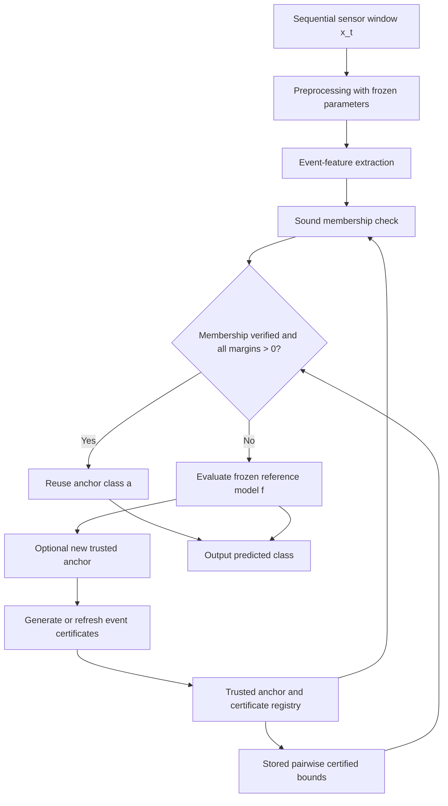

# Event-Conditioned Certification for Decision Reuse in Sequential Neural Network Inference

**Research dossier and experimental protocol | Version 1.0 | 16 October 2026**  
**Status:** Research proposal with preliminary dataset-audit findings; not a completed empirical research paper.  
**Research domains:** Efficient neural inference, formal neural-network verification, multivariate time-series analysis, and systems performance evaluation.  
**Working short name:** Event-Conditioned Certified Decision Reuse (ECDR).

## Abstract

Overlapping windows in multivariate sensor streams can exhibit temporal redundancy, yet standard neural classifiers execute a full forward pass for each incoming window. Reusing an earlier classification may reduce inference cost, but an empirical similarity threshold does not establish that the reference network would assign the same class to the new input. This study investigates **event-conditioned certified decision reuse**: a runtime mechanism that skips full network evaluation only when a sound lower bound proves that the frozen reference classifier's predicted class is invariant over a structured input region containing the new window. The proposed framework combines event-conditioned perturbation sets, direct class-pair logit-margin verification of the reference network, a trusted-anchor lifecycle, and end-to-end accounting of verification and cache-maintenance costs. Its primary dataset is the UCI Human Activities and Postural Transitions (HAPT) corpus. An initial project audit reports 61 raw recordings and 17,453 derived overlapping windows, but class-label support and event-region assumptions still require revision. No trained reference model, certified reuse rate, or runtime speedup has yet been verified. The work therefore advances a **testable research question and protocol**, not a claim of established acceleration. Success requires sound certificates, improved certified coverage under fair comparisons, and positive net runtime savings.

**Keywords:** certified inference; decision reuse; neural network verification; CROWN; linear relaxation-based perturbation analysis; logit margin; structured perturbation sets; time-series classification; runtime optimization.

## 1. Research Status and Evidence Conventions

### 1.1 Project status as of 16 October 2026

| Gate | Purpose | Status | Interpretation |
|---|---|---|---|
| G0 | Literature review and positioning | PASS for prototyping | Novelty assessment must continue |
| G1 | HAPT data and event audit | COMPLETE WITH REVISIONS | Audit performed; event assumptions unresolved |
| G2 | Reference classifier | NOT STARTED / NOT VERIFIED | Label-policy decision blocks training |
| G3 | Sound class-pair verification | NOT STARTED | Requires frozen G2 checkpoint |
| G4 | Event-conditioned bounds | NOT STARTED | Exploratory G1 coverage is not certification |
| G5 | End-to-end runtime evaluation | NOT STARTED | No measured savings exist |
| G6 | Paper and reproducibility package | NOT STARTED | No final results to report |

The progression **2/7 gates touched** does not mean that two scientific claims have been validated. The most accurate status is **G0 PASS; G1 COMPLETE WITH REVISIONS; G2–G6 pending**.

### 1.2 Evidence classes

- **[A] Project audit:** Findings described in the saved G1 status report, which was not independently rerun against the current repository in this writing session.
- **[B] Published or official sources:** Dataset documentation, peer-reviewed publications, preprints, or official framework documentation.
- **[C] Mathematical inference or hypothesis:** Derivations and predictions requiring stated assumptions.
- **[D] Research decision:** Proposed model, protocol, architecture, or experimental threshold. These are not measured findings.

The report uses this distinction throughout. A mathematical guarantee about *agreement with the reference model* is not a guarantee that the model is correct about the underlying activity label.

## 2. Motivation, Problem Definition, and Scope

### 2.1 Problem setting

Consider a stream of measurements from accelerometer and gyroscope channels. A streaming application constructs a sequence of potentially overlapping windows \(x_1,x_2,\ldots\) and classifies every window with a neural network \(f\). The ordinary execution path is

```
Incoming sensor window -> preprocessing -> reference network f -> predicted class
```

Adjacent windows can share measurements and may represent the same physical activity, but these observations do not imply identical network predictions. A classifier can change its decision near a decision boundary even when two inputs appear close under a simple distance metric.

**Symptom:** The reference model is invoked on every evaluation window.  
**Desired behavior:** Avoid a reference-model forward pass when its class decision can be proved unchanged.  
**Current observed behavior:** The project has not yet implemented or measured the certified runtime path.  
**Potential impact:** Lower compute consumption, mean latency, and model invocation rate, conditional on verifier cost and achievable reuse.  
**In scope:** Frozen classifiers, sequential multivariate sensor windows, direct decision-invariance certificates, conservative fallback, runtime benchmarking.  
**Out of scope:** Exact reuse of all logits or confidence scores, retraining-free adaptation under changing model weights, semantic correctness guarantees for activities, FPGA or GPU architecture design, and deployment into the Expiry application.

### 2.2 Primary research question

**RQ1.** *Can event-conditioned structured perturbation sets enable sound, direct certification of a neural network's predicted class across temporally correlated inputs, while achieving higher certified decision-reuse rates and lower end-to-end inference costs than conventional baselines?*

### 2.3 Secondary questions

- **RQ2, certification:** Under which margin, event-region, and verifier conditions is reuse sound for every accepted query?
- **RQ3, empirical effectiveness:** Does exploiting event structure improve certified reuse compared with global Lipschitz and global-ball verification baselines?
- **RQ4, systems effectiveness:** When do certificate-generation, membership checking, and fallback costs permit positive net savings?
- **RQ5, generalization:** How sensitive are benefits to activity class, transition type, subject, window size, overlap, and model architecture?

### 2.4 Hypotheses

- **H1:** At controlled perturbation budget or comparable region coverage, event-conditioned sets attain higher certified reuse than a specified global baseline on at least some reproducible operating regimes.
- **H2:** A runtime implementation with certificate reuse yields lower amortized end-to-end cost than running the frozen reference model for every query in some operating regime.
- **H3:** If the query belongs to the certified set and every competitor's verified class-pair lower margin is strictly positive, the reused label equals the frozen reference classifier's label under the stated numerical assumptions.
- **H4 (exploratory):** Correlated affine regions with a valid residual model outperform diagonal event boxes on selected sensor events.

H3 is a mathematical conditional claim. H1, H2, and H4 are open experimental questions; H1 need not hold globally.

## 3. Background and Related Work

### 3.1 Key concepts and correct terminology

| Term | Precise meaning in this study |
|---|---|
| Reference classifier / backbone | The frozen neural network whose argmax label defines the reference decision |
| Inference | Evaluation of a trained network on a given input |
| Logit | Pre-softmax class score output by the classifier |
| Predicted class / decision | The argmax of reference-network logits |
| Class-pair logit margin | Difference between the reference class logit and a competing class logit |
| Trusted anchor | An input at which the full frozen reference model was actually evaluated |
| Perturbation set | A precisely defined set of permissible input variations relative to an anchor |
| Event-conditioned perturbation set | A perturbation set parameterized by a sensor-event or variation pattern |
| Set membership | A check establishing that the query input is in a particular certified set |
| Sound certificate | A logically sufficient proof of the claimed property within stated assumptions |
| Certified decision reuse | Returning the anchor's predicted class instead of evaluating the reference model, conditional on sound membership and class-pair certificates |
| Conservative fallback | Evaluating the reference model whenever reuse is not certified |
| Certified reuse rate | Fraction of all evaluated queries handled by certified reuse |
| Reference agreement | Fraction of outputs identical to full reference-network outputs |
| End-to-end latency | Time including preprocessing, event processing, membership, certification/lookup, fallback, and state maintenance as appropriate |
| Verification overhead | Additional compute and memory costs required to make reuse decisions |
| Pareto dominance | Improving one measured objective without worsening the other measured objectives under consideration |

A **certified cache hit** is different from a **high-confidence prediction**. The softmax score alone does not prove invariance of the class under perturbations. **Robust accuracy** against ground-truth labels also differs from **reference-model decision agreement**.

### 3.2 Prior work and research positioning

**LipCache (Xiang et al., 2026).** LipCache proposes a local inference proxy for image classification that uses a lightweight GuardNet and Lipschitz-based certified reuse regions. Its reported upper speedup is 1.65x in the authors' evaluated tasks. The abstract explicitly characterizes accepted hits as satisfying the **GuardNet-side** consistency condition, not necessarily an invariance guarantee for the deployed MainNet throughout the full region. This supports the need to distinguish guard-model consistency from direct reference-network decision invariance [R1].

**Spatio-Temporal Bound Propagation (Varghese, Wicker, and Lomuscio, 2026).** STBP introduces structured spatio-temporal constraints in neural-network verification. Its reported 1.7x improvement in certified robust accuracy is specific to its verification benchmarks and should not be misreported as inference acceleration. Structured temporal verification is therefore not, by itself, a novel research contribution [R2].

**CROWN (Zhang et al., 2018).** CROWN derives provable bounds for neural networks using sound relaxations. It establishes relevant verification machinery but does not automatically produce an efficient sequential cache system [R3].

**auto_LiRPA (Xu et al., 2020 and official library).** The library implements linear-relaxation-based perturbation analysis, including CROWN-family methods. Compatibility with a custom correlated input set must be established through the implementation rather than presumed [R4].

**DeltaCNN (Parger et al., 2022).** DeltaCNN demonstrates that structured similarity across video frames can translate into practical inference speedups. It does not establish the precise decision-invariance certificate targeted here [R5].

### 3.3 Carefully delimited research gap

Prior work already includes class-pair and Lipschitz-based caching ideas, certified bounds, and structured temporal verification. The testable proposed contribution is their **specific integration**:

1. Event-conditioned input regions defined on sequential sensor windows.
2. A certificate on the **actual frozen reference classifier's** class-pair margins.
3. Trusted-anchor reuse over sequential requests without unjustified transitive drift.
4. Runtime accounting that includes certificate creation and refreshing, membership checks, and fallback.
5. Controlled comparisons against both formally certified and heuristic baselines.

This is a **candidate gap**, not a justified claim of being the world's first implementation. Novelty remains subject to systematic related-work review.

## 4. Formal Problem Formulation

### 4.1 Classifier and trusted anchor

Let a multichannel sensor window be flattened to \(x\in\mathbb{R}^{d}\), where \(d=C_sT\), \(C_s\) is the number of sensor channels, and \(T\) is the number of readings per channel. Let

\[
f:\mathbb{R}^{d}\to\mathbb{R}^{K}
\]

be the **frozen** reference classifier, with \(K\) classes and logits \(f_k(x)\). At a trusted anchor \(x^r\), evaluate the full model and define

\[
a=\operatorname{argmax}_{k\in\{1,\dots,K\}}f_k(x^r).
\]

Assume a unique winning class, or specify and verify an explicit tie-breaking policy. For each competing class \(j\ne a\), define

\[
g_{aj}(x)=f_a(x)-f_j(x),\qquad m_{aj}=g_{aj}(x^r)>0.
\]

The quantity \(m_{aj}\) is the **anchor class-pair logit margin**. A proof that \(g_{aj}(x)>0\) for all \(j\ne a\) proves that \(a\) remains the predicted class.

### 4.2 Event-conditioned input regions

For a variation pattern \(e\), define a structured affine region

\[
\mathcal{S}_e(x^r)=\left\{x^r+D_eu:\|u\|_\infty\le 1\right\},
\]

where \(D_e\in\mathbb{R}^{d\times q}\). The vector \(u\in\mathbb{R}^{q}\) contains bounded coefficients; the matrix \(D_e\) encodes allowed directions and magnitudes of variation. A diagonal \(D_e\) with \(q=d\) yields an axis-aligned box. A non-diagonal \(D_e\) can represent correlated directions and lower-dimensional event structure.

Examples include steady motion, periodic continuation, localized transients, and sensor-channel spikes. These are **candidate input-variation patterns**, not necessarily objectively labeled semantic events. The runtime guarantee relies on actual set membership, not on an event detector's semantic accuracy.

A candidate may be reused only if the runtime establishes

\[
x_t\in\mathcal{S}_e(x^r).
\]

A region learned from historical data is not automatically a sound representation of unseen inputs. Safe operation either proves membership for each query or falls back.

### 4.3 Exact worst-case margin reduction

For each competitor \(j\), define

\[
B^*_{aj}(e)=\sup_{x\in\mathcal{S}_e(x^r)}[m_{aj}-g_{aj}(x)].
\]

This is the greatest possible *decrease* in the class-pair margin relative to its value at the anchor. A sufficient condition for decision invariance is

\[
m_{aj}>B^*_{aj}(e)\quad\text{for every }j\ne a.
\]

**Proposition 1 (Class-decision invariance).** If the anchor has a unique winning class \(a\) and \(m_{aj}>B^*_{aj}(e)\) for every \(j\ne a\), then \(\operatorname{argmax}_k f_k(x)=a\) for every \(x\in\mathcal S_e(x^r)\).

**Proof.** By the supremum definition, \(m_{aj}-g_{aj}(x)\le B^*_{aj}(e)\). Thus \(g_{aj}(x)\ge m_{aj}-B^*_{aj}(e)>0\) for each competitor, so \(f_a(x)>f_j(x)\) for all \(j\ne a\). Therefore \(a\) is the unique predicted class throughout the region. \(\square\)

The proposition is a conditional mathematical fact. It does not assert that \(B^*\) can always be calculated efficiently.

### 4.4 Computable sound lower bound

Suppose a verifier produces an affine lower bound for every class pair, **valid on the full chosen set**:

\[
g_{aj}(x)\ge\alpha_{aj}^{\top}x+\beta_{aj}\quad\forall x\in\mathcal S_e(x^r).
\]

For \(x=x^r+D_eu\) with \(\|u\|_\infty\le1\), minimizing the affine expression gives

\[
\underline g^{(e)}_{aj}=\alpha_{aj}^{\top}x^r+\beta_{aj}-\|D_e^{\top}\alpha_{aj}\|_1.
\]

**Important dimensional detail:** \(D_e^{\top}\alpha_{aj}\in\mathbb R^q\) for a general \(d\times q\) region. Writing \(D_e\alpha_{aj}\) is valid only in special cases, such as a symmetric diagonal \(D_e\).

The computable bound satisfies \(\underline g^{(e)}_{aj}\le\inf_{x\in\mathcal S_e}g_{aj}(x)\). Hence the following is a sufficient certificate:

\[
\boxed{\underline g^{(e)}_{aj}>0\quad\forall j\ne a.}
\]

An associated conservative upper bound on margin reduction is \(\widehat B_{aj}^{(e)}=m_{aj}-\underline g_{aj}^{(e)}\), which satisfies \(\widehat B_{aj}^{(e)}\ge B^*_{aj}(e)\).

**Validity conditions:** The verifier must prove its bound on the **actual input domain**, account for all transformations, and use the same frozen reference model. A numerically computed bound is not automatically a machine-checked mathematical proof in the presence of floating-point rounding, implementation defects, or unsupported operators. Verification of numerical soundness is a distinct systems obligation.

### 4.5 Correlated sets with residual uncertainty

A PCA-derived low-dimensional region may fail to contain sensor windows because of reconstruction residuals. A safer candidate model is

\[
\mathcal S_e(x^r)=\left\{x^r+D_eu+v:\|u\|_\infty\le1,\ |v_i|\le\epsilon_i\right\}.
\]

If the verifier's affine lower bound is valid over this entire region, then

\[
\underline g^{(e)}_{aj}=\alpha_{aj}^{\top}x^r+\beta_{aj}-\|D_e^{\top}\alpha_{aj}\|_1-\sum_{i=1}^{d}\epsilon_i|\alpha_{aj,i}|.
\]

Here \(v\) is residual variation not captured by the correlated subspace, and \(\epsilon_i\) bounds its \(i\)-th component. At runtime, set membership must be established **including the residual**. Merely projecting a candidate onto a PCA subspace and discarding its reconstruction error is insufficient for a sound certificate.

### 4.6 Global Lipschitz reference certificate

A conventional sufficient condition is based on

\[
|g_{aj}(x)-g_{aj}(x^r)|\le L_{aj}\|x-x^r\|_2,
\]

where \(L_{aj}\) is a **valid upper bound** on the class-pair Lipschitz constant in the relevant domain. If \(\mathcal S_e\) lies inside a ball of radius \(\rho_e\), a sufficient condition is

\[
m_{aj}>L_{aj}\rho_e\qquad\forall j\ne a.
\]

For an affine perturbation region, \(\rho_e=\max_{\|u\|_\infty\le1}\|D_eu\|_2\); using \(\|r^{(e)}\|_2\) is justified for diagonal \(D_e=\operatorname{diag}(r^{(e)})\), not for every correlated matrix.

**Set-inclusion argument:** If \(\mathcal S_e\subseteq\mathcal B\), then the **exact** worst-case decrease obeys \(B^*_{aj}(\mathcal S_e)\le B^*_{aj}(\mathcal B)\). This does **not** guarantee that a particular CROWN implementation gives numerically tighter bounds than every Lipschitz estimate. The latter is an empirical comparison.

## 5. Proposed Runtime System

### 5.1 Control and data flow



### 5.2 State ownership

- **Reference model owner:** frozen model weights, model identifier, deterministic preprocessing configuration, and output-label mapping.
- **Anchor manager:** input \(x^r\), computed logits \(f(x^r)\), class \(a\), timestamp, allowed lifetime, certificate version, and invalidation rules.
- **Certificate manager:** event-region definition, full class-pair lower bounds, verifier metadata, and model/checkpoint identity.
- **Membership checker:** sound acceptance or rejection of \(x_t\in\mathcal S_e(x^r)\).
- **Runtime controller:** if all safety conditions pass, reuse; otherwise, perform a full forward pass.
- **Evaluator:** reference agreement, labels, costs, reason for fallback, and distribution-shift diagnostics.

### 5.3 Anchor lifecycle and drift prevention

Only an input **actually evaluated by the reference model** becomes a trusted anchor in the baseline design. A reused input cannot become a new trusted anchor merely because its class matches the previous anchor. Repeating locally acceptable changes can accumulate into large global drift. Every reused query must be certified relative to a still-valid trusted anchor or a separately proven composition rule.

Invalidate certificates when the reference checkpoint, preprocessing, label mapping, perturbation specification, or relevant verification assumptions change. Apply conservative fallback on missing or inconsistent metadata.

### 5.4 Two verification deployment modes

1. **Online verification:** Compute a query- or region-specific bound at runtime. Useful to test mathematical feasibility, potentially expensive for production.
2. **Precomputed certificate regions:** Generate a collection of certified regions for a trusted anchor or authorized template, then evaluate membership cheaply at runtime. This trades precomputation, memory, and refresh cost for faster queries.

The second mode cannot ignore anchor-specific generation expenses. A certificate derived for one anchor is not automatically reusable for arbitrary new anchors.

## 6. Dataset, Label Policy, and Preliminary G1 Findings

### 6.1 Primary dataset

The primary source is the **UCI Smartphone-Based Recognition of Human Activities and Postural Transitions (HAPT)** dataset [R6]. It includes recordings from 30 individuals wearing a smartphone at the waist, with three-axis accelerometer and three-axis gyroscope measurements sampled at 50 Hz. The annotation vocabulary includes six basic activities and six postural transitions. Raw inertial recordings are available, allowing a project-defined streaming evaluation protocol.

A proposed input window has \(C_s=6\), \(T=128\), and therefore \(d=768\). At 50 Hz, each window spans 2.56 seconds. A stride of 64 samples corresponds to 50% overlap and a 1.28-second step. The windowing decision must be recorded as part of the project's reproducibility specification.

### 6.2 Project audit, not an independently reproduced measurement

The saved G1 project status reports:

| Quantity | Reported value | Interpretation |
|---|---:|---|
| Raw recordings processed | 61 | Project-specific raw recordings |
| Derived windows | 17,453 | Project windowing output, not the UCI precomputed feature-row count |
| Data-validation issues | 0 reported | Audit-script finding, not a comprehensive scientific guarantee |
| Train/validation/test subjects | 17 / 4 / 9 | Subject-disjoint split reported by project |
| Pure windows | 59.4% | Windows assigned a single unambiguous target label under the project policy |
| Unlabeled windows | 20.55% | Incomplete label coverage |
| Ambiguous windows | 9.1% | Windows without a uniquely adopted target label |
| Transition-boundary windows | 7.29% | Windows near or across transition boundaries |
| Same/change diagonal-box p90 coverage | 36.3% / 28.6% | Region-membership observation, not certified reuse |
| Correlated-set vs compared diagonal coverage | 38.1% vs 30.1% | Not proof of tighter neural-network bounds |
| Stable-box-but-changed | 7.68% | Change in ground-truth activity label, not a certificate violation |
| Maximum reported lag-1 correlation | Approximately 0.14 | Definition/aggregation of correlation still unresolved |

These statistics are **project-reported** and were not recalculated from the 61 recordings in this report-generation session. Categories need not be mutually exclusive; their percentages should not be summed as a complete partition without the source audit's definitions.

### 6.3 Critical G1 blocker: class support

A 128-sample window lasts 2.56 seconds. A postural transition shorter than this cannot produce a **pure window** of the full length wholly contained within that transition. Consequently, a 12-class classifier trained exclusively on pure windows may have insufficient examples for some transition classes.

**Required decision (G2-A):** Report per-class support by training, validation, and test subject. Select either a defensible six-basic-activity classification protocol or an explicitly justified 12-class protocol with a revised window-label policy. Do not silently relabel transition windows to make a chosen class count feasible.

Training-label restrictions and deployment evaluation are separate decisions. Excluding ambiguous windows from supervised loss may be defensible; omitting all such windows from streaming reuse evaluation would systematically favor easy stable segments. Report a labeled-subset analysis **and** a full-stream reference-agreement analysis with transparent denominators.

### 6.4 Temporal structure remains unresolved

A small reported lag-1 correlation does not establish that there is no meaningful temporal structure. Correlations computed over raw sensor readings, flattened adjacent windows, and window-level features answer different questions. Fifty-percent overlap also shifts shared samples to different vector indices between adjacent windows. Recompute correlation and prediction stability with unambiguous definitions before drawing conclusions.

**Most important interpretation:** Event-region coverage is **not certified decision reuse**. A region can contain samples from distinct ground-truth activities; this alone does not violate a certificate for a model's predicted label. Conversely, class-label stability alone does not certify the neural network's decision.

## 7. Reference Network and Training Protocol

### 7.1 Candidate architecture (not yet trained)

A compact ReLU-based 1D-CNN is proposed to make initial verification tractable:

| Stage | Configuration |
|---|---|
| Input | 6 channels x 128 time samples |
| Convolution 1 | 6 -> 32 channels, kernel size 5, ReLU |
| Average pooling | Temporal stride 2 |
| Convolution 2 | 32 -> 64 channels, kernel size 5, ReLU |
| Average pooling | Temporal stride 2 |
| Convolution 3 | 64 -> 64 channels, kernel size 3, ReLU |
| Global average pooling | 64 features |
| Classification head | Linear 64 -> K logits |

This is a **candidate design**; exact parameter counts and layer output shapes must be calculated from specified padding, biases, and strides before publication. The value of \(K\) remains subject to the G2-A class-support audit.

### 7.2 Training integrity

- Separate **subjects** across train, validation, and test, preserving chronology within recordings.
- Fit scaling or normalization only on training subjects; apply the stored transform to validation and test.
- Resolve label-policy and exclusion criteria before model selection.
- Choose architecture and hyperparameters using training and validation only; keep the test set untouched until final evaluation.
- Report at least three independent random seeds and per-class classification metrics.
- Save model checkpoint hash, preprocessing version, environment, seed, and training configuration.
- Freeze the selected checkpoint for all verification and runtime-baseline experiments.

PyTorch's official reproducibility guidance notes that identical random seeds do not ensure exact equality across hardware and software versions [R7].

### 7.3 Required outputs

Per-class counts, class-policy justification, macro-F1, accuracy, confusion matrix, per-class precision and recall, logit-margin distributions, window-to-anchor prediction-change rates, reference CPU latency, model checkpoint, and reproducible config files.

## 8. Controlled Experimental Design

### 8.1 Methods to compare

- **B0: Full-reference inference:** No reuse; evaluate the frozen model on every window.
- **B1: Heuristic confidence-distance reuse:** Apply a predeclared confidence/margin and input-distance rule tuned on validation subjects. This is **not** a formal certificate.
- **B2: Global Lipschitz certified reuse:** Use valid class-pair global/local Lipschitz upper bounds on a fixed containing ball.
- **B3: Global-ball CROWN verified reuse:** Apply the same verifier family to a conventional ball as a stronger methodological control.
- **P1: Event-conditioned diagonal-set verified reuse:** Use per-coordinate event budgets and direct reference-model class-pair bounds.
- **P2: Event-conditioned correlated verified reuse:** Add bounded correlated directions and a sound residual set, provided implementation support is established.

The ablation should progress from B2/B3 to P1 and then P2 to identify which design choice causes any change in certified reuse. Avoid comparing region membership percentages alone when the regions have different volume, radii, or empirical coverage.

### 8.2 Core metrics

For \(N\) evaluation windows, let \(\hat y_t^{\rm system}\) denote the accelerated output and \(\hat y_t^{\rm ref}=\operatorname{argmax}_k f_k(x_t)\) the reference-network decision.

**Reference agreement**:

\[
\mathrm{Agreement}=\frac1N\sum_{t=1}^N\mathbf1[\hat y_t^{\rm system}=\hat y_t^{\rm ref}].
\]

**Certified decision-reuse rate**:

\[
\mathrm{CDRR}=\frac{N_{\rm certified\ reused}}{N}.
\]

**Reference invocation rate**:

\[
\mathrm{IR}=\frac{N_{\rm full\ reference\ evaluations}}{N}.
\]

**Empirical violation rate on certified hits**:

\[
\mathrm{EVR}=\frac{\sum_{t\in H}\mathbf1[\hat y_t^{\rm reused}\ne\hat y_t^{\rm ref}]}{|H|},
\]

where \(H\) denotes certified-hit queries. This metric is a debugging observation; **zero observed violations do not establish formal soundness**. Proof validity depends on the verifier and its assumptions.

Additional measurements: reference-model accuracy and macro-F1 on labeled windows; class- and event-specific reuse; positive lower-bound margins; event membership coverage; mean, median, p95 and p99 latency; memory cost; certificate-generation/refresh cost; precomputation amortization; and energy consumption if instrumented reliably.

### 8.3 Statistical protocol

Report multiple seeds, disjoint test subjects, clear evaluation denominators, and subject-level or recording-level uncertainty intervals. Overlapping windows are statistically dependent; treating 17,453 windows as independent observations in a naive confidence interval would exaggerate precision. Thresholds and event-region choices must be fixed using training/validation only before test evaluation.

## 9. Computational Cost and Break-Even Analysis

Let \(T_f\) be mean full-model execution time, \(T_c\) the mean per-query event extraction plus membership/certificate-lookup cost, \(r\) the certified reuse fraction, and \(T_g\) the **amortized** certificate generation and refresh cost per evaluation query. A simplified expected cost is

\[
\mathbb E[T_{\rm ECDR}]=T_c+(1-r)T_f+T_g.
\]

The system improves expected latency over always running the reference model only when

\[
T_c+(1-r)T_f+T_g<T_f
\iff\quad\boxed{r>\frac{T_c+T_g}{T_f}}.
\]

This expression assumes that \(T_c\) is paid on every request, a single full model evaluation is paid on every non-reused request, and \(T_g\) accurately amortizes all anchor-specific certificate work. If costs depend strongly on hit/miss type or event, use a conditional expectation over those paths instead of this simple model.

**Illustrative simulation, not an experiment:** With \(T_f=2.0\) ms, \(T_c=0.2\) ms, and \(T_g=0\), reuse must exceed 10% for positive average savings. At 60% reuse the simplified mean is 1.0 ms versus a 2.0 ms baseline, a 50% modeled reduction. These inputs are hypothetical. No observed project speedup follows from this example.

Even if the mean improves, p95 may remain unfavorable when more than roughly 5% of requests take the slow fallback path. Therefore report the entire latency distribution and the cost of certificate refresh.

## 10. Preliminary Results and Interpretation

**Observed / reported:** The G1 project audit produced a streaming-window dataset and preliminary region-coverage summaries, with unresolved label-policy and temporal-correlation questions (Section 6).

**Mathematically established under stated assumptions:** Proposition 1 and the derived class-pair lower-margin sufficient condition (Section 4).

**Not yet established:** Reference-classifier accuracy; certified decision-reuse rate; quantitative bound superiority; end-to-end speedup; external-dataset generalization; production-ready numerical verification.

No result table should report unavailable model scores or fabricate speedup numbers. A future results section must contain measured values, uncertainties, controlled baseline comparisons, and a record of all exclusions.

## 11. Threats to Validity and Failure Modes

1. **Class-support failure:** Pure 128-sample windows may omit or underrepresent brief postural transitions. Mitigation: G2-A label audit and documented class policy.
2. **Insufficient useful similarity:** Overlapping data do not guarantee decision stability. Mitigation: measure actual frozen-model prediction changes, not only distance or label correlation.
3. **Loose certified bounds:** Sound verification may certify almost no regions. Mitigation: analyze lower-margin distributions and compare global-ball with event-conditioned specifications.
4. **Excessive verifier cost:** Correctness may be established but runtime savings absent. Mitigation: separately measure online and precomputed verification modes and include refresh costs.
5. **Unsound subspace abstraction:** PCA projection without bounded residual does not preserve membership. Mitigation: explicit residual bounds and exact/conservative membership checks.
6. **Numerical unsoundness:** Floating-point roundoff and unsupported operations can invalidate formal claims at implementation level. Mitigation: implementation tests, certified numerical practices where available, and explicit limitation statements.
7. **Anchor drift:** Reusing outputs as unverified anchors accumulates change outside proven regions. Mitigation: anchor lineage and conservative invalidation.
8. **Model or preprocessing mismatch:** A certificate computed for stale weights or transforms is invalid. Mitigation: hash-linked checkpoints and immutable inference transforms.
9. **Statistical leakage:** Overlapping windows from the same recording must not cross train/test through random window splits. Mitigation: subject-disjoint protocol and leakage audit.
10. **Overstated novelty:** Caching, class-pair verification, and temporal structured bounds each have prior art. Mitigation: narrow contribution statement and ablation against close alternatives.
11. **Distribution shift:** Sensor placement and unseen subjects can reduce accuracy and coverage. Mitigation: held-out subjects and additional datasets if resources permit.

A valid negative finding (e.g., sound certificates with near-zero net speedup) must be reported rather than removed from the analysis. It may delimit when event-conditioned certification is useful.

## 12. Research Gates, Deliverables, and Decisions

### G1 revision and G2-A: Label policy

**Tasks:** Audit class support by subject/split, transition durations, and policy-sensitive pure/ambiguous counts. **Deliverable:** `G2_CLASS_DECISION.md` and a frozen data protocol. **Go criterion:** All target classes have defensible training and evaluation support, or scope is formally reduced to six classes.

### G2-B: Reference classifier

**Tasks:** Train/evaluate 1D-CNN, document shapes and parameter count, freeze checkpoint, inspect margins and prediction stability, benchmark CPU reference latency. **Deliverables:** model checkpoint, metrics, confusion matrix, reproducibility information. **Go criterion:** Stable and credible held-out-subject classification with non-degenerate class performance.

### G3: Verifier soundness

**Tasks:** Define class-pair output specifications, validate bounds on toy examples with independent checks, integrate with frozen CNN, handle unsupported operations and numerical assumptions. **Deliverables:** verification module and test report. **Go criterion:** Sound specification and implementations with zero detected certified-hit mismatches in extensive validation, while recognizing that empirical tests alone do not prove soundness.

### G4: Structured event evaluation

**Tasks:** Compare Lipschitz/global-CROWN/diagonal-event/correlated-event sets using matched reporting conditions; verify membership and residual coverage. **Deliverables:** reuse curves, certified-margin plots, event ablations. **Go criterion:** Demonstrate measurable bound/reuse gains on some properly controlled operating region, or record a negative result.

### G5: Runtime benefit

**Tasks:** Trusted-anchor lifecycle, conservative fallback, online and precomputed paths, CPU profiler, latency distribution and resource overhead. **Deliverables:** end-to-end curves, p50/p95/p99, model-invocation rate, memory and refresh costs. **Go criterion:** Positive amortized savings in at least one transparently reported regime, or a documented failure with causal analysis.

### G6: Paper and reproducibility

**Tasks:** Complete methods, proofs with assumptions, experimental tables, confidence intervals, ablation, limitations, references, and an executable replication guide. **Deliverables:** paper and code/data-manifest package. **Go criterion:** Another researcher can understand and rerun the essential evidence, subject to dataset availability and hardware differences.

## 13. Suggested Repository Organization

```text
research/
  docs/
    01_problem_statement.md
    02_related_work.md
    03_research_questions.md
    04_formal_method.md
    05_experimental_protocol.md
    G2_CLASS_DECISION.md
    evidence_ledger.md
  configs/
    data.yaml
    backbone.yaml
    verifier.yaml
    runtime.yaml
  src/
    data/
    models/
    verification/
    event_regions/
    runtime/
    evaluation/
  scripts/
    audit_class_support.py
    train_reference.py
    evaluate_reference.py
    verify_margins.py
    evaluate_events.py
    benchmark_runtime.py
  tests/
  results/
  checkpoints/
  paper/
  README.md
```

This tree is proposed architecture, not a claim that the files currently exist. Raw data, virtual environments, ephemeral caches, and unnecessarily large generated artifacts should generally not be committed to version control.

## 14. Final Assessment and Immediate Next Action

**Research readiness:** Sufficient to proceed to a constrained reference-model experiment, not sufficient to claim a validated certified-acceleration method.

**Recommended approach:** Retain direct reference-network class-decision certification as the core contribution; start with a diagonal event-region baseline and add correlated sets only after the verifier is sound and the runtime cost model is measurable. Preserve global Lipschitz, global-ball CROWN, heuristic reuse, and full inference as explicit controls.

**Do not:** Require an arbitrary 50% latency reduction for success; conflate HAPT activity-label stability with neural-network decision invariance; promote reuse windows to anchors without independent proof; or report coverage as a certified reuse rate.

**Next action (P0):** Complete G2-A by producing per-class support counts, duration distributions of all six transition classes, and a defensible six- versus twelve-class decision. Freeze the label and preprocessing policies before training. The subsequent G2 model will make it possible to test whether the event-region idea preserves **actual network decisions**, not merely similar input measurements.

The eventual conclusion must be based on the joint criteria **sound specification + adequate certified coverage + measured positive net benefit**. Failure of any one criterion is scientifically informative and should be reported.

## References and Primary Source Links

- **[R1]** Xiang, Z. et al. (2026). *LipCache: A Local Inference Proxy with Certified Caching for Edge Image Classification Service.* arXiv:2608.13144. https://arxiv.org/abs/2608.13144
- **[R2]** Varghese, S., Wicker, M., & Lomuscio, A. (2026). *Hybrid Robustness Verification for Spatio-Temporal Neural Networks.* arXiv:2606.09746; accepted at SAIV 2026 according to the paper. https://arxiv.org/abs/2606.09746
- **[R3]** Zhang, H. et al. (2018). *Efficient Neural Network Robustness Certification with General Activation Functions.* NeurIPS 2018. https://proceedings.neurips.cc/paper/2018/hash/d04863f100d59b3eb688a11f95b0ae60-Abstract.html
- **[R4]** Xu, K. et al. (2020). *Automatic Perturbation Analysis for Scalable Certified Robustness and Beyond.* NeurIPS 2020. Official implementation and documentation: https://github.com/Verified-Intelligence/auto_LiRPA
- **[R5]** Parger, M. et al. (2022). *DeltaCNN: End-to-End CNN Inference of Sparse Frame Differences in Videos.* CVPR 2022. https://openaccess.thecvf.com/content/CVPR2022/html/Parger_DeltaCNN_End-to-End_CNN_Inference_of_Sparse_Frame_Differences_in_Videos_CVPR_2022_paper.html
- **[R6]** Reyes-Ortiz, J. et al. (2015). *Smartphone-Based Recognition of Human Activities and Postural Transitions.* UCI Machine Learning Repository, DOI:10.24432/C54G7M. https://archive.ics.uci.edu/dataset/341/smartphone+based+recognition+of+human+activities+and+postural+transitions
- **[R7]** PyTorch. *Reproducibility Notes.* Official framework documentation. https://docs.pytorch.org/docs/stable/notes/randomness.html
- **[R8]** Internal research dossier, 15 October 2026, *Structured Event-Conditioned Certified Neural Inference* (prior research summary; not an external peer-reviewed source).
- **[R9]** Internal project review, 15 October 2026, *Research audit after G1* (source of the project-reported preliminary audit figures; not independently rerun here).

## Appendix A. Essential Mathematical Symbols

| Symbol | Meaning |
|---|---|
| \(x_t\) | Current sensor window |
| \(x^r\) | Trusted reference anchor |
| \(d\) | Number of flattened input coordinates |
| \(C_s\) | Number of sensor channels |
| \(T\) | Time samples per channel/window |
| \(K\) | Number of predicted classes |
| \(f\) | Frozen reference classifier |
| \(f_k(x)\) | Logit for class \(k\) |
| \(a\) | Anchor's winning class |
| \(j\) | Competing class index |
| \(g_{aj}(x)\) | Class-pair logit margin |
| \(m_{aj}\) | Anchor class-pair margin |
| \(\mathcal S_e\) | Event-conditioned perturbation set |
| \(D_e\) | Affine transformation mapping event coefficients into input-space perturbations |
| \(u\) | Bounded event coefficients |
| \(v,\epsilon\) | Residual perturbation and residual coordinate bounds |
| \(\alpha_{aj},\beta_{aj}\) | Sound affine lower-bound parameters |
| \(\underline g_{aj}^{(e)}\) | Certified lower bound on pairwise margin |
| \(B^*_{aj}\) | Exact maximum margin decrease in the region |
| \(L_{aj}\) | Valid Lipschitz bound for the class-pair margin |
| \(r\) | Certified reuse fraction in runtime cost equations |
| \(T_f,T_c,T_g\) | Full inference, per-query checking, and amortized certificate generation costs |

## Appendix B. Traceability Matrix

| Research question | Experiment / derivation | Required evidence | Gate |
|---|---|---|---|
| RQ1 / H1 | Controlled event vs global bound comparison | Certified reuse, tightness, fair region comparison | G4 |
| RQ2 / H3 | Proposition 1 and sound CROWN specification | Proof, independently tested implementation assumptions | G3 |
| RQ3 / H1 | Per-class and per-event ablation | Subject-disjoint certified metrics and uncertainty | G4 |
| RQ4 / H2 | Amortized runtime study | End-to-end latency, generation cost, fallback, RAM | G5 |
| RQ5 / H4 | Correlated/diagonal comparison and sensitivity analyses | Residual soundness, across-subject and window-size results | G4–G5 |

---

*End of research report. Status: proposal and preliminary findings; experimental outcome intentionally left open.*
