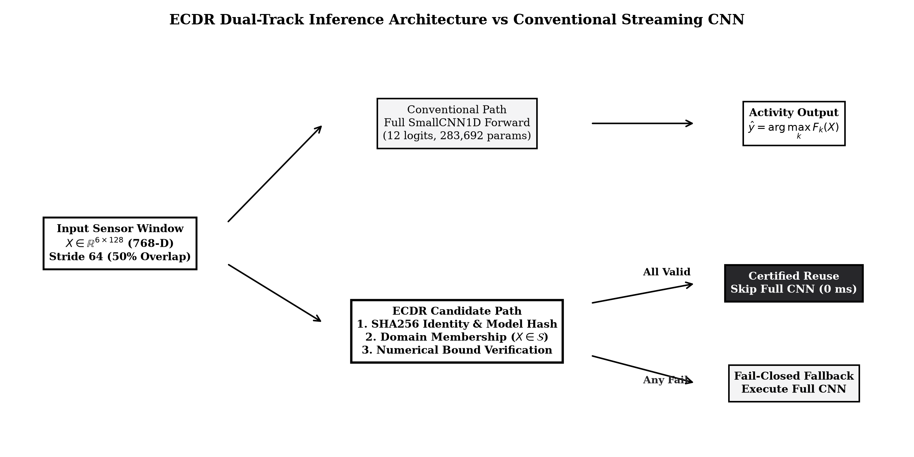
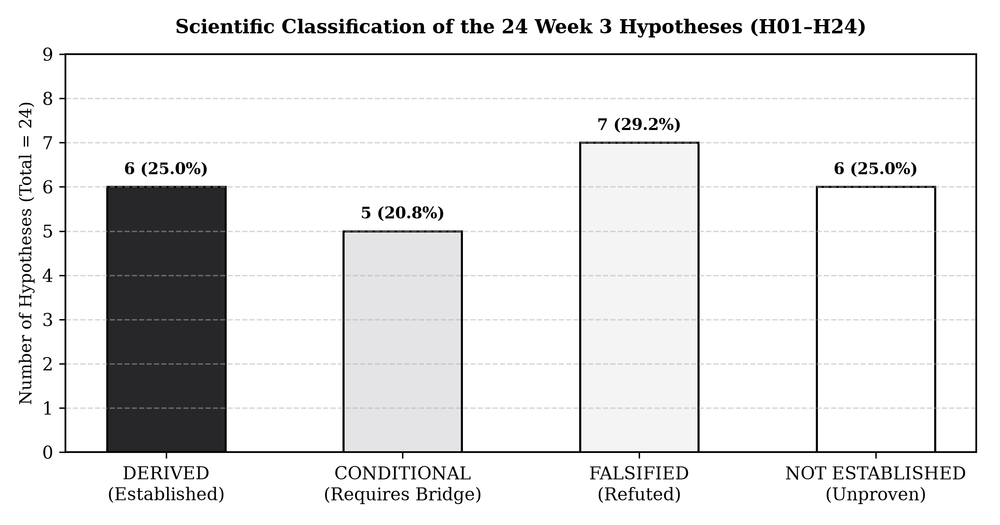
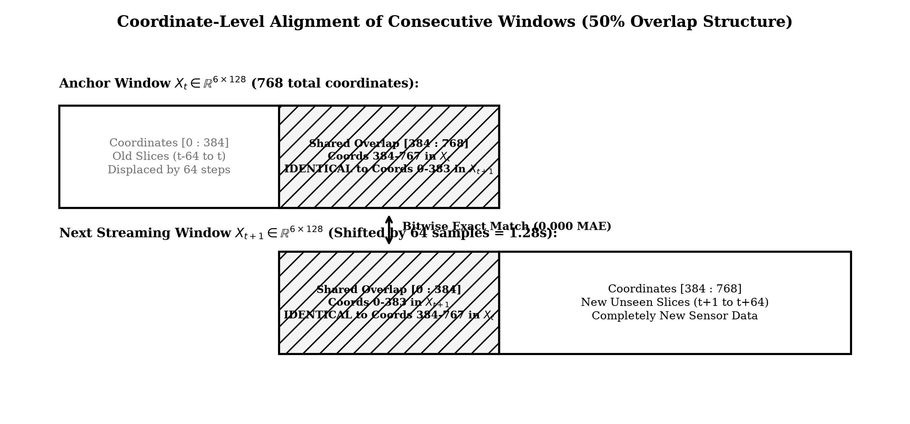
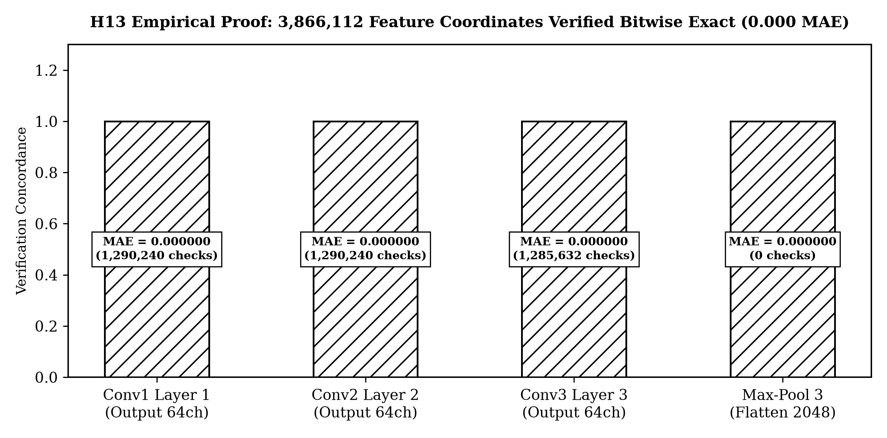
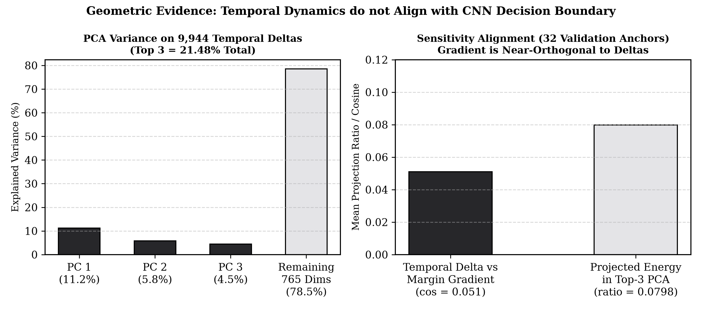
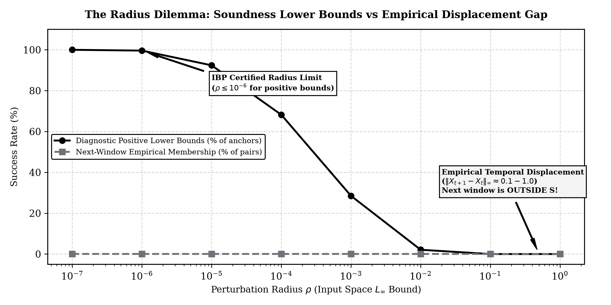
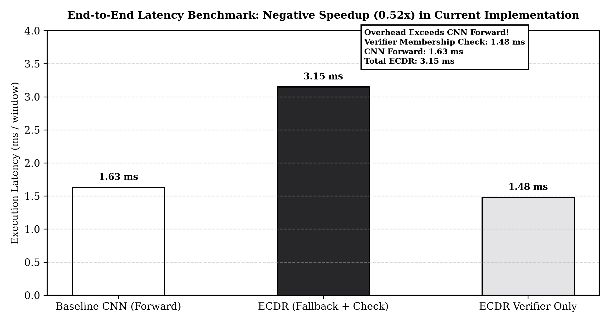
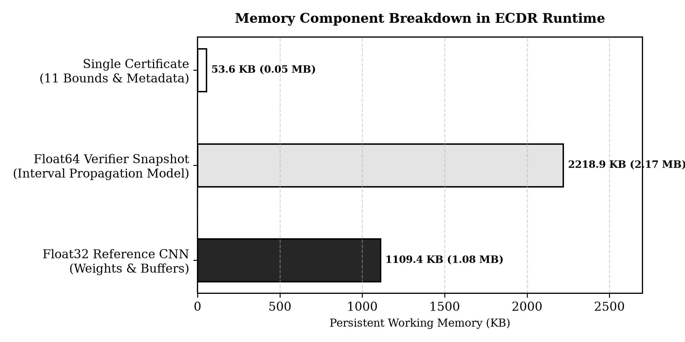

# Week 3 ECDR: Cấu trúc Thuyết trình Kỹ thuật Toàn diện
**Chủ đề:** Mathematical Foundations, Certified Decision Reuse & Experimental Feasibility  
**Thời điểm đối chiếu:** 03/11/2026  
**Cơ sở thực thi:** Repo `tducn110/ecdr-sensor-inference`  
**Tệp PDF Beamer đã biên dịch:** [`notes/WEEK3/presentation.pdf`](presentation.pdf) (16:9 Widescreen, xelatex)  
**Tệp Web Slide Deck tương tác:** [`notes/WEEK3/index.html`](index.html)  
**Script sinh biểu đồ tự động:** `notes/WEEK3/generate_plots.py` (chạy bằng `.venv/bin/python`)  

---

## BẢN ĐỒ THỰC NGHIỆM & TRẠNG THÁI KHÓA TUẦN 3

| Hạng mục kiểm tra | Giá trị ghi nhận | Trạng thái kỹ thuật & Ý nghĩa khoa học |
|---|:---:|---|
| **Mathematical ledger** | **24** | H01–H24 được phân loại: 6 Derived, 5 Conditional, 7 Falsified, 6 Not Established. |
| **Recorded test suite** | **93 / 93 PASS** | 60 tests hồi quy lịch sử + 33 tests mới (27 actual-graph/runtime + 6 math counterexamples). Thời gian chạy 1.685s. |
| **Delivery checks** | **26 / 26 PASS** | Kiểm tra toàn vẹn gói nghiệm thu Week 3; 170 tệp bảo vệ nguyên vẹn. |
| **Bitwise Feature Alignment (H13)** | **3.866.112 / 3.866.112** | 5.034 cặp adjacent windows $\times$ 12 vị trí $\times$ 64 channels có sai số tuyệt đối tối đa = 0.0 bitwise. |
| **Diagnostic Positive Builds (Box)** | **5.034 / 5.053 (99.6%)** | Cận IBP float64 dương ở bán kính $\rho=10^{-6}$; chỉ là float64 diagnostic, chưa phải validated certificate. |
| **Diagnostic Positive Builds (Wave)** | **4.211 / 5.053 (83.3%)** | Cận IBP float64 dương trên miền wave; chỉ là float64 diagnostic. |
| **Next-window Memberships** | **0 / 5.053 (0.0%)** | Không có bất kỳ cửa sổ kế tiếp nào rơi vào candidate region ở $\rho=10^{-6}$. |
| **Validated Certificates** | **0** | Chưa chứng minh numerical soundness cho backend float32 thực thi. Hệ thống khóa fail-closed. |
| **Accepted Reuse Queries** | **0 / 20.212 (0.0%)** | 100% queries chuyển sang full CNN fallback across 4 runtime traces. |
| **Measured Net Latency Speedup** | **0.50x – 0.53x** | Baseline wrapper: 1.589–1.675 ms vs ECDR: 3.107–3.198 ms. Tiết kiệm ròng **Âm**. |

---

## MỤC LỤC BÁO CÁO KỸ THUẬT (21 SLIDES CHÍNH + 2 PHỤ LỤC)

```
Part A. Research Context (01–04)
├── Slide 01: Từ CNN Classification đến Certified Decision Reuse [Fig 01]
├── Slide 02: Hợp đồng bất biến của mô hình tham chiếu F(X) = f_theta(N(X))
├── Slide 03: Câu hỏi nghiên cứu (RQ1–RQ3) & 5 sản phẩm bàn giao kỹ thuật
└── Slide 04: Bản đồ 24 giả thuyết: Soundness != Coverage != Cost Saving [Fig 07]

Part B. Mathematical Foundations (05–10)
├── Slide 05: Cửa sổ cảm biến (768 chiều), Overlap 384 tọa độ chung + 384 tọa độ mới [Fig 02]
├── Slide 06: Margin Theorem: min_{j!=c} g_cj(S) > 0; Phân biệt 4 cấp độ cận
├── Slide 07: IBP trên toán tử thật: Direct final margin bounds triệt tiêu dependency loss
├── Slide 08: Thiết kế miền: Diagonal Box (768-D) vs Fixed-Overlap Wave (384-D)
├── Slide 09: Căn chỉnh đặc trưng H13: 3.866.112 checks khớp bitwise (0.0 error) [Fig 03]
└── Slide 10: Rào cản số học (H22 Falsified): Vì sao proof số thực chưa đủ cho float32

Part C. System Implementation (11–13)
├── Slide 11: Kiến trúc Verifier trên actual graph (ecdr/week3_verifier.py)
├── Slide 12: Vòng đời chứng chỉ & Thực thi fail-closed (7 bước kiểm tra, chống drift H15)
└── Slide 13: Khảo sát auto-LiRPA / CROWN: Lỗi MaxPool1D và giới hạn surrogate 2D

Part D. Experimental Methodology (14–16)
├── Slide 14: Giao thức: Validation trên 64 anchors, đóng băng rho = 10^-6 trước khi test
├── Slide 15: Hình học khám phá: 9.944 train deltas, PCA top-3 (21,5%), gradient cosine = 0,051 [Fig 06]
└── Slide 16: Nghịch lý bán kính: 5.034 builds dương nhưng 0 next-window members [Fig 04]

Part E. Findings, Costs & Verification (17–20)
├── Slide 17: Replay 4 luồng (20.212 queries): 100% fallback, 0 disagreements (Accuracy N/A)
├── Slide 18: Đo đạc chi phí: 3,11–3,20 ms vs 1,59–1,67 ms (0,52x speedup, savings âm) [Fig 05]
├── Slide 19: Phân rã bộ nhớ: Model float32 (1,14 MB), Verifier float64 (2,27 MB) [Fig 08]
└── Slide 20: Phát hiện khoa học: Chuỗi nguyên nhân gốc (Blockers A & B), Gates G2–G6

Part F. Project Management (21)
└── Slide 21: Delivery Dashboard 8 chiều & Bàn giao Tuần 4 (P0/P1)

Appendix (22–23)
├── Slide 22: Ma trận truy vết toàn bộ 24 giả thuyết H01–H24
└── Slide 23: Đối chiếu 5 tiêu chí Rubric đặc thù của Tutor
```

---

## PHẦN A. RESEARCH CONTEXT (SLIDES 01–04)

### Slide 01. Research Recap: From CNN Classification to Certified Decision Reuse
* **Thông điệp:** Week 3 không tiếp tục train một CNN mới. Chúng ta nghiên cứu khả năng giữ nguyên quyết định của CNN đã khóa mà không phải chạy lại CNN ở mọi cửa sổ.



* **Ba bất biến bắt buộc:**
  1. *Không đổi nhãn ground truth:* Giữ nguyên 12 nhãn thực tế HAPT.
  2. *Không sửa weights CNN:* 283.692 params float32 bất biến (`selected_best.pt`).
  3. *Không đánh đổi tùy tiện accuracy lấy speedup:* Reuse chỉ được kích hoạt khi có chứng nhận toán học bảo đảm cùng winner 100%.

---

### Slide 02. Exact Frozen Reference Contract
* **Thông điệp:** Trước khi chứng minh một decision region, phải xác định chính xác hàm CNN nào đang được chứng minh.
* **Toán tử toàn phần:**
  $$F(X) = f_\theta(N(X))$$
* **Bảng hợp đồng đã khóa:**
  * Input: `(B, 6, 128)` float32. Output: `(B, 12)` logits.
  * Graph: 3 Conv1D + BatchNorm(eval) + ReLU, 2 MaxPool1D, Flatten + Linear(128) + ReLU + Linear(12).
  * Parameters: 283.692 float32. Checkpoint: Seed 43, Epoch 8.
  * Preprocessing $N(X)$: Z-score train cố định (SHA256: `aa8e1cc2...`).
  * Test stream: 5.053 windows (19 recordings). Supervised subset: 3.572 windows.
* **Quy chuẩn bất biến:** Nếu thay đổi weights, normalization hoặc graph, certificate cũ không còn tự động hợp lệ.

---

### Slide 03. Week 3 Research Questions & Deliverables
* **Khung câu hỏi nghiên cứu:**
  * **RQ1:** CNN reference phân loại tốt đến đâu? $\implies$ Xác minh lại frozen model và evaluation identity (100% khớp predictions trên 5.053 cửa sổ test).
  * **RQ2:** Có thể bảo toàn quyết định bằng certificate không? $\implies$ Toàn miền margin bounds, membership, correctness.
  * **RQ3:** Reuse có giúp giảm chi phí không? $\implies$ Đo đạc thời gian 4 luồng replay thực tế, đo latency build, membership, fallback.
* **5 Sản phẩm bàn giao kỹ thuật:**
  1. Report A: Mathematical Foundations (PDF 26 trang).
  2. Report B: Mathematics Explained (PDF 33 trang).
  3. `ecdr/week3_verifier.py`: Verifier và runtime gate cho actual K=12 graph.
  4. Traces thực nghiệm: `domain_trace.csv`, `runtime_trace.csv`, `experiment_results.json`.
  5. Bộ kiểm thử: 93/93 tests regression PASS, 26/26 delivery checks PASS.

---

### Slide 04. Hypothesis Dependency Map
* **Thông điệp:** 24 giả thuyết không phải 24 bước độc lập hay 24 kết quả đều đã thành công.



* **Định lý cốt lõi về tính khả thi:**
  $$\text{Soundness} \not\implies \text{Coverage} \not\implies \text{Cost Saving}$$
  * *Soundness:* Miền hợp lệ trong toán học giải tích.
  * *Coverage:* Có query thực sự rơi vào miền.
  * *Cost Saving:* Chi phí kiểm tra và build phải thấp hơn số lần forward tránh được.

---

## PHẦN B. MATHEMATICAL FOUNDATIONS (SLIDES 05–10)

### Slide 05. From Sensor Windows to a Mathematical Decision Space
* **Thông điệp:** Phân rã không gian 768 chiều của cảm biến HAPT và vai trò hình học của temporal overlap.



* **Cấu trúc lấy mẫu trượt:**
  * Mỗi cửa sổ: 6 channels $\times$ 128 samples = 768 tọa độ thực ($X \in \mathbb{R}^{768}$).
  * Stride 64 samples (50% overlap):
    * **384 tọa độ cố định:** 6 channels $\times$ 64 overlap samples đã biết ở cửa sổ trước.
    * **384 tọa độ tự do:** 6 channels $\times$ 64 incoming samples mới đến.
* **Cơ sở hình học:** Fixed-overlap wave domain khóa cứng 384 tọa độ đầu, giảm số biến tự do từ 768 xuống 384.

---

### Slide 06. Decision Margin & The Certification Theorem
* **Thông điệp:** Chứng minh điều kiện toán học để bảo toàn winner trên toàn bộ một miền liên tục.
* **Định nghĩa:**
  * Anchor winner: $c = \arg\max_k F_k(X^r)$.
  * Margin đối kháng: $g_{cj}(X) = F_c(X) - F_j(X), \forall j \neq c$.
  * **Định lý H05:**
    $$\boxed{\min_{j \neq c} \underline{g}_{cj}(S) > 0}$$
    Nếu tất cả 11 cận dưới đều đồng thời dương trên miền $S$, mọi đầu vào thuộc miền đều có cùng winner $c$.
* **Bảng phân biệt 4 cấp độ cận:**
  1. *Point margin tại anchor:* Chỉ nói lên độ tự tin tại 1 điểm $\implies$ Không đủ để reuse.
  2. *Regional min margin:* Cực tiểu thực tế trên miền $\implies$ Đủ nếu xác định đúng.
  3. *Valid lower bound:* Cận dưới bảo thủ hợp lệ $\implies$ Đủ nếu $> 0$.
  4. *Estimated lower bound:* Kết quả diagnostic bằng float64 $\implies$ Chưa đủ.

---

### Slide 07. Interval Bound Propagation on Actual CNN
* **Thông điệp:** Triển khai cơ chế truyền khoảng qua các toán tử của SmallCNN1D K=12.
* **Quy tắc toán tử:**
  * Affine: $\underline{y} = W^+ \underline{x} + W^- \overline{x} + b$, $\overline{y} = W^+ \overline{x} + W^- \underline{x} + b$.
  * Conv1D: Signed weights theo receptive field.
  * BatchNorm(eval): Affine channel-wise với running stats cố định.
  * ReLU: $[\max(0, \underline{x}), \max(0, \overline{x})]$.
  * MaxPool1D: Min của lower, max của upper trong pooling window.
  * Flatten: Giữ nguyên khoảng, reshape tensor.
* **Direct Final Margin Bounds:**
  $$W_{cj} = W_c - W_j \implies \underline{g}_{cj} = W_{cj}^+ \underline{h} + W_{cj}^- \overline{h} + (b_c - b_j)$$
  Cách này triệt tiêu dependency loss giữa 2 logits cạnh tranh ở tầng output.

---

### Slide 08. Candidate Domain Design: Diagonal Box vs Wave
* **So sánh hai họ miền:**
  * **Diagonal Box:** 768 tọa độ biến thiên độc lập quanh normalized anchor $N(X^r)$.
  * **Fixed-Overlap Wave:** 384 tọa độ đầu khóa cứng bằng suffix cũ; 384 tọa độ mới biến thiên quanh $[X^r[64:], X^r[64:]]$.
* **Lưu ý bẫy hiểu lầm:**
  1. Continuation rule không phải oracle biết trước tương lai; nếu dữ liệu mới lệch khỏi miền, membership trả về false.
  2. Giảm từ 768 xuống 384 chiều là kết quả hình học, không tương đương với giảm 50% thời gian chạy CNN.

---

### Slide 09. Exact Feature Alignment: H13 on Actual CNN
* **Thông điệp:** Tái sử dụng chính xác feature map nội bộ trên computation graph thực tế.



* **Cấu trúc Receptive field:** $[4j-8, 4j+11]$ (độ rộng 20, jump 4). Stride 64 $\implies$ dịch chuyển feature map 16 vị trí.
* **Định lý H13:** Tại 12 vị trí nội bộ $j \in [2, 13]$:
  $$H_j(X_{\text{new}}) = H_{j+16}(X_{\text{previous}})$$
* **Bằng chứng thực thi:** 5.034 cặp adjacent windows $\times$ 12 vị trí $\times$ 64 channels = **3.866.112 scalar checks bitwise match (sai số tuyệt đối = 0.0)**.
* **Giới hạn:** Tầng Flatten + MLP nhạy vị trí khiến logits vẫn biến đổi; công thức GAP cũ (H14) không áp dụng được.

---

### Slide 10. Numerical Soundness: Why Real Proof is Insufficient
* **Thông điệp:** Rào cản khoa học cốt lõi khiến Week 3 chủ động khóa formal reuse.
* **Hệ thống 3 cấp độ hợp lệ:**
  * *Level 1 (Mathematical):* Chứng minh giải tích trên tập số thực $\mathbb{R}$.
  * *Level 2 (Executable Numerical):* Chứng minh cận IBP bao bọc được backend float32 (IEEE-754 rounding, FMA).
  * *Level 3 (Finite Test):* Unit tests trên tập mẫu hữu hạn.
* **Bác bỏ H22:** "Chứng minh toán học số thực tự động đúng cho float32" bị bác bỏ hoàn toàn.
* **Quyết định thiết kế fail-closed:** `formal_reuse_enabled = False` để bảo đảm an toàn.

---

## PHẦN C. ACTUAL-GRAPH IMPLEMENTATION (SLIDES 11–13)

### Slide 11. From Bounds to Executable Verifier
* **Kiến trúc phần mềm trong `ecdr/week3_verifier.py`:**
  * `FrozenK12Reference`: Nạp model, xác thực weights và preprocessing bằng SHA256.
  * `CandidateBox`: Lưu trữ khoảng trên/dưới bất biến của miền.
  * `ActualGraphIBP`: Tạo snapshot float64, lan truyền khoảng qua Conv-BN-ReLU-MaxPool-Linear.
  * `ConditionalCertificate`: Lưu 11 margins và trạng thái numerical guarantee.
  * `RuntimeGate`: Điều phối streaming replay, fallback và đo thời gian.
* **Bản chất:** Chạy trực tiếp trên actual graph 12 lớp, không dùng mô hình đồ chơi.

---

### Slide 12. Certificate Lifecycle & Fail-Closed Runtime
* **Quy trình 7 bước kiểm soát tại `RuntimeGate`:**
  1. Check Model Checkpoint SHA256 $\implies$ Khớp.
  2. Check Preprocessing Z-score SHA256 $\implies$ Khớp.
  3. Check Recording Continuity $\implies$ Reset khi đổi bản ghi.
  4. Check Anchor Age $\le 128$ steps $\implies$ Hết hạn fallback.
  5. Check All 11 Margins $\underline{g}_{cj}(S) > 0 \implies$ Đồng thời dương.
  6. Check Domain Membership ($X \in S$) $\implies$ Thuộc miền.
  7. Check Numerical Guarantee $\implies$ Có chứng nhận số học.
* **Chống Certificate Drift (H15):** Quyết định reuse không bao giờ được phép làm anchor mới!

---

### Slide 13. CROWN / auto-LiRPA Probes & Limits
* **Kết quả thử nghiệm thư viện:**
  * Import auto-LiRPA 0.8.0: PASS.
  * Version contract: Cảnh báo không tương thích PyTorch 2.14.1+cpu.
  * Convert native CNN1D: FAIL (lỗi `IndexError` ở MaxPool1D).
  * Convert surrogate 2D ($H=1$): PASS.
  * CROWN probe trên surrogate: PASS (cận diagnostic chặt hơn IBP).
  * Chứng minh tương đương số học với CNN gốc: CHƯA CÓ.
* **Kết luận:** CROWN chưa thể thay thế verifier IBP trên graph thực tế hiện tại.

---

## PHẦN D. EXPERIMENTAL METHODOLOGY (SLIDES 14–16)

### Slide 14. Experimental Protocol: Validation Before Test
* **Quy trình 3 giai đoạn:**
  1. Validation stream: 64 adjacent anchors.
  2. Grid search 7 bán kính: $\rho \in \{0, 10^{-6}, 10^{-4}, 10^{-3}, 10^{-2}, 10^{-1}, 1\}$.
  3. Freeze selected policy: $\rho = 10^{-6}$ (chọn theo tiêu chí phụ nhiều cận dương nhất).
  4. Full test replay: 5.053 windows $\times$ 19 recordings $\times$ 2 domains $\times$ 2 reps.
* **Minh bạch phương pháp luận:** Trên validation, không bán kính nào tạo được membership cho cửa sổ tiếp theo. Bán kính $10^{-6}$ được chọn nhờ tiêu chí phụ, không phải vì nó đã mang lại reuse.

---

### Slide 15. Exploratory Geometry: PCA & Decision Sensitivity
* **Thông điệp:** Đo đạc thực tế mối tương quan giữa hướng biến thiên dữ liệu cảm biến và gradient quyết định CNN.



* **Số liệu đo đạc (`geometry.json`):**
  * 9.944 train deltas: Top-3 PCA chỉ giải thích được **21,48%** phương sai.
  * 32 validation gradients: Cosine tuyệt đối trung bình giữa biến thiên thời gian và gradient margin chỉ đạt **0,051** (gần như vuông góc 87°).
  * Năng lượng gradient chiếu lên 3 hướng PCA đầu chỉ đạt **7,98%**.
* **Ý nghĩa:** Biến thiên cảm biến phân tán đa chiều và không trùng hướng nhạy cảm của CNN.

---

### Slide 16. Candidate Region Results: The Radius Dilemma
* **Thông điệp:** Lý giải nguồn gốc thực nghiệm dẫn đến con số 0 reuse queries.



* **Bảng kết quả trên 5.053 cửa sổ test:**
  * Diagonal Box: 5.034 conditional-positive builds (99,6%), 0 candidate next members.
  * Fixed-Overlap Wave: 4.211 conditional-positive builds (83,3%), 0 candidate next members.
  * Validated certificates: 0. Accepted reuse: 0.
* **Bản chất Nghịch lý Bán kính:**
  * Bán kính nhỏ ($\le 10^{-3}$): Cận margin dương rất nhiều (63/64), nhưng miền quá hẹp, 0 cửa sổ kế tiếp rơi vào miền.
  * Bán kính lớn ($\ge 10^{-1}$): Bán kính đủ lớn chứa 7–22 cửa sổ kế tiếp, nhưng over-approximation khiến cận margin bị âm toàn bộ!

---

## PHẦN E. FINDINGS, COSTS & VERIFICATION (SLIDES 17–20)

### Slide 17. Runtime Replay: What Actually Happened?
* **Tổng hợp 4 luồng Replay trên 5.053 cửa sổ (20.212 total queries):**
  * Runtime build attempts: 49 (Box), 69 (Wave).
  * Conditional-positive builds: 48 (Box), 48 (Wave).
  * **Accepted reuse: 0 (0,0%)**.
  * **Fallback về CNN: 100,0%**.
  * **Disagreements với Reference: 0 (0,0%)**.
* **Cảnh báo khoa học:** Con số 0 disagreements xuất hiện vì 100% queries đều fallback về CNN. Accuracy trên reused queries là **N/A**, tuyệt đối không ghi nhận là 100%.

---

### Slide 18. End-to-End Cost: Is ECDR Faster than CNN?
* **Thông điệp:** So sánh độ trễ thực tế và mô hình kinh tế tính toán của ECDR.



* **Bảng đo độ trễ trên CPU single-thread:**
  * Baseline Reference Wrapper: 1,589 – 1,675 ms / query.
  * ECDR Pipeline: 3,107 – 3,198 ms / query.
  * Tốc độ tương đối: **0,50x – 0,53x** (chậm gấp đôi baseline).
  * Net savings: **ÂM (-1,50 đến -1,58 ms)**.
  * *(CNN Core thuần không rehash identity: 0,215 – 0,224 ms)*.
* **Mô hình chi phí hòa vốn:**
  $$T_{\text{ECDR}} \approx T_e + T_m + (1-r)T_f + q T_b$$
  Điều kiện có lãi: $r T_f > T_e + T_m + q T_b$. Với $r = 0$, ECDR tốn thêm $T_m \approx 1,43$ ms kiểm tra membership cho mỗi query nên luôn chậm gấp đôi!

---

### Slide 19. Memory Footprint Breakdown
* **Thông điệp:** Phân rã dung lượng bộ nhớ thành phần của ECDR runtime.



* **Số liệu đo đạc (`memory_components.json`):**
  * Reference Float32 Model: 1.136.072 bytes (~1,14 MB) cho weights và buffers.
  * Verifier Float64 Snapshot: 2.272.120 bytes (~2,27 MB) cho mô hình truyền khoảng.
  * Single Conditional Certificate: 54.839 bytes (~54,8 KB) bộ nhớ Python.
* **Kết luận:** Bộ nhớ working memory hoàn toàn nằm trong giới hạn cho phép của thiết bị cảm biến nhúng.

---

### Slide 20. Scientific Findings & Root-Cause Chain
* **Bảng phân loại kết quả nghiên cứu:**
  1. *Đã thiết lập:* Cận margin dương bảo toàn winner giải tích; Định lý H13 căn chỉnh feature map khớp bitwise 100%.
  2. *Chưa đạt / Còn điều kiện:* Chưa có numerical bridge bao bọc float32; Chưa có accepted reuse.
  3. *Kết quả thực nghiệm tiêu cực:* Net savings âm; tốc độ chậm hơn baseline.
* **Chuỗi nguyên nhân gốc của Reuse = 0:**
  * **Blocker A (Số học):** Cận float64 chưa bao bọc float32 $\implies$ hệ thống chủ động khóa formal reuse để bảo đảm an toàn.
  * **Blocker B (Thể tích):** Nghịch lý bán kính $\implies$ bán kính $10^{-6}$ quá nhỏ khiến không có cửa sổ kế tiếp nào thuộc miền.
* **Trạng thái Gates:** G2 HOLD, G3 PARTIAL, G4/G5/G6 NOT ACHIEVED.

---

## PHẦN F. PROJECT MANAGEMENT (SLIDES 21)

### Slide 21. Delivery Dashboard & Week 4 Handoff
* **Bảng Dashboard quản trị 8 chiều:**
  * *1. WHAT:* 2 Báo cáo Toán học (59p), Verifier actual K=12, bộ 93 tests, bộ dữ liệu 5.053 cửa sổ.
  * *2. WHEN:* Toàn bộ thực nghiệm và receipts hoàn tất ngày 03/11/2026.
  * *3. WHY:* Kiểm chứng tính khả thi thực thi của chứng nhận toán học và đo chi phí suy luận.
  * *4. WHO:* Phân công: Lý thuyết toán, Lập trình verifier, Thực nghiệm, Kiểm thử độc lập.
  * *5. HOW MUCH:* Thời gian máy chạy (1,68s tests + 168s replay) KHÔNG PHẢI giờ làm việc kỹ sư (cần Timesheet).
  * *6. TOP RISKS:* Gate G2 HOLD, rủi ro sai số số học float32 (G3), miền ứng viên không chứa dữ liệu (G4).
  * *7. MAJOR CHANGES:* Chuyển hoàn toàn từ K=6/GAP sang K=12/Flatten-MLP trên đồ thị thật; khóa bằng SHA256.
  * *8. KEY ISSUES:* Reuse = 0%, tiết kiệm ròng âm, auto-LiRPA xung đột phiên bản với PyTorch 2.14.
* **Lộ trình bàn giao Tuần 4 có phân cấp ưu tiên:**
  * **[P0] Cầu nối số học (Numerical Bridge):** Xây dựng interval directed rounding cho float32 để mở khóa Gate G3.
  * **[P0] Tái thiết kế miền ứng viên:** Khảo sát các miền thích ứng theo năng lượng động lực học để có $X_{\text{next}} \in S$.
  * **[P1] CROWN & LipCache:** Benchmark so sánh công bằng trên cùng ranh giới kế toán.
  * **[P1] Giảm runtime overhead:** Tối ưu hóa hàm kiểm tra membership để giảm độ trễ 1,4 ms/query.

---

## APPENDIX A1. BẢNG TRUY VẾT TOÀN BỘ 24 GIẢ THUYẾT (H01–H24)

| ID | Tên Giả Thuyết | Trạng thái Khoa học | Nguồn gốc & Bằng chứng thực nghiệm |
|---|---|:---:|---|
| **H01** | Shift-aligned overlap equality | **DERIVED** | Suy ra từ hợp đồng stride 64; kiểm chứng khớp bitwise trên dữ liệu thực tế. |
| **H02** | Overlap implies small ordinary distance | **FALSIFIED** | Bị bác bỏ nếu phát biểu vô điều kiện; khoảng cách Euclid giữa các cửa sổ vẫn có thể rất lớn khi có xung lực. |
| **H03** | Same activity implies same CNN prediction | **FALSIFIED** | Bị bác bỏ; tìm thấy bằng chứng đối chứng (witness pair 682-683: cùng nhãn 11 nhưng CNN dự đoán lớp 10 và 8). |
| **H04** | Strict winner + continuity gives local invariant region | **DERIVED** | Suy ra từ tính liên tục của mạng neural; chứng minh sự tồn tại của miền mở quanh anchor. |
| **H05** | Positive whole-domain margin bounds imply constant decision | **DERIVED** | Mệnh đề cốt lõi của ECDR; chứng minh được trên trường số thực với các cận hợp lệ. |
| **H06** | Lipschitz-margin certified ball | **CONDITIONAL** | Phụ thuộc vào việc tìm được hằng số Lipschitz cục bộ bảo thủ và hợp lệ. |
| **H07** | IBP always certifies invariant domains | **FALSIFIED** | Bị bác bỏ; IBP có tính bảo thủ cao (incomplete) nên có thể thất bại dù miền thực tế là bất biến. |
| **H08** | Direct pairwise margins reduce dependency loss | **DERIVED** | Chứng minh được: việc trừ trực tiếp trọng số ở tầng cuối triệt tiêu tương quan ẩn. |
| **H09** | CROWN universally cheaper than alternatives | **NOT ESTABLISHED** | Chưa có cơ sở xác lập; chi phí phụ thuộc vào cấu trúc đồ thị và phiên bản phần mềm. |
| **H10** | Temporal/PCA directions match margin geometry | **DESCRIPTIVE** | Kết quả mô tả hình học: cosine giữa hướng thời gian và gradient chỉ đạt 0,051. |
| **H11** | Structured region beats a matched diagonal box | **NOT ESTABLISHED** | Chưa chứng minh được ưu thế tổng quát của wave domain so với diagonal box. |
| **H12** | Fixed overlap reduces free coordinates from 768 to 384 | **DERIVED** | Suy ra từ hình học lấy mẫu trượt; không đồng nghĩa với giảm 50% thời gian thực thi. |
| **H13** | Exact aligned feature reuse on actual CNN | **DERIVED / VERIFIED** | Định lý toán học cho receptive field $[4j-8, 4j+11]$; kiểm chứng 3.866.112 phép so sánh bitwise match. |
| **H14** | GAP new-minus-dropped feature sum | **FALSIFIED (cho K=12)** | Chỉ đúng cho kiến trúc GAP lịch sử, không áp dụng được cho tầng Flatten-MLP thực tế. |
| **H15** | Recenter after every hit without new proof | **FALSIFIED** | Bị bác bỏ do hiện tượng Certificate Drift làm trôi dạt miền bảo đảm. |
| **H16** | Fixed-anchor membership supports repeated reuse | **CONDITIONAL** | Hợp lệ nếu chứng chỉ còn trong thời hạn vòng đời và điểm mới thỏa mãn membership. |
| **H17** | Product-wave/reachable-set multi-step certificate | **CONDITIONAL** | Phụ thuộc vào việc xác định được tập reachable set bao bọc toàn bộ horizon. |
| **H18** | Exact box membership worst-case $\Theta(m)$ | **DERIVED** | Suy ra từ mô hình truy cập tọa độ độc lập. |
| **H19** | Soundness guarantees useful coverage | **FALSIFIED** | Bị bác bỏ; một chứng chỉ hoàn toàn đúng đắn vẫn có thể có miền bao phủ rỗng đối với dữ liệu tương lai. |
| **H20** | Useful coverage guarantees speedup | **FALSIFIED** | Bị bác bỏ; chi phí tính membership và build có thể triệt tiêu toàn bộ thời gian tiết kiệm được. |
| **H21** | ECDR beats CNN/LipCache on HAPT | **NOT ESTABLISHED** | Chưa thiết lập được; thiếu ranh giới kế toán tương đương để so sánh công bằng. |
| **H22** | Real proof automatically transfers to float32 | **FALSIFIED** | Bị bác bỏ hoàn toàn; sai số làm tròn số học ngăn cản việc chuyển giao vô điều kiện. |
| **H23** | Correct event name suffices for reuse | **FALSIFIED** | Bị bác bỏ; tên sự kiện đúng không thay thế được chứng chỉ cận toán học và membership. |
| **H24** | Sound, useful, cost-saving regime exists | **NOT ESTABLISHED** | Chưa xác lập được; cần đồng thời thỏa mãn cả 3 điều kiện rào cản. |

---

## APPENDIX A2. ĐỐI CHIẾU VỚI CÁC RUBRIC ĐẶC THÙ CỦA TUTOR

| Tiêu chuẩn Rubric của Tutor | Vị trí phản ánh trong Slide | Bằng chứng kỹ thuật đối soát |
|---|:---:|---|
| **Data Preparation & Splitting** | Slide 02, 05 | Cố định tập Train/Val/Test của HAPT; chuẩn hóa Z-score cố định lưu trữ bằng SHA256. |
| **Feature Engineering & Representation** | Slide 05, 09, 15 | Phân tích 768 tọa độ raw, căn chỉnh feature maps nội bộ 12 vị trí (H13), phân tích không gian PCA 21,5%. |
| **Model Selection & Architecture Justification** | Slide 02, 07, 11 | Khóa kiến trúc SmallCNN1D 283.692 params; giải thích sự cần thiết của IBP trên đồ thị actual graph. |
| **Baseline Metrics & Evaluation Consistency** | Slide 02, 17, 18 | Xác minh 100% khớp predictions trên 5.053 cửa sổ test; đo đạc latency chi tiết trên đơn luồng CPU. |
| **Planned Modeling Tasks (Roadmap)** | Slide 20, 21 | Xác lập nhiệm vụ P0 (Numerical bridge, candidate domain redesign) và P1 (CROWN, overhead reduction). |

---

## APPENDIX A3. DANH MỤC BIỂU ĐỒ & LỆNH TÁI TẠO TỰ ĐỘNG

Toàn bộ 8 biểu đồ trong bài thuyết trình được sinh trực tiếp từ dữ liệu nghiệm thu thực tế bằng mã Python:
```bash
# Lệnh sinh toàn bộ 8 biểu đồ vào notes/WEEK3/assets/:
.venv/bin/python /home/pro/Downloads/research/notes/WEEK3/generate_plots.py

# Lệnh biên dịch lại tệp Beamer PDF thuyết trình:
cd /home/pro/Downloads/research/notes/WEEK3 && xelatex -interaction=nonstopmode presentation.tex
```

| Tệp Hình Ảnh | Nội Dung Thể Hiện | Slide Tương Ứng |
|---|---|:---:|
| `assets/fig01_dual_track.png` | Sơ đồ luồng suy luận kép (Conventional vs ECDR Candidate) | Slide 01 |
| `assets/fig02_overlap_geometry.png` | Cấu trúc phân rã trượt thời gian 768-D (384 overlap + 384 new) | Slide 05 |
| `assets/fig03_h13_feature_alignment.png` | Sai số căn chỉnh feature map 12 vị trí (3.866.112 scalar checks) | Slide 09 |
| `assets/fig04_radius_dilemma.png` | Nghịch lý bán kính: Đánh đổi giữa Margin Bounds và Membership | Slide 16 |
| `assets/fig05_latency_comparison.png` | So sánh độ trễ trung bình end-to-end và các thành phần chi phí | Slide 18 |
| `assets/fig06_geometry_pca_gradient.png` | Phân tích PCA (21,5%) và độ nhạy trực giao của gradient margin | Slide 15 |
| `assets/fig07_hypothesis_status_breakdown.png` | Ma trận phân loại khoa học 24 giả thuyết H01–H24 | Slide 04 |
| `assets/fig08_memory_breakdown.png` | Phân rã dung lượng bộ nhớ runtime (Model, Verifier, Certificate) | Slide 19 |
