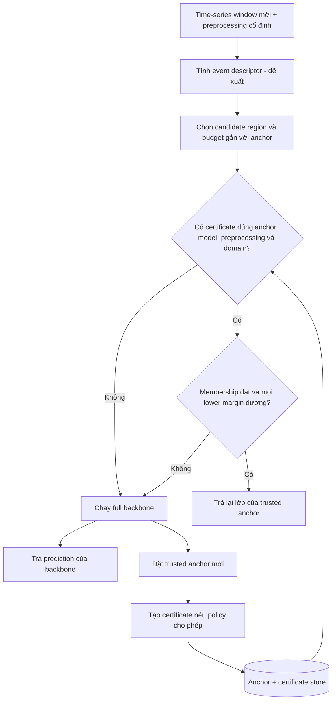

# Project brief — Event-Conditioned Certified Decision Reuse

**Snapshot tài liệu:** 22/10/2026 · **Tên làm việc:** ECDR.
**Ngày đo G1/G2:** 15/10/2026; số liệu giữ nguyên từ artifact, không chạy lại experiment.
**Phạm vi:** nghiên cứu phương pháp và hệ thống suy luận neural network trên chuỗi cảm biến.
**Trạng thái:** đã có data pipeline và backbone baseline; cơ chế certified reuse còn ở thiết kế.

Brief này tổng hợp hiện trạng từ source/config/JSON đang có và phân tích phần
cần chứng minh tiếp. Kết quả thực nghiệm bên dưới được đọc từ artifact đã lưu;
lượt đồng bộ này không chạy lại training, evaluation hay benchmark. Brief là
bản tổng hợp; [domain contract G3](07_G3_DOMAIN_CONTRACT.md) sở hữu định nghĩa
miền/preprocessing/certificate. Bản báo cáo khoa học đang viết ở
[report.md](report.md) và [LaTeX source](latex/dossier.tex); chi tiết đồng bộ ở
[DOCS_SYNC_2026-10-22.md](DOCS_SYNC_2026-10-22.md). Việc tạo tài liệu không làm G3 PASS.

Nhãn dùng trong brief: **[A]** source/artifact của project; **[B]** nguồn công bố
hoặc tài liệu chính thức; **[C]** phân tích/suy luận; **[D]** đề xuất chưa thực hiện.

## 1. Tóm tắt dự án

Dự án nghiên cứu cách **tái sử dụng quyết định của một neural classifier đã cố
định**, thay cho chạy lại toàn bộ model trên mỗi cửa sổ cảm biến. Một kết quả
chỉ được tái sử dụng khi hệ thống kiểm tra rằng đầu vào mới thuộc một miền đã
được chứng nhận và model giữ nguyên lớp dự đoán trên toàn bộ miền đó.

Điểm cần kiểm nghiệm là liệu miền đầu vào được mô hình hóa theo cấu trúc biến
thiên của sự kiện có giúp chứng nhận được nhiều trường hợp hữu ích hơn, đồng
thời đủ rẻ để tổng chi phí thấp hơn chạy model thông thường hay không.

**Kết quả đang có:** dữ liệu HAPT đã được dựng thành cửa sổ theo thời gian, chia
subject, kiểm chất lượng và dùng để huấn luyện một backbone K=6. **Kết quả chưa
có:** verifier chạy được, certified reuse rate, trusted-anchor runtime và số đo
net saving. Đây là một hướng nghiên cứu đã có baseline, chưa phải phương pháp
tăng tốc đã được xác nhận. [A: E01–E08]

## 2. Problem, mục tiêu và ý nghĩa của guarantee

**Problem:** chạy backbone trên mọi cửa sổ liên tiếp có thể lặp lại computation
không cần thiết. Tuy nhiên, cửa sổ gần nhau hoặc có cùng nhãn hoạt động không
tự bảo đảm model sẽ trả cùng một kết quả. [C]

**RQ chính:** event-conditioned class-pair bounds có thể chứng nhận backbone
giữ nguyên quyết định trên đầu vào liên tiếp thường xuyên hơn global Lipschitz
bounds, trong khi tổng chi phí vẫn đủ thấp để tiết kiệm inference hay không?
[A: E01, E03]

Ba mục tiêu cần kiểm riêng:

| Mục tiêu | Kết quả cần chứng minh | Trạng thái |
|---|---|---|
| Soundness | Mọi đầu vào được chấp nhận reuse đều giữ quyết định reference model theo các giả định đã nêu | Chưa có implementation/proof-to-code validation |
| Giá trị của event structure | Cải thiện certified coverage/reuse trong so sánh công bằng | Chưa có certified ablation |
| Giá trị hệ thống | Tiết kiệm chi phí sau khi tính membership, lookup, fallback và rebuild | Chưa đo |

**Guarantee dự kiến là cùng quyết định với backbone**, không phải chắc chắn
đúng nhãn thực tế. Nếu backbone nhầm SITTING thành STANDING, một certificate
decision-preservation hợp lệ vẫn có thể bảo toàn chính dự đoán sai đó.
Accuracy với ground truth và agreement với backbone phải báo riêng. [A: E03]

Đối tượng sử dụng kết quả trước mắt là nghiên cứu về efficient inference và
neural-network verification. Các ứng dụng sensor/edge là hướng ứng dụng tiềm
năng; project chưa có deployment, người dùng thử hay đo energy trên thiết bị.

## 3. Scope hiện tại

Trong brief, **window là time-series window**: một đoạn tín hiệu cảm biến được
cắt ra làm input cho classifier. Project không nghiên cứu mở rộng context
window hoặc bộ nhớ của LLM.

Ba đối tượng trong thiết kế có vai trò riêng:

| Khái niệm | Ký hiệu / dạng | Ý nghĩa và vai trò |
|---|---|---|
| Time-series window | `xₜ`, một tensor `6 × 128` | Một đầu vào quan sát được: 128 thời điểm trên mỗi kênh cảm biến |
| Event descriptor / selector | Descriptor `e` và cơ chế chọn miền | Mô tả biến thiên dùng để chọn region template/budget; chưa có online event selector được triển khai và xác nhận |
| Candidate perturbation region | `Sₑ(xʳ)`, một tập trong input space | Tập các window khả dĩ gắn với trusted anchor `xʳ`, được định nghĩa bằng ràng buộc biến thiên đầu vào; không phải một đoạn thời gian |

Một window là **một điểm đầu vào**; candidate region là **một tập đầu vào**;
event descriptor giúp **chọn tập và tham số**. Descriptor ở runtime không tự
đồng nhất với nhãn hoạt động ground truth dùng trong audit offline.
[A: window từ E02; D: event selector và region policy từ E03]

| Thành phần | Phạm vi hiện có |
|---|---|
| Dataset | UCI HAPT, raw accelerometer + gyroscope, 30 subjects, 61 recordings |
| Time-series window | 6 kênh × 128 samples, 50 Hz; dài 2,56 giây, stride 64 tương ứng 1,28 giây; overlap 50% |
| Classification | 6 basic activities; training/evaluation G2 chỉ lấy pure windows, label 1–6 |
| Backbone | Frozen SmallCNN1D, 282.918 tham số; checkpoint chọn bằng validation |
| Event conditioning dự kiến | Descriptor/selector dùng để chọn region template hoặc budget; chưa có online selector được xác nhận |
| Candidate region | Global/diagonal box; PCA candidate đã audit; domain contract quy định miền cần nối với verifier, diagonal là bước đầu |
| Verifier dự kiến | IBP/CROWN qua auto_LiRPA; chưa tích hợp và chưa kiểm trên backbone thực tế |
| Runtime dự kiến | Trusted anchor + certificate lưu sẵn + online membership + fallback |
| Đầu ra nghiên cứu | Literature synthesis, formulation, verifier/runtime prototype, ablations và kết quả có thể tái kiểm |

Overlap 50% nghĩa là hai cửa sổ liền kề chia sẻ 64 thời điểm lấy mẫu. Nó không
tự bảo đảm hai input gần nhau trong hệ tọa độ của model, cùng prediction hoặc
đủ điều kiện reuse. [A, C: E02, E07]

K=12 hiện HOLD vì hỗ trợ pure transition windows chưa đủ theo tiêu chí project.
Thay đổi label policy, retrain model, tối ưu GPU/điện thoại và đo energy là các
hướng cần quyết định riêng; brief này không thực hiện chúng. [A: E02, E05]

## 4. Hiện trạng có bằng chứng

### 4.1 Dữ liệu và denominator

| Phạm vi | Train | Validation | Test | Tổng |
|---|---:|---:|---:|---:|
| Mọi stream windows | 9.978 | 2.422 | 5.053 | 17.453 |
| Pure K=6 windows dùng trong G2 | 5.693 | 1.450 | 2.874 | 10.017 |
| Subjects | 17 | 4 | 9 | 30 |
| Recordings | 34 | 8 | 19 | 61 |

Các subject và recording không giao giữa split; chronology được giữ theo
recording. Đây là một split cố định, chưa phải cross-validation. Có 3.587
unlabeled windows và 1.588 ambiguous windows trong toàn corpus; không tự gán
nhãn cho các nhóm đó. Số accuracy/F1 bên dưới chỉ dùng **2.874 test pure K=6
windows**, không đại diện cho mọi window hoặc đủ 12 lớp. [A: E04–E06]

Với experiment streaming tiếp theo, cần phân biệt **17.453 windows toàn corpus**
với **5.053 windows của test stream**. Có thể kiểm prediction agreement trên
test stream đầy đủ, kể cả window thiếu ground truth; accuracy vẫn cần giới
hạn nhãn hợp lệ và phạm vi K=6. Không dùng toàn bộ train/val/test như một test
set gộp. [C, D dựa trên E04–E06]

### 4.2 Backbone đã có

Kiến trúc trong source: ba Conv1d `6→32→64→64`, kernels `5/3/3`, mỗi conv có
BatchNorm + ReLU; MaxPool sau hai conv đầu; Flatten 2.048 features → Linear128
→ ReLU → Linear6. Normalize mean/std theo channel, fit trên training windows.
[A: E02]

| Metric lưu trong artifact | Giá trị | Cách hiểu |
|---|---:|---|
| Checkpoint được chọn | seed 44, epoch 25 | Validation macro-F1 cao nhất trong các run |
| Validation macro-F1 của checkpoint | 0,9504 | Metric chọn model |
| Test accuracy của checkpoint | 0,9349 | Trên test pure K=6 |
| Test macro-F1 của checkpoint | 0,9354 | Trên test pure K=6 |
| Test macro-F1 qua 3 seeds | 0,9122 ± 0,0183 | Mean ± population standard deviation, cùng fixed split |
| Test accuracy qua 3 seeds | 0,9110 ± 0,0185 | Mean ± population standard deviation, cùng fixed split |
| Tham số | 282.918 | Source architecture khớp model-summary artifact |

Mapping seed trong JSON: seed 42 có val/test macro-F1 **0,9454 / 0,9105**;
seed 43 **0,9418 / 0,8906**; seed 44 **0,9504 / 0,9354**. Các selected epoch
tương ứng là 4, 3 và 25. Không gán các giá trị đã sort theo độ lớn cho thứ tự seed.

`±` ở đây không phải confidence interval. Epoch và seed được chọn bằng
validation; script evaluation sau đó tính lại val/test từ các checkpoint.
Không mô tả test chỉ được truy cập đúng một lần trong toàn bộ workflow.
[A: E06, E08]

### 4.3 Feasibility của candidate region

Audit xét **17.392 cặp cửa sổ liền kề**, trong đó test có **5.034 cặp**:

| Candidate | Coverage trên mọi test pair | Test same-activity | Test label-change |
|---|---:|---:|---:|
| Diagonal q75 | 25,53% | 45,81% | 0,21% |
| Diagonal q90 | 31,94% | 52,54% | 2,26% |
| PCA candidate, 108 components | 35,42% | Không lưu riêng trong summary PCA | Không lưu riêng trong summary PCA |

`same-activity` trong script là hai pure windows cùng `label_majority`;
`label-change` là hai `label_majority` khác nhau. Các nhãn này phục vụ phân tích
offline, chưa phải online event detector. [A: E07]

PCA hơn diagonal q90 **3,48 điểm phần trăm** trên mọi test pair. So sánh chưa
matched budget/coverage, nên chưa chứng minh cấu trúc PCA hiệu quả hơn. Các
tỷ lệ trên chỉ là membership coverage; **chưa có tỷ lệ certified reuse**.
Trusted anchor được giữ nhiều bước cũng khác window ngay trước đó. [C từ E07]

### 4.4 Baseline latency

Artifact ghi CPU, PyTorch `2.14.1+cpu`, 6 Torch threads, batch 1:

| Mean | p50 | p95 |
|---:|---:|---:|
| 0,2511 ms | 0,2357 ms | 0,3313 ms |

Timing chỉ bao `model(x)` trên tensor đã normalize và nằm trong RAM, sau 200
warmups, với 1.000 lần đo. Không bao windowing, normalization, event extraction,
membership, certificate construction, cache/rebuild hoặc I/O. CPU model và OS
của lần đo chưa được lưu. Đây là số đã có trong artifact, chưa được đo lại ở
lượt brief này. [A: E08]

## 5. Cơ chế đề xuất và ownership

Sơ đồ sau là **thiết kế dự kiến**, chưa phải runtime đã triển khai:

Trong brief, gọi `F(x)` là pipeline reference gồm normalization cố định và
backbone. Tại anchor `xʳ` đã thực sự chạy pipeline, lưu `a = argmax F(xʳ)`.
`x` và `Sₑ(xʳ)` phải dùng cùng hệ tọa độ đầu vào cho pipeline được chứng nhận.
Điều kiện **đủ** để reuse là:

    x thuộc Sₑ(xʳ), và với mọi j khác a:
    lower_bound(Fₐ − Fⱼ trên toàn Sₑ(xʳ)) > 0.

**Candidate region** là miền mới được đề xuất. Chỉ gọi miền đó là **certified
region** khi có lower bounds hợp lệ trên toàn miền và mọi class-pair lower
margin đều dương, với identity anchor/model/preprocessing/domain khớp. Việc
chứng nhận có thể áp lên chính miền đã chọn, không bắt buộc tạo hình học mới.

Event selector chỉ đề xuất miền; membership kiểm input mới có thuộc miền đó.
**Membership pass riêng lẻ chưa đủ để reuse.** Mỗi query còn phải dùng đúng
certificate hợp lệ và các lower margins dương. Thiết kế dự kiến tính bounds
khi tạo certificate rồi dùng lại; sơ đồ không ngụ ý chạy CROWN cho mọi window.
Nếu thiếu certificate hoặc bất kỳ check bắt buộc nào không đạt, phải chạy
full backbone. Không tạo trusted anchor mới chỉ từ một input vừa được reuse.
[A: thiết kế E03; D: implementation còn thiếu]

Ví dụ minh họa: anchor được backbone dự đoán `WALKING`; window mới chỉ nhận lại
`WALKING` khi thỏa các điều kiện trên. Prediction được bảo toàn vẫn có thể sai
so với ground truth. Ví dụ này không phải kết quả certified reuse đã đo.

auto_LiRPA có specification matrix `C` để ánh xạ logits thành class margins.
Điều này hỗ trợ hướng triển khai, chưa xác nhận correlated domain hay toàn
bộ backbone hiện tại đã được tích hợp đúng. [B: API chính thức, E10]

## 6. Định vị nghiên cứu và gap còn mở

Literature review có nhiệm vụ kiểm collision của contribution, chọn baseline
và làm rõ các điều kiện bảo đảm. Hiện có reading list P01–P23 và claim ledger;
chưa có review đầy đủ cho toàn corpus. [A: E09]

| Nhánh prior work | Điều đã tồn tại theo ledger/nguồn đang có | Phần phải phân biệt khi viết contribution |
|---|---|---|
| LipCache | Certified caching với guarantee phía GuardNet trong bản đã đọc | Đối tượng bảo đảm có phải trực tiếp frozen backbone không? |
| Wei & Liu | Reuse computation cho online verification | Tăng tốc verification khác bỏ qua forward inference |
| NoScope, DeltaCNN | Temporal computation reuse/conditional hoặc sparse inference | Cần phân biệt empirical trade-off với decision certificate |
| CROWN/auto_LiRPA | Công cụ tính bounds và class-pair margins | Không nhận class-pair construction là novelty của project |
| STBP/time-series certification | Structured perturbations/certification đã có prior art | Phải chứng minh giá trị riêng cho sequential decision reuse |

Các row tóm tắt phạm vi từ [claim ledger](02_LITERATURE.md), không phải bằng
chứng đã đọc lại toàn bộ các paper trong lượt này. Đã kiểm lại trang official
CROWN, auto_LiRPA và Wei & Liu; lần mở lại LipCache qua web bị lỗi fetch, nên
row LipCache giữ provenance của lần đọc PDF đã ghi trong repo. [A, B: E09–E10]

**Candidate contribution [D]:** một cơ chế event-conditioned reuse cho quyết
định của frozen backbone, có sound membership, anchor lifecycle và đánh giá
chi phí đầy đủ. Giá trị mới của tổ hợp này còn phải qua literature audit, proof,
implementation và experiment. C11 novelty và C12 net saving vẫn UNVERIFIED.

[C] Điều kiện mọi class-pair lower margin dương là cơ sở logic để bảo toàn
argmax. Riêng Proposition 1 chưa tạo thành contribution mới; giá trị cần tìm
nằm ở miền/policy cụ thể, cách thực hiện sound và kết quả so sánh.

## 7. Phân tích khả thi và điểm yếu trọng yếu

### 7.1 Bài toán đã kiểm chứng được từng phần; lợi ích hệ thống còn rủi ro cao

[C] Project có điểm tựa thực nghiệm: dataset, split, model và baseline đều có
artifact. Mục tiêu decision agreement cũng có điều kiện toán học rõ để kiểm.
Tuy nhiên, chưa có bằng chứng phần việc tránh được lớn hơn overhead tạo ra.

Cost model đang dùng:

    E[T] = Tₑ + Tₘ + (1 − r)T𝒻 + qTᵦ
    Có net saving khi rT𝒻 > Tₑ + Tₘ + qTᵦ.

`Tₑ`: mean event processing; `Tₘ`: mean lookup/membership/kiểm certificate; `T𝒻`: mean forward;
`r`: tỷ lệ reuse trên denominator đã khai báo; `q`: số rebuild trung bình mỗi
window; `Tᵦ`: mean cost trên các lần rebuild. Các thời gian dùng cùng đơn vị.
Đây là mô hình phần computation khác nhau giữa hai nhánh; các khâu chung như
preprocessing vẫn phải được đo ở cả hai trong benchmark end-to-end.

Lấy **mean** forward lưu sẵn `T𝒻 = 0,2511 ms`, nếu giả sử `r = 50%`, tổng
overhead trung bình phải thấp hơn **0,12555 ms = 125,55 µs/window** để có saving.
Đây là sensitivity calculation, không phải reuse rate đã đo. Không thay mean
bằng p50 trong công thức kỳ vọng; p95 phải đo riêng trên runtime trace. [C]

Một stream với stride 1,28 giây chỉ tạo window mới mỗi 1.280 ms. Forward mean
hiện tại bằng khoảng **0,0196%** khoảng này, nên số đo đang có chưa thể hiện áp
lực deadline realtime cho một stream trên CPU đã benchmark. Nghiên cứu vẫn có
thể có giá trị về giảm compute/đa stream hoặc môi trường chậm hơn, nhưng các
điều kiện đó cần đo thêm; chưa có evidence tiết kiệm energy hay latency edge.
[C: phép chia 0,2511/1.280 × 100; E02, E08]

### 7.2 Miền PCA phải khớp audit trước khi mở rộng verifier

[A] Script audit dùng `δ − μ`, giới hạn PCA scores và **L2 norm của residual**.
Draft theory trước đồng bộ dùng `δ = U z + v`, residual box theo từng tọa độ và
không ghi centering; hai miền đó không đồng nghĩa. Coverage 35,42% thuộc chính
candidate trong script, không chuyển thành kết quả cho một miền khác chỉ bằng
việc sửa công thức trong tài liệu. [E03, E07]

[D] [Domain contract](07_G3_DOMAIN_CONTRACT.md) là điểm đối chiếu khi nối
membership với verifier; G3 bắt đầu bằng diagonal region. PCA/correlated domain
cần khớp centering, basis, budgets và residual norm trước khi triển khai. Projection
decomposition của một Minkowski-sum region nói chung có thể chỉ cho một check
đủ bảo thủ; không gọi là exact membership “iff” khi chưa có điều kiện tương ứng.

### 7.3 Data domain và model domain phải cùng một hệ tọa độ

[A] Event audit dùng raw windows; backbone chạy normalized inputs. [C] Verifier
cần đưa normalization vào graph hoặc biến đổi center, directions và budgets
sang normalized coordinates. Dùng raw budget trực tiếp cho model normalized
có thể làm certificate không còn bảo đảm đúng miền định nghĩa. [E02, E07]

Quantile train-fit có thể dùng để chọn candidate region. Bản thân việc dùng
quantile không làm certificate unsound; guarantee phụ thuộc bound hợp lệ trên
toàn miền đã chọn và membership đúng. Coverage thống kê không thay thế các
điều kiện này. [C: phân tích điều kiện đủ của E03]

### 7.4 Những số liệu dễ bị diễn giải quá mức

- Adjacent-pair coverage chưa cho biết reuse từ anchor được giữ qua nhiều bước.
- Ground-truth label stability chưa cho biết backbone decision stability.
- Margin hiện lưu là `f_y − max f_other` tại điểm có ground truth; không phải certified radius hay lower bound trên một vùng.
- Ba seeds trên một split chưa cho confidence interval theo subject hoặc generalization sang dataset khác.
- Checkpoint có BN/MaxPool; khả năng tính bound và chi phí trên graph thực tế chưa được thử.

Các điểm trên là giới hạn evidence hiện tại, chưa phải kết luận phương pháp
chắc chắn thất bại. [A, C: E02, E06–E08]

### 7.5 Các xung đột tài liệu được xử lý trong lượt đồng bộ

| Xung đột trước đồng bộ | Nguồn ưu tiên | Cách xử lý trong tài liệu hiện tại |
|---|---|---|
| RQ chứa kiến trúc no-BN khoảng 24k params | `configs/backbone.yaml`, `SmallCNN1D`, model-summary | RQ/brief dùng 282.918 params, BN/MaxPool và K=6 đã train |
| Dossier cũ ghi G2 chưa làm | JSON training/metrics và gate state | Report hiện tại dùng G2 PASS; bản cũ chỉ có giá trị lịch sử |
| Theory header dùng G1 PASS thay cho verdict chi tiết | G1 verdict + revision record | Giữ COMPLETE_WITH_REVISIONS; viết theory không làm G3 PASS |
| Roadmap cũ ghi 0/7, legacy report có simulation | Gate records và JSON measurements | Phân biệt lịch sử/proposal với measured baseline; không kế thừa speedup mô phỏng |
| G2 text đảo mapping seed 42/43 và nói test chỉ chạy một lần | `g2_training.json`, script 08/09 | Ghi đúng từng seed; selection bằng validation, evaluation tính lại test |

Phạm vi file, nguồn và trạng thái sau đồng bộ được ghi trong
[DOCS_SYNC_2026-10-22.md](DOCS_SYNC_2026-10-22.md). Tài liệu mới/cập nhật vẫn cần
human review; trạng thái Git hoặc khả năng biên dịch LaTeX không thay cho việc
chấp nhận scientific claims. Source/config/JSON và các kết quả thực nghiệm được giữ nguyên.

## 8. Quyết định và bước kế tiếp được đề xuất

**Đánh giá [C]:** đủ cơ sở để tiến hành một feasibility prototype hẹp. Chưa đủ
cơ sở mở rộng thành implementation lớn hoặc kết luận đóng góp đã thành công.
Nút thắt cần giải quyết trước là **soundness nối với domain thực tế và ngân
sách overhead rất nhỏ**, không phải thêm nhiều lớp model hay nhiều công cụ.

| Stage | Đầu ra G3 cần làm [D] | Điều kiện qua |
|---|---|---|
| G3.1 | [Domain contract](07_G3_DOMAIN_CONTRACT.md) | Cùng input coordinate system, normalization, miền, checkpoint/preprocessing identity, tie và numerical policy |
| G3.2 | Minimal diagonal verifier trên backbone đã freeze | Lower bounds hợp lệ trên toàn miền cho mọi competing class; hỗ trợ BN/MaxPool thực tế; case fail/unsupported fallback |
| G3.3 | Reuse gate và trusted-anchor lifecycle | Đúng certificate identity + membership + lower margins dương; reset theo recording; không nâng reused input thành trusted anchor |
| G3.4 | Component instrumentation | Tách event, lookup/membership, full forward, build/rebuild; trace và denominator rõ; chưa gọi là net saving |

Bốn đầu ra G3 là thứ tự triển khai đề xuất; lượt đồng bộ hiện tại chỉ tạo/cập
nhật tài liệu, chưa thực hiện ba phần code/measurement. Sau G3 mới có structured
ablations G4 và benchmark end-to-end **G5**: so với full inference cùng
preprocessing/device, tính build/rebuild, p50/p95/mean và memory. Policy chọn trên
validation rồi cố định trước test stream; observed agreement là một check,
không tự thay cho soundness argument. Literature synthesis tiếp tục song song.

Bộ baseline tối thiểu đã đề xuất trong reading plan là B0 full inference, B2
confidence gate, B3 global Lipschitz, B5 diagonal CROWN và B6 structured CROWN,
còn tùy feasibility; chưa có kết quả so sánh giữa các baseline này.

Nếu overhead đã lớn hơn phần forward có thể tránh ngay ở cấu hình hẹp, cần
xem lại certificate amortization hoặc định vị kết quả như phân tích giới hạn
khả thi. Không thay benchmark/model chỉ để giữ một speedup claim. Nếu structured
set chỉ giúp khi thu miền quá nhỏ, phải báo cả coverage và reuse thực tế.

## 9. Đầu ra cuối và mức hoàn thành hiện tại

| Deliverable | Hiện trạng |
|---|---|
| Literature review có truy vết | Đã có ledger, bibliography, protocol và pilot note; 23-paper corpus chưa đọc đầy đủ |
| Data/model baseline | Có source/config/artifact; brief kiểm nhất quán, chưa reproduce các run |
| Formal specification và proof assumptions | Có working theory và domain contract tài liệu; G3 code/numerical validation vẫn pending |
| Verifier + membership + anchor lifecycle | Chưa có implementation trong inventory `scripts/` |
| Certified reuse / structured ablation / net saving | Chưa có kết quả |
| Scientific report hiện tại | Có Markdown/LaTeX working report tổng hợp evidence và limitations; chưa phải kết quả G3–G5 hoặc paper hoàn tất |

Gate record hiện tại: **G0 PASS; G1 COMPLETE_WITH_REVISIONS; G2 PASS; G3–G6
pending**. Không chuyển số gate thành phần trăm giá trị nghiên cứu đã chứng
minh. Venue, thời hạn, tác giả/phân công và hardware mục tiêu chưa được xác
định trong nguồn của brief; không tự bổ sung các thông tin này.

## 10. Evidence register

| ID | File / symbol / record | Vai trò và giới hạn |
|---|---|---|
| E01 | [00_START_HERE.md](00_START_HERE.md), [GATES.md](GATES.md), [01_RQ_GAP.md](01_RQ_GAP.md) | RQ, hypothesis và gate state đã đối chiếu source/config/JSON |
| E02 | [backbone config](configs/backbone.yaml), [training config](configs/training.yaml), [backbone.py](scripts/backbone.py): `SmallCNN1D`, `fit_norm`, `apply_norm`, `class_margins` | Current model/preprocessing/margin semantics |
| E03 | [04_THEORY.md](04_THEORY.md): §1–5, Proposition 1, §2.3 và §3.3; [domain contract](07_G3_DOMAIN_CONTRACT.md) | Proposed certificate/runtime và contract triển khai; working theory chưa được code/numerical validation |
| E04 | [split audit](data/split_audit.json): `subject_counts`, `window_counts`, disjoint flags; [window summary](data/build_windows_summary.json) | Dataset counts/split |
| E05 | [G2_CLASS_DECISION.md](G2_CLASS_DECISION.md), [class support](data/g2_class_support.json) | K=6 scope, K=12 HOLD và denominator |
| E06 | [training results](data/g2_training.json), [metrics](data/g2_metrics.json), [model summary](data/g2_model_summary.json) | Saved metrics, selected seed và parameter count |
| E07 | [data audit](03_DATA_AUDIT.md), [event audit](data/event_audit.json), [correlation semantics](data/corr_semantics.json), [audit source](scripts/05_audit_temporal_events.py): `delta`, `ok_corr` | Post-fix exploratory coverage; chưa là certification |
| E08 | [training source](scripts/08_train_backbone.py), [evaluation source](scripts/09_evaluate_backbone.py), [latency source](scripts/10_profile_inference.py), [CPU latency](data/g2_cpu_latency.json): `batch1`, `scope` | Selection, population std và forward-only timing scope |
| E09 | [literature ledger](02_LITERATURE.md), [reading plan](05_READING_PLAN.md), [bibliography](refs.bib), [review protocol](06_REVIEW_PROTOCOL.md), [NoScope note](notes/P04_NoScope.md) | Prior-art positioning; coverage còn giới hạn |
| E10 | [auto_LiRPA API](https://auto-lirpa.readthedocs.io/en/latest/api.html), [CROWN proceedings](https://proceedings.neurips.cc/paper/2018/hash/d04863f100d59b3eb688a11f95b0ae60-Abstract.html), [Wei & Liu arXiv](https://arxiv.org/abs/2106.12732) | Official pages mở lại 21/10/2026; không thay cho G3 integration test |

Checkpoint file được hash read-only trong lượt brief ngày 21/10/2026:
`checkpoints/backbone_best.pt`, 1.142.546 bytes;
SHA-256 `17e7cfa3877134feaa1392d989ffb824a68de266338da69bc8e43c0ae59bcd1d`.
Hash nhận diện snapshot file được đọc khi đó; chưa load weights để chứng minh
artifact/model identity hoặc tái tạo metrics. Git HEAD lúc đọc: `35d9bd446dc997df6e73cc8956a2d4a1e1c2bfdd`;
workspace đã dirty trước task. Chỉ file brief được tạo trong lượt 21/10/2026.
Lượt làm rõ ban đầu ngày 22/10 bổ sung định nghĩa window/event/region và pipeline.
Lượt đồng bộ sau đó cập nhật brief cùng bộ tài liệu/report theo yêu cầu; xem
sync record để biết phạm vi cụ thể. Không chạy lại experiment hoặc coi hash/số
liệu lưu sẵn là kết quả được tái kiểm bằng model trong lượt đồng bộ này.
