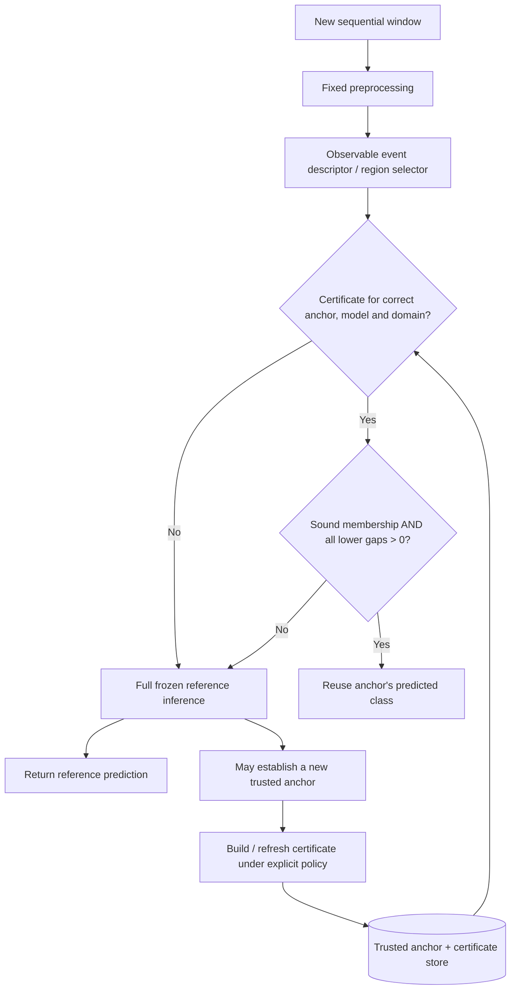

# RESEARCH PROJECT BRIEF
## Event-Conditioned Certified Decision Reuse (ECDR)

**Working title:** Event-Conditioned Certified Decision Reuse for Sequential Neural Network Inference  
**Version:** 22 October 2026 — consolidated English research brief, including the project owner's technical review  
**Research areas:** Efficient Neural Inference; Formal Neural Network Verification; Multivariate Time-Series Analysis; Systems Performance Evaluation  
**Document status:** Research problem and methodology brief. **Not** a completed experimental study, a published claim of novelty, or a report of demonstrated acceleration.  
**Evidence convention:** **[A]** saved project source/artifact evidence; **[B]** external publications/official documentation; **[C]** mathematical derivation or reasoned inference; **[D]** proposed method, hypothesis, or action still requiring proof or experiment.

> **Central thesis.** Sequential neural classification can involve redundant full-network evaluations, but temporal overlap or apparent similarity does not establish decision invariance. ECDR investigates when a previously computed class decision of a frozen reference classifier can be **directly certified** as valid for a new input, and whether the avoided forward computation exceeds the full cost of verifying, storing, selecting, checking, and rebuilding that certificate.

---

## 1. Executive Summary

ECDR studies **certified decision reuse** for a fixed neural classifier operating on sequential multivariate sensor measurements. Instead of evaluating a complete network for every new time-series window, a candidate system records a **trusted anchor**: an input genuinely evaluated by the reference network, its predicted class, and the metadata needed to establish the identity of the reference computation. It proposes an **event-conditioned candidate region** around the anchor. Reuse is allowed only if (1) the current input is soundly shown to belong to that region, (2) a valid verifier proves that the anchor class beats every competing class throughout the entire region, and (3) the checkpoint, preprocessing, domain, and numerical conditions match the certificate. Otherwise, the system performs the full reference inference.

The proposed guarantee is **preservation of the frozen model's argmax decision**. It is not a guarantee of ground-truth correctness, identical logits, equal confidence scores, or automatic performance improvement. The research has three independently assessable outcomes: (i) mathematically sound certification and faithful implementation; (ii) a measured advantage, if any, from event-conditioned region geometry under fair baselines; and (iii) positive end-to-end compute savings, if any, after all certificate and cache overheads are accounted for. Negative or conditional results remain scientifically relevant if supported by a reproducible protocol.

**Primary focus:** direct class-pair certification for a real frozen backbone, beginning with a precisely defined diagonal region, followed by controlled region comparisons and early cost-feasibility testing. More complex correlated/PCA regions, learned controllers, wave-based surrogates, and specialized hardware are deliberately deferred.

## 2. Origins and Research Context

### 2.1 From neural computation redundancy to a measurable question

The earliest discussions explored whether neural networks perform operations that do not materially contribute to their final decisions. Candidate ideas included SPGR-Net/PulseGraphNet, tensor or graph representations, event/pulse-driven sparse execution, skipping multiplication by zero, low-rank parameterization, and potential use on constrained devices such as ESP32-class microcontrollers. For a linear layer `y = Wx + b`, an operation involving an exactly zero input or weight may sometimes be skipped without changing the ideal mathematical result. Yet fewer arithmetic operations do **not** imply lower wall-clock latency: sparse indexing, scheduling, data movement, and branch overhead can outweigh the avoided multiplications. [A: historical research dossier]

A heuristic such as “only 10% of weights matter” belongs to the separate domain of pruning/sparsity. It is neither an established premise of this project nor an assertion that 90% of weights are useless. **Weight redundancy, operation redundancy, and repeated full-inference redundancy are distinct research subjects.** ECDR selects the third.

### 2.2 Why routing and equilibrium ideas did not become the central contribution

Further discussions considered an auxiliary neural Decision Maker that chooses `CONTINUE`, `EXIT`, or `ROUTE`; neural equilibrium/fixed-point dynamics; fourth-order tensors; and the geometry of state subspaces. These mechanisms might predict when computation is unnecessary. However, learned policies may be wrong, stable internal dynamics do not imply stable classification, and geometrically similar representations may still cross a decision boundary. The next question was therefore stricter: **Can we derive a valid, sufficiently tight bound on how an unevaluated change affects class-pair logits?** This motivates certification, safety-preserving fallback, and precise reference-model semantics. [A, C]

### 2.3 Why event-conditioned time-series structure was introduced

Sequential signals may exhibit repeated patterns, gradual evolution, periodic components, or changes restricted to particular directions. Earlier discussions considered wave and dynamical representations, interpolation, subspace projections, and state transitions as possible ways of characterizing such changes. These ideas suggested that a **structured input region** might describe meaningful variation more usefully than an indiscriminate global ball. Nevertheless, a good predictor of sensor signals is not automatically a sound predictor of neural logits: interpolation and extrapolation require their own error guarantees.

The eventual research narrowing was: **redundant computation → deciding whether to skip → proving that skipping preserves the original decision → making the proof cheap enough to matter in sequential inference.** The historical sequence explains the project choice; it is not evidence that each intermediate architecture was implemented or outperformed an alternative. [A]

## 3. Problem Statement and Candidate Research Gap

### 3.1 Observed setting

Many sequential sensor and video applications process a stream `x_1, x_2, ...` with a frozen classifier `F`, performing a complete forward evaluation on each window. Neighboring windows can share measurements or exhibit temporal dependencies. Prior work on temporal sparse updates and eventful inference demonstrates that **some** workloads have exploitable repeated computation [B2–B3]. This does **not** imply that any particular ECDR workload already has a high certified reuse rate.

### 3.2 Why similarity alone is insufficient

Two windows that appear similar may produce different argmax labels. A confident prediction at one point does not prove a class remains optimal at another point. In the chosen 128-sample windowing scheme with stride 64, the 64 shared samples occur at **different coordinate positions** in the flattened input. Consequently, 50% overlap does not imply a small coordinate-wise difference in `R^768` or membership in a box centered on the immediately previous window, much less on an older trusted anchor. [C]

### 3.3 Verification and systems trade-off

A global Lipschitz certificate can be sound but too conservative to certify useful regions. A stronger bound method, such as CROWN/auto_LiRPA, may certify more inputs but require expensive per-anchor or per-query work. Restricting perturbations according to event structure could improve this trade-off, but that is a **testable hypothesis**, not an inherent guarantee.

### 3.4 Candidate gap

The project investigates whether the **combination** of (a) event-conditioned structured input regions, (b) direct class-pair certification of the **actual frozen backbone**, (c) trusted-anchor sequential decision reuse, and (d) full runtime-cost accounting achieves measurable advantages over suitable controls. Individual ingredients are not new: certified caching, verification bounds, temporal computation reuse, and structured perturbation verification all have prior art [B2–B8]. Priority and originality claims for the full combination remain **unverified** pending a complete claim ledger and close paper-by-paper comparison.

**Core problem in one sentence:** *When can a frozen neural classifier safely skip an entire forward evaluation by reusing a certified previous class decision, and when is proving that fact cheaper than recomputing the decision?*

## 4. Research Object, Objectives, and Scope

**Research object:** preservation and reuse of the `argmax` predicted class of a **frozen reference classifier** under structured, sequential input variation. The subject is not human activity recognition accuracy as a stand-alone problem.

**Initial experimental testbed:** HAPT smartphone accelerometer and gyroscope streams, segmented into 6-channel, 128-sample windows, and a trained six-class one-dimensional CNN reference. HAPT is a test environment rather than the claimed methodological contribution.

**Objective O1 — Soundness.** Specify the input space, region geometry, membership predicate, class-pair lower bounds, checkpoint/preprocessing identity, numeric assumptions, tie behavior, anchor ownership, and fallback conditions needed for safe decision reuse.

**Objective O2 — Scientific effectiveness.** Determine whether event-conditioned regions improve certified coverage, sequential certified reuse, or the coverage–verification-cost trade-off compared with global-ball, diagonal, and bound-method-matched controls.

**Objective O3 — Systems effectiveness.** Determine the operating regimes, if any, in which certificate generation, selection, membership, cache maintenance, and fallback produce **net end-to-end savings**, and characterize the regimes where they do not.

**In scope:** frozen networks; multivariate time-series windows; direct reference-model class-pair margins; sound membership and conservative fallback; trusted-anchor lifecycle; proof-to-code checking; chronological, subject-disjoint evaluation; baseline-matched runtime studies.

**Out of scope for the core contribution:** ground-truth correctness guarantees; identical logits or probability outputs; the claim that 90% of weights can be discarded; model pruning; a newly trained routing Decision Maker, GRU, spiking network or deep-equilibrium network; mandatory fourth-order tensors; wave/Fourier/DMD/Koopman surrogate modeling; mobile/ESP32 deployment; energy claims without instruments; changing the classification policy to twelve classes merely to broaden the demo. These may be future projects or conditional extensions, not present requirements.

## 5. Terminology, Testbed, and Evidence Inventory

### 5.1 Operational definitions

| Term | Meaning in ECDR |
|---|---|
| Time-series window `x_t` | One 6 × 128 sensor input, thus one point in a 768-dimensional coordinate representation; not an LLM context window. |
| Frozen reference classifier `F` | The fixed reference computation from input representation through preprocessing and backbone to K logits. |
| Trusted anchor `x^r` | An input **actually evaluated by F**, with its predicted class `a` and identity/version metadata. |
| Event descriptor or selector | Observable information and a rule proposing an input region and budget. It does not itself certify reuse. |
| Candidate region `S_e(x^r)` | A set of inputs around a trusted anchor constrained by allowed variation. |
| Membership predicate | A sound test establishing the query belongs to the **same** region used for certification. |
| Certificate | A collection of valid lower bounds proving the anchor class wins against all competing classes over the whole region. |
| Certified hit | A query passing membership, all margin tests, and model/domain/numeric/identity checks. |
| Fallback | Full frozen reference evaluation whenever certification is unavailable, invalid, or inconclusive. |

### 5.2 Saved project evidence [A]

The **21 October 2026 project snapshot**, not a new run performed for this brief, reports the following:

| Item | Saved value | Interpretation/limit |
|---|---:|---|
| HAPT subjects / recordings | 30 / 61 | Project data-audit inventory |
| All stream windows | 17,453 | Across the entire saved data split |
| Pure six-class windows | 10,017 | Eligible subset for the reported classification metrics |
| Test-stream windows | 5,053 | Full held-out test stream, distinct from train/validation |
| Pure six-class test windows | 2,874 | Denominator for the selected checkpoint's test accuracy/F1 |
| Input shape | 6 × 128 | 768 coordinate values per window |
| `SmallCNN1D` parameters | 282,918 | Source/summary artifact value |
| Selected checkpoint | Seed 44, epoch 25 | Chosen by validation macro-F1 per saved artifacts |
| Pure-test accuracy | 93.49% | Not full-stream or 12-class accuracy |
| Pure-test macro-F1 | 93.54% | Not a certification metric |
| Mean CPU forward | 0.2511 ms = 251.1 µs | Batch 1, model call only, normalized resident tensor; excludes full pipeline overhead |
| Test adjacent-pair diagonal q90 membership | 31.94% | Candidate region membership, **not** certified reuse |
| Test adjacent-pair PCA candidate membership | 35.42% | No matched-region comparison and **not** certified reuse |

The event-region audit assessed adjacent pairs, whereas a trusted anchor may be maintained across multiple windows. Moreover, the PCA region's centering and residual norm in the working theory were reported as inconsistent with the audit script. PCA-vs-diagonal coverage values must not be interpreted as evidence that the PCA certificate is tighter or faster. [A, C]

**Not currently demonstrated [A/D boundary]:** a working verifier on the frozen network; formal proof-to-code validation; certified reuse rate; robust numerical bounds on the deployed code path; trusted-anchor runtime behavior; full end-to-end savings; measured edge-device energy use. Earlier simulated timing scenarios are not measured ECDR results.

### 5.3 Evidence discipline

- **[A] Saved project facts:** refer to specific scripts, metrics JSON, config, checkpoint or audit files cited in the prior snapshot. Numbers here were copied with their denominators; the checkpoint was **not** reloaded or benchmarked while authoring this English brief.
- **[B] Published/official work:** supports established background methods and novelty boundaries, **not** the success of this proposal.
- **[C] Mathematics/inference:** soundness follows conditionally from valid bounds, membership and reference semantics; proposed geometry's benefit is not thereby proved.
- **[D] Hypotheses/plans:** improved certification, reuse and net savings require actual comparisons and trace-based cost measurement.

## 6. Research Questions and Falsifiable Hypotheses

**Primary research question (RQ).** *Can event-conditioned structured perturbation sets soundly certify the decision of a frozen neural classifier across sequential inputs while improving certified reuse and reducing end-to-end inference cost relative to conventional baselines?*

**RQ1 — Certification correctness.** Which precise input-space, preprocessing, membership, verifier, margin, numeric and version conditions are sufficient to preserve the reference class for every accepted query?

**RQ2 — Value of event structure.** Under matched budgets, comparable coverage, and a controlled bound method, can event-conditioned regions produce greater certified reuse or a better coverage–cost trade-off than global or conventional diagonal regions? How does this depend on margin, event type and distance from the anchor?

**RQ3 — System feasibility.** For which reuse rate, anchor lifetime, rebuild frequency, reference latency and verifier cost does the overall system outperform full reference inference? What happens to p95/p99 latency and memory?

**RQ4 — Generalization and limitations.** How sensitive are benefits to activity transitions, subjects, recordings, window stride, model identity and distribution changes?

**H1 — Conditional soundness [C].** Given valid whole-region class-pair bounds, true membership, consistent frozen model/preprocessing metadata and adequate numeric conservatism, reuse preserves the reference model's predicted class. A counterexample under fully satisfied assumptions indicates a proof or implementation defect.

**H2 — Structural advantage [D].** In at least some reproducible sequential-input regimes, event-conditioned regions yield a better certified-coverage/reuse–verification-cost trade-off than appropriate global controls. The effect need not hold universally.

**H3 — Net runtime advantage [D].** In some regimes, enough certificate reuse can amortize certificate construction and checking to improve the measured end-to-end cost over always invoking the frozen reference.

**Falsification strategy:** invalid certificates or counterexamples invalidate soundness claims; matched studies showing no advantage challenge H2; full-cost measurements showing overhead dominates challenge H3. Zero observed mismatches in a finite oracle sample do **not** constitute a proof of H1.

## 7. Mathematical Formulation and Proof Obligations

### 7.1 Frozen reference decision

Let `d = 6 × 128 = 768`. Fix a deterministic reference mapping `F: R^d → R^K` with a specified preprocessing convention, checkpoint, class order and tie-breaking policy. Let `x^r` be a trusted anchor and

\[
a = \operatorname*{argmax}_{k\in\{1,\ldots,K\}} F_k(x^r).
\]

For each competitor `j ≠ a`, define the class-pair logit gap

\[
g_{aj}(x)=F_a(x)-F_j(x).
\]

A guarantee about the **winner of these logits** is weaker than a guarantee about equality of logits and independent of whether the winner matches the ground truth.

### 7.2 Region geometry and coordinates

A proposed affine region is

\[
S_e(x^r)=\{x^r+D_eu:\|u\|_\infty\le1\},
\]

where `D_e` specifies allowable directions and budgets. A diagonal `D_e` yields a coordinate-wise box. A non-diagonal matrix can encode correlated directions, but only if the set definition and membership algorithm are consistent.

The mathematical coordinates must match the verifier's network input. For example, if raw data `z` are normalized by a fixed per-channel map `N(z)=(z-µ)/σ`, choose **one** of the following and document it end to end:

1. Define `F(z)=f(N(z))` on raw coordinates and verify the composed graph; or
2. Define the region in normalized coordinates `x=N(z)` and verify the frozen backbone `f(x)` on that region, transforming the raw center, directions and budgets using `N`.

A raw-space budget may not be fed unchanged to a normalized-input verifier. Any residual or PCA centering must likewise be specified in the same coordinates. A conservative membership predicate is acceptable, provided **every accepted input is actually in the certified region**; it need not accept every true member.

### 7.3 Class-pair affine lower bounds

Suppose the verifier supplies, for every `j ≠ a`, a valid affine bound over **all** of `S_e`:

\[
g_{aj}(x)\ge\alpha_{aj}^{\top}x+\beta_{aj}.
\]

Minimizing the affine expression over the region gives

\[
\underline g_{aj}(S_e)
=\alpha_{aj}^{\top}x^r+\beta_{aj}-\|D_e^{\top}\alpha_{aj}\|_1.
\]

The transpose is essential for a general non-diagonal direction matrix. If the certified set includes an **independent** coordinate-wise residual `v` with `|v_i| ≤ ε_i`, the lower bound must additionally subtract `Σ_i ε_i |α_{aj,i}|`; a different residual norm, such as `||v||_2 ≤ ρ`, requires its matching dual-norm contribution instead. A PCA audit that used an L2 residual does not validate a theory that silently uses per-coordinate residual limits.

The sufficient reuse condition is

\[
x_t\in S_e(x^r)
\quad\land\quad
\underline g_{aj}(S_e)>0\quad\forall j\ne a
\quad\Longrightarrow\quad
\operatorname*{argmax}_k F_k(x_t)=a.
\]

**Reason:** every competing logit is strictly below the anchor class logit throughout the domain. Strict positivity also avoids ambiguous ties in certified hits. This conditional class-pair argument is standard verification reasoning, **not** a standalone novel theorem claimed by ECDR. The scientific contribution, if established, must involve useful region construction, sound sequential use, and empirically favorable cost and coverage.

### 7.4 Numerical and implementation assumptions (P0)

A mathematically positive real-number bound is not automatically sound when obtained with ordinary floating-point arithmetic. The specification must state supported layers (the current backbone includes BatchNorm and MaxPool), the treatment of floating-point rounding, use of conservative outward rounding or another validated sound-error scheme, and a strictly positive acceptance guard. Uncertain bounds, unsupported graph operations, checkpoint changes, preprocessing mismatches, missing metadata or failed membership must all trigger fallback. Full-backbone oracle tests help find defects but cannot replace the numerical verification argument.

### 7.5 Direct class-pair specification matrix

For `K=6`, define `C ∈ R^{(K−1)×K}` relative to the trusted-anchor class `a`; each row computes one `F_a − F_j`, for `j ≠ a`. An `auto_LiRPA`-style bound call using such a specification is a practical prototype direction [B7], **not** evidence that the current BatchNorm/MaxPool backbone and correlated domains are already supported and soundly integrated.

## 8. Proposed System and State Ownership

**Reference owner:** the frozen checkpoint and preprocessing specification determine the reference output.  
**Anchor owner:** only an input **actually evaluated by the reference network** can become a trusted anchor; a reused query cannot automatically replace it.  
**Certificate owner:** the verifier produces bounds bound to the exact anchor, region, model version and preprocessing identity; the store may cache and retrieve but cannot invent guarantees.  
**Selector role:** proposes event types and budgets using runtime-observable information; it must not rely on ground-truth activity labels during deployment.  
**Decision role:** returns a cached class only after *all* guards pass; otherwise evaluates full `F`.  
**Lifecycle rules:** invalidate on changes to the checkpoint, normalization, class mapping, certificate assumptions or domain; reset at recording/stream boundaries. Avoid accumulated drift from chaining certificates through reused inputs unless a separately proved composition rule exists.

## 9. Research Methodology

### M1 — Research positioning and formal problem definition

Inventory the original objective, the exact unit of skipped work (**one whole forward evaluation**), the reference semantics, and the chosen guarantee. Compare temporal sparse updates, cached inference, online verification reuse, class-pair bound methods, and structured perturbation verification. Maintain a claim ledger with verified source locations and explicit novelty limitations rather than asserting first-of-kind status [B2–B8].

### M2 — Characterize real sensor variation

Use the HAPT raw streams and fixed subject-disjoint train/validation/test protocol. Fit preprocessing statistics on training data only. Characterize coordinate-wise window distances after normalization, model-decision agreement between neighboring windows, actual-anchor distances and survival, class-pair margin distributions, event frequencies and transitions. Analyze the full held-out test stream separately from labeled pure-window classification metrics. Do not treat offline `same activity` labels as a deployable event selector, and do not assume overlap implies closeness.

### M3 — Build the minimal sound diagonal verifier

First freeze a coherent definition of the normalized input domain, diagonal perturbation region and membership predicate. Validate `SmallCNN1D` operator support, build the direct class-pair specification matrix, and test lower-bound validity and conservative fallback on the real checkpoint. Include boundary cases, wrong model versions, wrong normalization, zero/tied margins, failed membership and adversarial or property-based probes. The oracle computes the actual reference decision for sampled queries; **a matching oracle trace is diagnostic evidence, not mathematical proof**.

### M4 — Controlled comparison of region geometry and bound method

Compare global Lipschitz certificates, a global ball with the chosen stronger verifier, conventional diagonal regions, and event-conditioned diagonal regions under the same frozen model and split. Match or disclose region budgets and coverage; if exact matching is infeasible, report a Pareto trade-off rather than a single incomparable score. Separate improvements due to the bound algorithm from improvements due to region geometry. Evaluate correlated affine/PCA regions **only after** their centering, residual norms, membership, and bound propagation have been reconciled.

### M5 — Sequential runtime experiment

Process held-out recordings chronologically. Select policies on validation subjects, then lock them before final testing. Record each certificate build/refresh, anchor age, membership attempt, certified hit, fallback, complete model invocation, end-to-end latency and memory cost. Reset state at recording boundaries. Report results by event type, subject, margin range and transition regime, not only a favorable aggregate.

### M6 — Reproducibility and failure analysis

Save dataset/split versions, input transformation, checkpoint hash, model/config/seed, numeric and verifier settings, device/CPU-thread specification, warmed-up timing protocol, trace files and computation of every metric. Report mean, median, p95/p99, as well as meaningful uncertainty intervals using subject/recording units rather than treating overlapping windows as independent observations. Report negative feasibility as a scientific result when justified.

## 10. Baselines, Ablations, and Evaluation Metrics

### 10.1 Minimum comparisons

| ID | Method | Question answered | Guarantee category |
|---|---|---|---|
| B0 | Full frozen-reference inference | Decision oracle and full cost baseline | Exact reference execution |
| B1 | Exact-input cache | How often does an identical eligible input recur? | Exact under identity assumptions |
| B2 | Distance/confidence heuristic reuse | Empirical quality–cost trade-off if statistical risk is accepted | Not a per-query formal certificate |
| B3 | Global Lipschitz certified ball | Coverage with conventional, potentially loose bounds | Conditional formal guarantee |
| B4 | Global-ball CROWN-style verification | Control for verifier strength separate from region shape | Conditional formal guarantee |
| P1 | Event-conditioned diagonal certified region | Value of event-specific coordinate budgets | Proposed; certificate-dependent |
| P2 (deferred) | Correlated/PCA affine certified region | Incremental value of correlated structure after its overhead | Proposed; requires exact domain reconciliation |

Ablations should isolate: no event conditioning versus conditioning; equal budget versus matched coverage; different verifier families versus the *same* verifier; adjacent-window candidate coverage versus actual-anchor sequential coverage; and certificate precomputation/rebuild policy.

### 10.2 Metrics with non-interchangeable meanings

**Reference classification accuracy and macro-F1** compare `F` with ground truth on a valid labeled subset.  
**Reference agreement** is the proportion of system outputs equal to `argmax F(x)` on identical input under the specified numerical/reference conditions.  
**Certified decision-reuse rate (CDRR)** is `N_certified_reused / N_evaluated`, with the evaluation stream/denominator stated.  
**Reference invocation rate** is `N_full_F_calls / N_evaluated`.  
**Observed violation rate on certified hits** counts measured mismatches, but zero observations alone do **not** prove soundness.  
**Coverage** states the fraction of queries contained in a proposed/certified region; candidate membership coverage must not be relabeled certified reuse.  
**Systems metrics** include full elapsed mean/p50/p95/p99 latency, throughput, selector time, membership/lookup time, build/refresh cost, fallback cost, memory, cache size and reliably measured energy only when instrumentation exists.

Always state whether denominators are adjacent pairs, pure K=6 windows, all test-stream windows, per-subject recordings, or full cross-split project windows. Do **not** combine train/validation/test into a test set or report classification accuracy for unlabeled windows.

## 11. Cost Model and Early Go/No-Go Feasibility Test

Let:

- `T_f`: mean full frozen-reference forward time;
- `T_e`: mean event processing/selector cost per evaluated window;
- `T_m`: mean certificate lookup, membership and decision-check cost per window;
- `r`: fraction of evaluated windows that truly achieve certified reuse;
- `q`: mean number of certificate builds or rebuilds per window;
- `T_b`: mean cost per build/rebuild, amortized consistently across the stream.

A first-order cost model is

\[
\mathbb E[T_{\mathrm{ECDR}}]=T_e+T_m+(1-r)T_f+qT_b.
\]

The expected mean-time break-even condition, assuming non-overlapping accounting and one full reference call for every miss, is

\[
\boxed{rT_f>T_e+T_m+qT_b.}
\]

This is **not a measured speedup**. If costs vary by hit/miss or by event, replace the simplified expression with per-path conditional expectations or directly measured trace sums.

### 11.1 The 251.1-µs reference ceiling

The saved CPU artifact reports **`T_f=0.2511 ms=251.1 µs`**, measured on an already normalized resident tensor for `model(x)` in a specific CPU/PyTorch setting [A]. At a **hypothetical** certified reuse rate `r=0.50`, the combined average overhead must satisfy

\[
T_e+T_m+qT_b < 0.5\times 0.2511\,\mathrm{ms}
=0.12555\,\mathrm{ms}
=125.55\,\mu\mathrm{s/window}.
\]

This leaves little room for expensive certificate rebuilding. A CROWN/auto_LiRPA certificate requiring milliseconds at each new anchor could eliminate every prospective gain unless it can be amortized across enough certified queries. The proposed method must **not** assume that a certificate is free to create or that candidate-region coverage equals realized `r`.

### 11.2 Early decision experiment

Before building a large runtime stack, measure `T_f`, `T_e`, `T_m`, `T_b`, realized `r`, rebuild rate `q`, anchor survival length (`approximately 1/q` only under a compatible stationary-policy interpretation), and per-path latency on validation recordings. Determine whether any observed operating regime can satisfy break-even with a realistic certificate schedule. Classify outcomes as:

- **Proceed:** soundness implementation is credible and at least a reproducible runtime regime has feasible amortization;
- **Constrain the scope:** some event/anchor regimes work but not others; publish explicitly conditional applicability;
- **No-Go for acceleration claim:** sound certificates are too weak or too expensive under the measured testbed; report the negative bound/runtime findings rather than altering the backbone merely to manufacture a favorable speedup.

The previous 1.28-second window stride should also be considered: a 0.2511-ms model forward on the saved CPU does not by itself demonstrate a single-stream real-time deadline problem. Multi-stream, energy or constrained-device motivations require **separate evidence**, not extrapolation from forward-only latency.

## 12. Priorities, Actionable Tracks, and Explicitly Deferred Work

### P0 — Mandatory first-line priorities

**T1 / P0.1 — Lock the mathematical and numerical domain specification.** Establish one raw→normalized convention, frozen checkpoint/class mapping, diagonal `D_e`, event descriptor, trusted-anchor semantics, candidate membership, residual assumptions, tie behavior and floating-point conservatism. Reconcile the PCA centering (`δ` versus `δ−µ`) and residual-norm (coordinate-wise versus L2) discrepancy before using correlated-set claims. **Exit test:** theory, membership, preprocessing and verifier refer to one precise domain.

**T2 / P0.2 — Direct backbone verifier and oracle checks.** Implement the six-class pairwise matrix `C ∈ R^{5×6}` for each anchor class. Validate the real `SmallCNN1D` graph, including BatchNorm and MaxPool, and ensure that verifier lower bounds apply to the same model and input region as the membership test. Add oracle/reference checks, boundary and failure tests, and deterministic fallback. **Exit test:** sound bound construction with documented numeric assumptions and faithful failure behavior. Oracle agreement alone is insufficient.

**T3 / P0.3 — Early go/no-go runtime measurement.** Measure complete full-reference and verification paths, including `T_b`, `T_m`, `T_e`, `T_f`, reuse rate, rebuild count, and anchor lifetime. Use validation to select a policy and reserve held-out recordings for final evaluation. **Exit test:** an evidence-based amortization/break-even decision, even if it is negative.

### P1 — After P0

**T4 / P1.6 — Literature claim ledger.** Compare LipCache (GuardNet-versus-MainNet guarantee), STBP, DeltaCNN, Eventful Transformers, CROWN/auto_LiRPA, and Wei & Liu. Record paper passages, assumptions, guarantees, system roles and where ECDR remains genuinely untested; leave the final novelty claim **UNVERIFIED** until this is complete.

**P1 scientific comparisons:** fair matched global-vs-diagonal-vs-event region ablations, with distinct region and verifier effects.  
**P1 systems evaluation:** end-to-end trusted-anchor sequential reuse, full cost tracing and failure-regime analysis.

### P2 — Conditional future work

Correlated/PCA regions, a learned event selector, wave/Fourier/DMD/Koopman prediction, different classifiers/datasets, power-instrumented edge hardware, and controller/tensor alternatives. Each additional method must target a **specific measured weakness** of the simpler design, not become a default prerequisite.

**Not a priority:** 90% pruning, arbitrary model redesign for a prettier latency number, SNN/DEQ, fourth-order tensors, changing labels to K=12 without a new protocol, or deploying this technique in the Expiry application.

## 13. Risks, Threats to Validity, and Expected Deliverables

| Risk | Why it matters | Proposed response |
|---|---|---|
| Sliding-window coordinate shift | Shared samples move to different tensor coordinates, so membership may be low. | Measure normalized distances and actual-anchor coverage rather than assuming small shifts. |
| Loose certificates | Valid lower bounds may be negative for most useful inputs. | Record lower-bound margin/slack distributions and matched-coverage curves; begin with diagonal controls. |
| Excessive verification overhead | The reference network is already fast in the saved CPU setting. | Cost-account builds and refreshes; perform early go/no-go testing. |
| Mathematical-domain mismatch | Raw vs normalized, centering and residual norms can invalidate results. | Maintain one versioned, tested domain spec and sound membership implementation. |
| Floating-point unsoundness | A nominally positive approximate bound may be unsafe numerically. | Document verified numeric assumptions, conservative guards and fallback. |
| Unsupported novelty claims | Class-pair and temporal verification techniques already exist. | Source-linked claim ledger; compare precise guarantees and operational scope. |
| Evaluation leakage or optimistic denominators | Stable-only or pure-only reuse rates can exaggerate benefits. | Lock validation policies; report full test stream separately from labeled accuracy. |
| Correlated window dependence | Overlap can yield misleadingly narrow naive confidence intervals. | Aggregate uncertainty over subjects/recordings and retain chronological order. |

**Expected deliverables [D]:** (1) a source-linked problem/gap formulation; (2) formal domain specification and proof assumptions; (3) a verifier/membership/fallback prototype for the frozen backbone; (4) reproducible sequential reuse traces and complete runtime profiles; (5) matched baseline and ablation analysis including negative findings; and (6) a research report that answers only what its evidence justifies.

The **success criterion is not merely** a strong reference classifier, a high candidate-region coverage figure, zero observed oracle mismatches, or a bound algorithm that executes. It is a defensible conjunction of soundness, controlled comparison, and truthful end-to-end cost analysis. A narrow or negative empirical answer can still be informative about the boundary conditions for certified reuse.

## 14. Conclusion and Provenance

ECDR arose from the question of redundant neural computation and has matured into a more falsifiable target: **Can we prove that a whole frozen-network evaluation is unnecessary for a particular sequential input, and can we do so more cheaply than executing that evaluation?** HAPT and `SmallCNN1D` are the initial testbed. Event-conditioned region geometry is the key scientific hypothesis; advanced controllers, subspace/wave models, and specialized hardware remain optional directions dependent on evidence.

**Investigation order:** *correct input/domain specification → sound direct-backbone certificate → early go/no-go cost analysis → controlled region ablations → sequential runtime evidence → final novelty and systems claims.* No measured speedup or confirmed methodological novelty is asserted here.

### 14.1 Internal provenance [A]

- `Toan_bo_thao_luan_nghien_cuu_AI_2026-10.pdf`: chronological research-history dossier, with some earliest discussion segments explicitly reconstructed from summaries rather than verbatim transcripts.
- `Pasted text(20261022-032759).txt`: saved Project Brief snapshot of 21 October 2026; source for the reported HAPT split, CNN, candidate-coverage and forward-latency values and their limitations.
- `Event_Conditioned_Certified_Decision_Reuse_Research_Report_2026-10-16.md`: an earlier proposal/dossier; its initial training-status description is superseded by later saved backbone results.
- `ACADEMIC_RESEARCH_WRITING_GUIDELINE.md`: prior document-writing and evidence-provenance guidance, not an institutionally approved submission requirement.
- `ECDR_Project_Brief_2026-10-22.md`: full Vietnamese-language research brief used as the translation/source baseline.
- `ECDR_Review_Recommendations_2026-10-22.md`: owner-supplied critique and action tracks incorporated in the English revision.
- Files cited by the earlier project snapshot but **not re-executed** for this document: `configs/backbone.yaml`, `scripts/backbone.py`, `data/g2_metrics.json`, `data/g2_cpu_latency.json`, `data/event_audit.json`, `04_THEORY.md`, `02_LITERATURE.md` and `refs.bib`.

### 14.2 External literature and official sources [B]

- **[B1] UCI HAPT dataset:** https://archive.ics.uci.edu/dataset/341/smartphone+based+recognition+of+human+activities+and+postural+transitions
- **[B2] DeltaCNN (CVPR 2022):** https://openaccess.thecvf.com/content/CVPR2022/html/Parger_DeltaCNN_End-to-End_CNN_Inference_of_Sparse_Frame_Differences_in_Videos_CVPR_2022_paper.html
- **[B3] Eventful Transformers (ICCV 2023):** https://openaccess.thecvf.com/content/ICCV2023/html/Dutson_Eventful_Transformers_Leveraging_Temporal_Redundancy_in_Vision_Transformers_ICCV_2023_paper.html
- **[B4] LipCache (2026 preprint):** https://arxiv.org/abs/2608.13144 — cited for the GuardNet/MainNet guarantee distinction as recorded in the prior literature notes; validate the original paper before asserting definitive novelty.
- **[B5] Hybrid Robustness Verification for Spatio-Temporal Neural Networks / structured spatio-temporal verification (2026 preprint):** https://arxiv.org/abs/2606.09746
- **[B6] CROWN (NeurIPS 2018):** https://proceedings.neurips.cc/paper/2018/hash/d04863f100d59b3eb688a11f95b0ae60-Abstract.html
- **[B7] auto_LiRPA API:** https://auto-lirpa.readthedocs.io/en/latest/api.html — specification matrix `C` is relevant; actual compatibility/soundness on this project's frozen graph remain untested.
- **[B8] Wei & Liu, online neural-network verification:** https://arxiv.org/abs/2106.12732 — verification reuse must be distinguished from skipping a full classifier evaluation.

**Provenance rule:** Never promote [A] source summaries into fresh measurements, [B] literature into proof of this project's performance, [C] conditional mathematics into an implemented guarantee, or [D] proposals into completed research outcomes.
