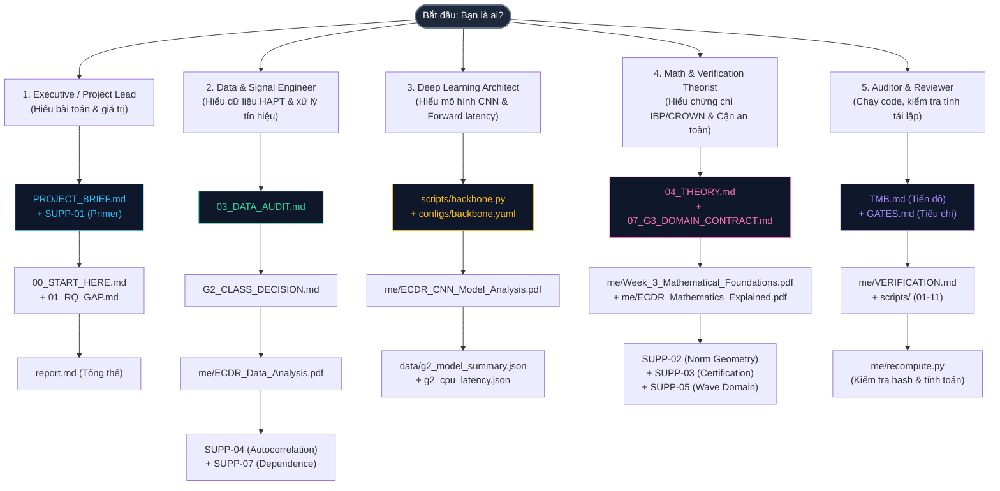

# HỆ THỐNG TÀI LIỆU VÀ LỘ TRÌNH ĐỌC TUYẾN TÍNH ECDR
## Event-Conditioned Certified Decision Reuse in Sensor Time-Series Streams

> **Dành cho độc giả (Customer-Centric Documentation Journey)**  
> Chào mừng bạn đến với kho lưu trữ nghiên cứu ECDR. Dự án này bao gồm hệ thống tài liệu đồ sộ từ lý thuyết toán học hình thức, kiểm toán dữ liệu cảm biến thực tế, bóc tách mô hình học sâu 1D-CNN đến các trình chứng nhận an toàn (Safety Verifier).
>
> Để tránh tình trạng quá tải thông tin, tài liệu này được thiết kế theo **mô hình tuyến tính và quan hệ phụ thuộc**:  
> **"Đọc xong [X] (DONE) $\rightarrow$ Nắm vững khái niệm [Y] $\rightarrow$ Mở khóa đọc hiểu sâu [Z]"**.
>
> 📌 Bảng theo dõi tiến độ kỹ thuật chuẩn **TrustMeBro**: Xem tại [`TMB.md`](TMB.md).  
> 🔮 **Giao diện Obsidian Vault**: Mở trang chủ Vault tại [`00_HOME.md`](00_HOME.md) hoặc bản đồ tư duy trực quan tại [`ECDR_Knowledge_Map.canvas`](ECDR_Knowledge_Map.canvas).

---

## ⚠️ INSTRUCTION 0: BẢNG KÝ HIỆU TIỀN QUYẾT & BẢN ĐỒ TIỀN GIẢ ĐỊNH
### (BẮT BUỘC ĐỌC TRƯỚC KHI VÀO WEEK 1 HOẶC BẤT KỲ TÀI LIỆU LÝ THUYẾT NÀO)

> **CẢNH BÁO CHO ĐỘC GIẢ LẦN ĐẦU TIẾP CẬN**:  
> Nếu bạn nhảy thẳng vào đọc **Week 1**, **Week 2**, **Week 3** hoặc các tệp chuyên đề toán trong `me/` mà chưa nắm hệ quy chiếu ký hiệu, bạn sẽ gặp ngay các ký hiệu viết tắt như $\mathcal{P}$, $X$, $f_\theta$, $F$, $h(X)$, $X^r$, $\mathcal{S}_r$. Bảng dưới đây giải nghĩa bản chất vật lý và toán học của từng ký hiệu để bạn không bị bỡ ngỡ.

### 1. Bảng Tra Cứu Ký Hiệu Toán Học & Hệ Thống Cốt Lõi

| Ký hiệu | Tên gọi chuẩn hóa | Định nghĩa toán học & Ý nghĩa vật lý | Tại sao lại quan trọng? |
| :---: | :--- | :--- | :--- |
| **$X \in \mathbb{R}^{C \times W}$** | **Raw Sensor Window**<br/>(Cửa sổ tín hiệu thô) | Cửa sổ tín hiệu cảm biến thô gồm $C=6$ kênh ($3$ trục gia tốc $a_x, a_y, a_z$ đơn vị $g$, $3$ trục con quay $g_x, g_y, g_z$ đơn vị $\text{rad/s}$) với độ dài $W=128$ mẫu ($2{,}56\text{ s}$ ở tần số $50\text{ Hz}$). Khi duỗi thẳng (flatten), $X \in \mathbb{R}^{768}$ ($6 \times 128 = 768$). | Là tín hiệu vật lý trực tiếp từ cảm biến đeo, mang thứ nguyên và đơn vị vật lý thực tế. |
| **$\mathcal{P}$ (hoặc $N$)** | **Fixed Preprocessing**<br/>(Tiền xử lý chuẩn hóa cố định) | Ánh xạ chuẩn hóa z-score độc lập từng kênh: $$Z_{c,i} = \mathcal{P}(X)_{c,i} = \frac{X_{c,i} - \mu_c}{\sigma_c}$$ với vector trung bình $\mu \in \mathbb{R}^6$ và độ lệch chuẩn $\sigma \in \mathbb{R}^6$ được **đóng băng bất biến từ tập huấn luyện** (training split). | **BẮT BUỘC CỐ ĐỊNH**: Nếu $\mathcal{P}$ thay đổi động (như chuẩn hóa min-max từng window hay streaming mean), hàm $F$ bị trôi dạt (drift) và chứng chỉ an toàn $\mathcal{S}_r$ lập tức mất hiệu lực! *(Lưu ý: Trong [`07_G3_DOMAIN_CONTRACT.md`](07_G3_DOMAIN_CONTRACT.md), $\mathcal{P}$ được ký hiệu là $N$ - Normalization).* |
| **$Z \in \mathbb{R}^{C \times W}$** | **Normalized Input Tensor**<br/>(Tensor đầu vào chuẩn hóa) | Tensor không thứ nguyên (dimensionless): $Z = \mathcal{P}(X)$, có giá trị trung bình xấp xỉ 0 và phương sai xấp xỉ 1 trên tập train. | Là đầu vào thực tế mà mạng nơ-ron nhận để thực hiện các phép tích chập Conv1D. |
| **$f_\theta$** | **Frozen Backbone Network**<br/>(Mô hình mạng nơ-ron đóng băng) | Mô hình học sâu (SmallCNN1D với 282.918 tham số, gồm Conv1d, BatchNorm, ReLU, MaxPool, Linear) nhận tensor $Z$ và xuất ra vector logits $K$ chiều: $$f_\theta: \mathbb{R}^{C \times W} \longrightarrow \mathbb{R}^K$$ | Tham số $\theta$ và thống kê BatchNorm running mean/var đã được huấn luyện xong và đóng băng hoàn toàn ở Gate G2. |
| **$F = f_\theta \circ \mathcal{P}$** | **End-to-End Reference Pipeline**<br/>(Chuỗi suy luận tham chiếu) | Ánh xạ hợp thành toàn diện từ tín hiệu thô vật lý $X$ sang vector logits: $$F(X) = f_\theta(\mathcal{P}(X)) \in \mathbb{R}^K$$ | Là chuẩn mực chân lý của suy luận. Mục tiêu của ECDR là tái sử dụng quyết định của $F$ mà không cần tốn năng lượng chạy $f_\theta$. |
| **$h(X)$** | **Hard Class Decision**<br/>(Quyết định nhãn lớp) | Lớp có điểm số logit cao nhất: $$h(X) = \arg\max_{1 \le k \le K} F_k(X)$$ | Đầu ra phân loại cuối cùng (nhãn hoạt động người dùng). Quy tắc tie-breaking được cố định. |
| **$X^r$** | **Trusted Anchor Window**<br/>(Cửa sổ mỏ neo tin cậy) | Một cửa sổ trong quá khứ đã được chạy suy luận thật bằng $F$, có kết quả nhãn $c = h(X^r)$ và được lưu trong bộ nhớ anchor. | Là tâm điểm để xây dựng miền an toàn. Không bao giờ được dùng một query được reuse để làm anchor mới (tránh lỗi trôi dạt tích lũy). |
| **$\mathcal{S}_r$ hoặc $\mathcal{D}(X^r)$** | **Certified Safety Region**<br/>(Miền quyết định an toàn) | Tập hợp các cửa sổ tín hiệu xung quanh mỏ neo $X^r$ thỏa mãn: $$X \in \mathcal{S}_r \implies h(X) = h(X^r) = c$$ | Là "vùng bảo chứng" toán học: Bất kỳ tín hiệu $X$ nào rơi vào miền này đều chắc chắn cho ra cùng quyết định $c$. |
| **$K$** | **Number of Classes**<br/>(Số lượng lớp hoạt động) | Số lượng hành động nhận diện. Trong UCI HAPT gốc $K=12$. Trong mô hình đóng băng hiện tại: $K=6$ (gồm 3 thế tĩnh: Sitting, Standing, Laying; và 3 thế động: Walking, Walking Upstairs, Walking Downstairs). | 6 lớp chuyển tiếp (postural transitions) bị loại khỏi K=6 do thiếu mẫu ($<2\%$) theo [`G2_CLASS_DECISION.md`](G2_CLASS_DECISION.md). |
| **$C, W$** | **Channels & Window Length**<br/>(Kênh & Chiều dài cửa sổ) | $C=6$ (kênh cảm biến), $W=128$ (số điểm mẫu mỗi cửa sổ). Bước trượt $s=64$ (overlap $50\%$). | Định hình không gian đầu vào $d = C \times W = 768$ chiều. |
| **$g_{cj}(X)$** | **Class-Pair Margin**<br/>(Cận biên khoảng cách giữa các lớp) | Hiệu số logit giữa lớp thắng $c$ và lớp cạnh tranh $j$: $$g_{cj}(X) = F_c(X) - F_j(X)$$ | Điều kiện an toàn để tái sử dụng nhãn là cận dưới của margin này phải luôn dương: $\min_{X \in \mathcal{S}_r} g_{cj}(X) > 0, \forall j \neq c$. |

### 2. Quy Tắc Bất Biến: Tại Sao Preprocessing $\mathcal{P}$ Bắt Buộc Phải Đóng Băng Cố Định?
Trong xử lý dữ liệu thông thường, kỹ sư hay dùng chuẩn hóa động (adaptive streaming normalization hoặc per-window min-max): mỗi khi có cửa sổ mới $X_t$, hệ thống tự tính lại min/max hoặc mean/std của chính cửa sổ đó.
**Trong hệ thống chứng nhận an toàn ECDR, chuẩn hóa động bị BÁC BỎ HOÀN TOÀN vì lý do toán học:**
1. Giả sử ta chứng nhận an toàn trên miền chuẩn hóa $\mathcal{D}_Z$: $\forall Z \in \mathcal{D}_Z \implies \arg\max f_\theta(Z) = c$.
2. Để kiểm tra query $X$ trong miền tín hiệu thô có an toàn không, ta dựa vào tạo ảnh ngược (preimage): $X \in \mathcal{P}^{-1}(\mathcal{D}_Z)$.
3. Khi $\mathcal{P}$ là hàm cố định (affine transform với $\mu, \sigma$ cố định): $\mathcal{P}^{-1}(\mathcal{D}_Z)$ là một tập hợp xác định bất biến trong không gian tín hiệu thô $\mathbb{R}^{768}$.
4. Nếu $\mathcal{P}$ thay đổi động theo từng cửa sổ (nghĩa là $\mu(X), \sigma(X)$ phụ thuộc vào chính $X$): Ánh xạ $\mathcal{P}_X$ biến thiên liên tục, khiến việc kiểm tra $X$ rơi vào miền thô không còn bảo đảm được $Z$ rơi vào $\mathcal{D}_Z$, làm sụp đổ toàn bộ nền tảng toán học của IBP và CROWN!

---

## 1. Bản Đồ Hành Trình Độc Giả (Customer Reading Journey)

Mỗi độc giả ("Customer") đến với dự án với một mục tiêu và xuất phát điểm khác nhau. Hãy chọn lộ trình phù hợp nhất với bạn:



---

## 2. Bảng Quan Hệ Tuyến Tính: Đọc Xong Cái Này Là Hiểu Cái Này

Dưới đây là ma trận tiến trình đọc tuần tự. Mỗi tài liệu được định nghĩa rõ **nội dung truyền tải**, **kiến thức bạn đạt được sau khi đọc xong [DONE]**, và **cánh cửa tri thức tiếp theo mà nó mở khóa**.

| Bước | Tài liệu & Liên kết | Nội dung cốt lõi (Nói cái gì) | Đọc xong [DONE] là hiểu được gì? | Mở khóa tiếp theo (Unlocks) | Điều kiện tiên quyết (Prerequisites) |
| :---: | :--- | :--- | :--- | :--- | :--- |
| **01** | [`PROJECT_BRIEF.md`](PROJECT_BRIEF.md) | Giới thiệu bài toán ECDR, bối cảnh inference trên thiết bị đeo (wearable) | Hiểu được vì sao chạy CNN liên tục gây cạn pin, và tại sao caching ngây thơ dựa trên độ tương đồng (similarity) không thể đảm bảo an toàn. | Mở khóa: [`00_START_HERE.md`](00_START_HERE.md) & [`me/ECDR_Data_Analysis_Supplement_ECDR_Primer.pdf`](me/ECDR_Data_Analysis_Supplement_ECDR_Primer.pdf) | Không có (Điểm bắt đầu) |
| **02** | [`me/ECDR_Data_Analysis_Supplement_ECDR_Primer.pdf`](me/ECDR_Data_Analysis_Supplement_ECDR_Primer.pdf) | Chuyên đề sơ nhập ECDR (SUPP-01): Vòng đời Anchor và chuỗi chứng thực | Hiểu vòng đời 4 trạng thái (`FRESH` $\rightarrow$ `ACTIVE` $\rightarrow$ `STALE` $\rightarrow$ `REFRESH`) và sự khác biệt tuyệt đối giữa "Cache mềm" (heuristic) và "Chứng chỉ an toàn" (Certified). | Mở khóa: Toàn bộ các chuyên đề toán và verifier | [`PROJECT_BRIEF.md`](PROJECT_BRIEF.md) |
| **03** | [`00_START_HERE.md`](00_START_HERE.md) | Bức tranh tổng quan hiện trạng dự án, số liệu checkpoint K=6 và trạng thái Gate G0–G6 | Nắm được mô hình thực tế hiện tại là SmallCNN1D (282.918 tham số, test macro-F1 0.9354 trên 2.874 pure windows), tránh nhầm lẫn với các mô hình 24k cũ. | Mở khóa: [`01_RQ_GAP.md`](01_RQ_GAP.md) & [`TMB.md`](TMB.md) | [`PROJECT_BRIEF.md`](PROJECT_BRIEF.md) |
| **04** | [`01_RQ_GAP.md`](01_RQ_GAP.md) | Hai câu hỏi nghiên cứu (RQ1: Certified Decision, RQ2: Net Saving) và khoảng trống khoa học | Hiểu được 2 lỗ hổng lớn của các nghiên cứu trước (LipCache, Early-Exit): C11 (chưa ai mô hình hóa biến thiên sự kiện thời gian thực) và C12 (chưa ai trừ đi chi phí verifier). | Mở khóa: [`02_LITERATURE.md`](02_LITERATURE.md) & [`05_READING_PLAN.md`](05_READING_PLAN.md) | [`00_START_HERE.md`](00_START_HERE.md) |
| **05** | [`02_LITERATURE.md`](02_LITERATURE.md) | Phân loại tổng quan nghiên cứu trước theo 4 trục: Ngữ cảnh, Phương pháp, Cận toán học, Tái sử dụng | Nắm được vị trí của ECDR trên bản đồ khoa học thế giới: So sánh với NoScope, Cavigelli, LipCache, CROWN và auto_LiRPA. | Mở khóa: [`notes/P04_NoScope.md`](notes/P04_NoScope.md) & [`refs.bib`](refs.bib) | [`01_RQ_GAP.md`](01_RQ_GAP.md) |
| **06** | [`03_DATA_AUDIT.md`](03_DATA_AUDIT.md) | Kiểm toán tập dữ liệu UCI HAPT: 61 bản ghi, 12 lớp, 30 người dùng, sửa lỗi index dòng | Hiểu rõ cấu trúc dữ liệu cảm biến: 50Hz, cửa sổ 128 điểm (2.56s), trượt 64 điểm. Hiểu vì sao script cũ bị sai index và kết quả sửa chữa chính xác F1–F3. | Mở khóa: [`G2_CLASS_DECISION.md`](G2_CLASS_DECISION.md) & [`me/ECDR_Data_Analysis.pdf`](me/ECDR_Data_Analysis.pdf) | [`00_START_HERE.md`](00_START_HERE.md) |
| **07** | [`G2_CLASS_DECISION.md`](G2_CLASS_DECISION.md) | Quyết định chiến lược: Thu hẹp bài toán từ 12 lớp xuống 6 lớp tĩnh/động cơ bản (pure-only) | Hiểu tại sao 6 lớp chuyển tiếp thế đứng (postural transitions) chỉ chiếm < 2% dữ liệu và không thể chứng nhận an toàn, từ đó bảo vệ tính khả thi của mô hình. | Mở khóa: [`scripts/backbone.py`](scripts/backbone.py) & [`configs/backbone.yaml`](configs/backbone.yaml) | [`03_DATA_AUDIT.md`](03_DATA_AUDIT.md) |
| **08** | [`me/ECDR_Data_Analysis.pdf`](me/ECDR_Data_Analysis.pdf) | Báo cáo phân tích dữ liệu chuyên sâu (28 trang): Phân phối, tự tương quan và hình học chuẩn hóa | Hiểu sâu về 4 độ đo vật lý (lag-1, lag-64, window-position, channel-mean), hiện tượng biến dạng elip khi chuẩn hóa z-score, và độ phủ thực tế của PCA. | Mở khóa: [`me/ECDR_Data_Analysis_Supplement_Autocorrelation.pdf`](me/ECDR_Data_Analysis_Supplement_Autocorrelation.pdf) & [`me/ECDR_Data_Analysis_Supplement_Statistical_Dependence.pdf`](me/ECDR_Data_Analysis_Supplement_Statistical_Dependence.pdf) | [`03_DATA_AUDIT.md`](03_DATA_AUDIT.md) |
| **09** | [`me/ECDR_Data_Analysis_Supplement_Autocorrelation.pdf`](me/ECDR_Data_Analysis_Supplement_Autocorrelation.pdf) | Chuyên đề tự tương quan (SUPP-04): Công thức Pearson, ACF và phản ví dụ dốc tuyến tính | Hiểu tại sao tín hiệu cảm biến có $r \approx 0.985$ giữa 2 mẫu liên tiếp nhưng hai cửa sổ có overlap 50% vẫn có thể mang nhãn hoàn toàn khác nhau. | Mở khóa: [`me/ECDR_Data_Analysis_Supplement_Wave_Domain.pdf`](me/ECDR_Data_Analysis_Supplement_Wave_Domain.pdf) | [`me/ECDR_Data_Analysis.pdf`](me/ECDR_Data_Analysis.pdf) |
| **10** | [`me/ECDR_Data_Analysis_Supplement_Statistical_Dependence.pdf`](me/ECDR_Data_Analysis_Supplement_Statistical_Dependence.pdf) | Chuyên đề phụ thuộc thống kê (SUPP-07): Tại sao giả định i.i.d. sụp đổ, lạm phát phương sai $\times 65$ | Hiểu tại sao các phép kiểm t-test thông thường bị sai số nghiêm trọng trên chuỗi thời gian trượt, và cách dùng Block Bootstrap để ước lượng khoảng tin cậy chuẩn xác. | Mở khóa: Đánh giá độ tin cậy trong [`report.md`](report.md) | [`me/ECDR_Data_Analysis_Supplement_Autocorrelation.pdf`](me/ECDR_Data_Analysis_Supplement_Autocorrelation.pdf) |
| **11** | [`scripts/backbone.py`](scripts/backbone.py) | Mã nguồn kiến trúc SmallCNN1D PyTorch (Conv1d, BatchNorm, MaxPool, Linear) | Nắm vững từng phép biến đổi tensor từ $(B, 6, 128)$ qua 3 tầng tích chập đến $(B, 6)$ logits. | Mở khóa: [`me/ECDR_CNN_Model_Analysis.pdf`](me/ECDR_CNN_Model_Analysis.pdf) | [`G2_CLASS_DECISION.md`](G2_CLASS_DECISION.md) |
| **12** | [`me/ECDR_CNN_Model_Analysis.pdf`](me/ECDR_CNN_Model_Analysis.pdf) | Bóc tách mô hình CNN từ nguyên lý đầu (64 concepts): Receptive field, FLOPs, MACs, Memory | Hiểu chính xác chi phí tính toán: Số lượng phép nhân cộng (MACs), bộ nhớ đệm, vùng nhìn thấy của kernel, và tại sao phép toán MaxPool gây khó khăn cho bộ chứng nhận verifier. | Mở khóa: Phân tích độ trễ tại [`data/g2_cpu_latency.json`](data/g2_cpu_latency.json) | [`scripts/backbone.py`](scripts/backbone.py) |
| **13** | [`04_THEORY.md`](04_THEORY.md) | Khung lý thuyết toán học: Định nghĩa miền Event-Conditioned $\mathcal{D}$, cận biên an toàn, định lý Soundness | Hiểu bản chất toán học: Điều kiện để tái sử dụng nhãn mà không cần chạy lại mạng là cận dưới khoảng cách logit $\min_{k \neq y} (z_y - z_k) > 0$. | Mở khóa: [`07_G3_DOMAIN_CONTRACT.md`](07_G3_DOMAIN_CONTRACT.md) & [`me/Week_3_Mathematical_Foundations.pdf`](me/Week_3_Mathematical_Foundations.pdf) | [`PROJECT_BRIEF.md`](PROJECT_BRIEF.md) & [`G2_CLASS_DECISION.md`](G2_CLASS_DECISION.md) |
| **14** | [`07_G3_DOMAIN_CONTRACT.md`](07_G3_DOMAIN_CONTRACT.md) | Khế ước kỹ thuật Gate 3: Ràng buộc bất biến giữa tiền xử lý, chuẩn hóa và không gian verifier | Hiểu được khế ước sống còn: Verifier và mạng CNN phải nhìn thấy cùng một không gian đầu vào đã chuẩn hóa $N(x)$; không được lẫn lộn giữa raw sensor và normalized tensor. | Mở khóa: Triển khai code [`scripts/11_gate_a_prototype.py`](scripts/11_gate_a_prototype.py) | [`04_THEORY.md`](04_THEORY.md) |
| **15** | [`me/ECDR_Data_Analysis_Supplement_Norm_Geometry.pdf`](me/ECDR_Data_Analysis_Supplement_Norm_Geometry.pdf) | Chuyên đề hình học chuẩn (SUPP-02): $L_2$ vs $L_\infty$ trong không gian $\mathbb{R}^{768}$, tỷ số $\sqrt{768} \approx 27.7$ | Hiểu tại sao bán kính hình cầu $L_2$ khi đổi sang hình hộp $L_\infty$ bị phình to gấp 27.7 lần, và tại sao việc dịch chuyển percentile qua các chuẩn khác nhau là sai lầm chết người. | Mở khóa: Thiết kế miền $\mathcal{D}$ chặt chẽ | [`04_THEORY.md`](04_THEORY.md) |
| **16** | [`me/ECDR_Data_Analysis_Supplement_Certification_Methods.pdf`](me/ECDR_Data_Analysis_Supplement_Certification_Methods.pdf) | Chuyên đề phương pháp chứng thực (SUPP-03): Quy tắc truyền khoảng IBP, CROWN relaxation, LiRPA | Hiểu chi tiết cách IBP truyền cận qua tầng tuyến tính và ReLU, tại sao IBP nhanh nhưng lỏng (loose), còn CROWN dùng 2 đường bao tuyến tính giúp thắt chặt cận. | Mở khóa: [`me/ECDR_Mathematics_Explained.pdf`](me/ECDR_Mathematics_Explained.pdf) | [`04_THEORY.md`](04_THEORY.md) & [`me/ECDR_Data_Analysis_Supplement_Norm_Geometry.pdf`](me/ECDR_Data_Analysis_Supplement_Norm_Geometry.pdf) |
| **17** | [`me/ECDR_Data_Analysis_Supplement_Wave_Domain.pdf`](me/ECDR_Data_Analysis_Supplement_Wave_Domain.pdf) | Chuyên đề miền sóng (SUPP-05): Toán tử dịch chuyển $T_S$, thành phần PCA bậc thấp, độ nhạy pha | Hiểu cách mô hình hóa tín hiệu tuần hoàn (bước đi, chạy bộ) bằng phép quay pha sóng sin, và cách chặn cận sai số trôi dạt (multi-step drift). | Mở khóa: Cận Event-Conditioned thắt chặt trong G4 | [`me/ECDR_Data_Analysis_Supplement_Certification_Methods.pdf`](me/ECDR_Data_Analysis_Supplement_Certification_Methods.pdf) |
| **18** | [`me/ECDR_Data_Analysis_Supplement_Float_Precision.pdf`](me/ECDR_Data_Analysis_Supplement_Float_Precision.pdf) | Chuyên đề độ chính xác số học (SUPP-06): IEEE 754 float32 vs float64, machine epsilon, int8 | Hiểu rủi ro làm tròn số trong verifier: Khi nào float32 gây sai lệch cận an toàn và cách containment lỗi số học trên phần cứng nhúng. | Mở khóa: Hoàn thiện tính vững chắc toán học G3 | [`me/ECDR_Data_Analysis_Supplement_Certification_Methods.pdf`](me/ECDR_Data_Analysis_Supplement_Certification_Methods.pdf) |
| **19** | [`me/ECDR_Weeks_1_2_3_Theory.pdf`](me/ECDR_Weeks_1_2_3_Theory.pdf) | Báo cáo lý thuyết tổng hợp 31 trang (Tuần 1: Project Brief, Tuần 2: Data, Tuần 3: Mathematics) | Nắm vững toàn bộ bức tranh khoa học từ tiền đề vật lý, cơ sở dữ liệu đến toàn văn công thức toán chứng nhận. | Mở khóa: [`report.md`](report.md) & [`latex/dossier.tex`](latex/dossier.tex) | Đã đọc các bước 01 đến 18 |
| **20** | [`me/ECDR_Mathematics_Explained.pdf`](me/ECDR_Mathematics_Explained.pdf) | Cẩm nang giải thích toàn bộ toán học (29 trang): Giải nghĩa H01–H24, ví dụ tính tay từng bước | Nắm vững từng phép tính vi mô: Tự tay tính được GAP, logits, margins của một mạng CNN thu nhỏ và hiểu rõ phản ví dụ stale certificate. | Mở khóa: Bảo vệ luận án / Viết paper khoa học G6 | [`me/ECDR_Weeks_1_2_3_Theory.pdf`](me/ECDR_Weeks_1_2_3_Theory.pdf) |
| **21** | [`GATES.md`](GATES.md) & [`TMB.md`](TMB.md) | Tiêu chí nghiệm thu thực chứng (Evidence Gates) và Bảng quản lý tiến độ TrustMeBro | Nắm rõ bằng chứng cần có để đóng từng Gate, phân biệt rạch ròi giữa code đã verify và các giả thuyết chưa chứng minh. | Mở khóa: Thực thi các pha tiếp theo (G3 $\rightarrow$ G6) | [`00_START_HERE.md`](00_START_HERE.md) & [`roadmap suggestion.md`](roadmap%20suggestion.md) |
| **22** | [`report.md`](report.md) | Báo cáo khoa học hoàn chỉnh nhất hiện tại của dự án: Tích hợp đầy đủ giả thuyết, bằng chứng, rủi ro | Trở thành chuyên gia làm chủ toàn bộ đề tài nghiên cứu ECDR, sẵn sàng viết bài báo hội nghị quốc tế. | Mở khóa: Xuất bản khoa học | Toàn bộ các tài liệu trên |

---

## 3. Hệ Thống Thư Mục Phân Tầng & Phím Tắt Điều Hướng (Tiered Architecture & Symlink Shortcuts)

Để thuận tiện tối đa cho việc tra cứu và đọc tài liệu theo từng tầng tri thức, toàn bộ kho lưu trữ đã được cấu trúc hóa thành thư mục [`tiers/`](tiers/) và tạo các **đường dẫn tắt (symlinks) ngay tại thư mục gốc**:

```
/home/pro/Downloads/research/
├── 00_OVERVIEW/        -> tiers/00_overview/            # Tầng 0: Khởi đầu, bài toán & RQ
├── 01_DATA/            -> tiers/01_data_foundations/    # Tầng 1: Dữ liệu UCI HAPT, 12 vs 6 classes & Tín hiệu
├── 02_MODEL/           -> tiers/02_model_cnn/           # Tầng 2: Mô hình SmallCNN1D (282k params), FLOPs & Weights
├── 03_MATH/            -> tiers/03_math_certification/  # Tầng 3: Lý thuyết IBP, CROWN, Norm Geometry & G3
├── 04_SYNTHESIS/       -> tiers/04_synthesis_and_gates/ # Tầng 4: Báo cáo tổng hợp, Gates, Roadmap & Papers
├── PDF_LIBRARY/        -> tiers/pdf_shelf/              # Tủ sách PDF 21 tệp đánh số thứ tự từ 01 đến 21
├── LATEX_LIBRARY/      -> tiers/latex_sources/          # Kho 19 mã nguồn LaTeX .tex và .bib
└── SCRIPTS_LIBRARY/    -> tiers/executable_scripts/     # Kho 19 scripts Python thực thi (01-11, recompute)
```

> 💡 **Mẹo điều hướng nhanh**:
> - Nếu bạn muốn đọc trọn bộ tài liệu dạng **PDF**, hãy mở ngay thư mục [`PDF_LIBRARY/`](PDF_LIBRARY/) và đọc theo thứ tự từ `01_Week_1_Project_Brief.pdf` đến `17_Dossier_Scientific_Report.pdf`.
> - Nếu bạn muốn chỉnh sửa hay biên dịch **LaTeX**, toàn bộ nguồn nằm tại [`LATEX_LIBRARY/`](LATEX_LIBRARY/).
> - Nếu bạn muốn chạy lại các thực nghiệm **Python**, mở [`SCRIPTS_LIBRARY/`](SCRIPTS_LIBRARY/).

---

## 4. Danh Mục Toàn Bộ Tài Liệu Trong Dự Án (Complete Catalog)

### A. Tài liệu Nền tảng & Điều phối tại Thư mục gốc (`/`)
- [`README.md`](README.md): Bản đồ tri thức độc giả & hướng dẫn đọc tuyến tính (File này).
- [`TMB.md`](TMB.md): Bảng quản lý tiến độ thực thi & trạng thái Gate theo chuẩn **TrustMeBro**.
- [`00_START_HERE.md`](00_START_HERE.md): Điểm xuất phát nhanh, cảnh báo hiện trạng và checkpoint.
- [`01_RQ_GAP.md`](01_RQ_GAP.md): Câu hỏi nghiên cứu và phân tích khoảng trống khoa học.
- [`02_LITERATURE.md`](02_LITERATURE.md): Đối chiếu nghiên cứu liên quan theo 4 trục.
- [`03_DATA_AUDIT.md`](03_DATA_AUDIT.md): Báo cáo kiểm toán dữ liệu UCI HAPT và lịch sử sửa lỗi script.
- [`04_THEORY.md`](04_THEORY.md): Khung lý thuyết toán học về miền sự kiện và chứng chỉ an toàn.
- [`05_READING_PLAN.md`](05_READING_PLAN.md): Kế hoạch nghiên cứu 23 bài báo khoa học P01–P23.
- [`06_REVIEW_PROTOCOL.md`](06_REVIEW_PROTOCOL.md): Giao thức đánh giá tài liệu và trích dẫn khoa học.
- [`07_G3_DOMAIN_CONTRACT.md`](07_G3_DOMAIN_CONTRACT.md): Khế ước miền đầu vào chuẩn hóa cho Gate G3.
- [`G2_CLASS_DECISION.md`](G2_CLASS_DECISION.md): Quyết định kỹ thuật chọn tập 6 lớp pure-only K=6.
- [`GATES.md`](GATES.md): Tiêu chí nghiệm thu khắt khe từ Gate G0 đến G6.
- [`PROJECT_BRIEF.md`](PROJECT_BRIEF.md): Bản tóm tắt dự án ECDR, định nghĩa thực thể và ranh giới.
- [`report.md`](report.md): Báo cáo nghiên cứu khoa học tổng hợp toàn diện.
- [`roadmap suggestion.md`](roadmap%20suggestion.md): Đề xuất lộ trình kỹ thuật và phân tích đánh đổi.
- [`ECDR_Project_Brief_2026-10-22.md`](ECDR_Project_Brief_2026-10-22.md) & [`ECDR_Project_Brief_Full_EN_2026-10-22.md`](ECDR_Project_Brief_Full_EN_2026-10-22.md): Bản brief chuẩn hóa song ngữ ngày 22/10.
- [`Event_Conditioned_Certified_Decision_Reuse_Research_Report_2026-10-16.md`](Event_Conditioned_Certified_Decision_Reuse_Research_Report_2026-10-16.md): Báo cáo lịch sử ngày 16/10.
- [`refs.bib`](refs.bib): Tệp nguồn trích dẫn BibTeX cho toàn bộ dự án.
- [`latex/dossier.tex`](latex/dossier.tex): Mã nguồn LaTeX của tập hồ sơ dự án tổng hợp.

### B. Bộ Chuyên Đề Lý Thuyết Sâu tại `me/`
- [`me/README.md`](me/README.md): Hướng dẫn biên dịch LaTeX, cấu trúc bản in PDF và nhật ký QA.
- [`me/ECDR_Weeks_1_2_3_Theory.pdf`](me/ECDR_Weeks_1_2_3_Theory.pdf) ([Mã nguồn TeX](me/ECDR_Weeks_1_2_3_Theory.tex)): Toàn văn báo cáo lý thuyết 3 tuần (31 trang).
- [`me/Week_1_Project_Brief.pdf`](me/Week_1_Project_Brief.pdf) ([TeX](me/Week_1_Project_Brief.tex)): Trích đoạn Tuần 1 — Project Brief (6 trang).
- [`me/Week_2_Data_Foundations.pdf`](me/Week_2_Data_Foundations.pdf) ([TeX](me/Week_2_Data_Foundations.tex)): Trích đoạn Tuần 2 — Nền tảng Dữ liệu HAPT (10 trang).
- [`me/Week_3_Mathematical_Foundations.pdf`](me/Week_3_Mathematical_Foundations.pdf) ([TeX](me/Week_3_Mathematical_Foundations.tex)): Trích đoạn Tuần 3 — Nền tảng Toán học & Cận biên (17 trang).
- [`me/ECDR_Mathematics_Explained.pdf`](me/ECDR_Mathematics_Explained.pdf) ([TeX](me/ECDR_Mathematics_Explained.tex)): Cẩm nang giải thích toán học chi tiết 29 trang (Ví dụ CNN nhỏ tính tay, H01–H24).
- [`me/ECDR_Mathematics_Concepts_EN.tex`](me/ECDR_Mathematics_Concepts_EN.tex): Bản đồ 104 khái niệm toán học tiếng Anh (Concept Atlas — mỗi trang 1 concept).
- [`me/ECDR_CNN_Model_Analysis.pdf`](me/ECDR_CNN_Model_Analysis.pdf) ([TeX](me/ECDR_CNN_Model_Analysis.tex)): Bóc tách mô hình 1D-CNN từ nguyên lý đầu (Bản tiếng Anh).
- [`me/ECDR_CNN_Model_Analysis_VI.pdf`](me/ECDR_CNN_Model_Analysis_VI.pdf) ([TeX](me/ECDR_CNN_Model_Analysis_VI.tex)): Bóc tách mô hình CNN (Bản tiếng Việt lưu trữ).
- [`me/ECDR_Data_Analysis.pdf`](me/ECDR_Data_Analysis.pdf) ([TeX](me/ECDR_Data_Analysis.tex)): Phân tích dữ liệu UCI HAPT và phương pháp luận chuyên sâu (28 trang tiếng Anh).
- [`me/ECDR_Data_Analysis_VI.pdf`](me/ECDR_Data_Analysis_VI.pdf) ([TeX](me/ECDR_Data_Analysis_VI.tex)): Phân tích dữ liệu HAPT (Bản tiếng Việt lưu trữ).

#### 7 Chuyên đề Bổ trợ Độc lập (`me/` Supplements):
1. [`me/ECDR_Data_Analysis_Supplement_ECDR_Primer.pdf`](me/ECDR_Data_Analysis_Supplement_ECDR_Primer.pdf) ([TeX](me/ECDR_Data_Analysis_Supplement_ECDR_Primer.tex)): SUPP-01 — Bản chất ECDR, vòng đời Anchor và lập luận an toàn toàn diện.
2. [`me/ECDR_Data_Analysis_Supplement_Norm_Geometry.pdf`](me/ECDR_Data_Analysis_Supplement_Norm_Geometry.pdf) ([TeX](me/ECDR_Data_Analysis_Supplement_Norm_Geometry.tex)): SUPP-02 — Hình học chuẩn $L_2$ vs $L_\infty$ trong $\mathbb{R}^{768}$, nghịch lý vỏ cầu cao chiều.
3. [`me/ECDR_Data_Analysis_Supplement_Certification_Methods.pdf`](me/ECDR_Data_Analysis_Supplement_Certification_Methods.pdf) ([TeX](me/ECDR_Data_Analysis_Supplement_Certification_Methods.tex)): SUPP-03 — Phương pháp chứng nhận IBP, CROWN relaxation và LiRPA framework.
4. [`me/ECDR_Data_Analysis_Supplement_Autocorrelation.pdf`](me/ECDR_Data_Analysis_Supplement_Autocorrelation.pdf) ([TeX](me/ECDR_Data_Analysis_Supplement_Autocorrelation.tex)): SUPP-04 — Tự tương quan chuỗi thời gian, 4 chỉ số vật lý và phản ví dụ dốc tuyến tính.
5. [`me/ECDR_Data_Analysis_Supplement_Wave_Domain.pdf`](me/ECDR_Data_Analysis_Supplement_Wave_Domain.pdf) ([TeX](me/ECDR_Data_Analysis_Supplement_Wave_Domain.tex)): SUPP-05 — Tham số hóa miền sóng, toán tử dịch $T_S$ và cận trôi dạt đa bước.
6. [`me/ECDR_Data_Analysis_Supplement_Float_Precision.pdf`](me/ECDR_Data_Analysis_Supplement_Float_Precision.pdf) ([TeX](me/ECDR_Data_Analysis_Supplement_Float_Precision.tex)): SUPP-06 — Độ chính xác dấu phẩy động IEEE 754 float32/float64 và nghĩa vụ lượng tử hóa int8.
7. [`me/ECDR_Data_Analysis_Supplement_Statistical_Dependence.pdf`](me/ECDR_Data_Analysis_Supplement_Statistical_Dependence.pdf) ([TeX](me/ECDR_Data_Analysis_Supplement_Statistical_Dependence.tex)): SUPP-07 — Sự sụp đổ của i.i.d., công thức hiệp phương sai đầy đủ và Block Bootstrap.

### C. Ghi chép & Báo cáo Tham khảo (`notes/` & `papers/`)
- [`notes/README.md`](notes/README.md): Quy chuẩn ghi chép tóm tắt bài báo khoa học.
- [`notes/2026-10-21_REVIEW_KICKOFF.md`](notes/2026-10-21_REVIEW_KICKOFF.md): Snapshot lịch sử rà soát công cụ và khởi động literature review.
- [`notes/P04_NoScope.md`](notes/P04_NoScope.md): Bóc tách chuyên sâu bài báo NoScope (Kang et al., VLDB 2017).
- [`notes/2026-10-21_SEARCH_LOG.json`](notes/2026-10-21_SEARCH_LOG.json): Nhật ký tìm kiếm bài báo khoa học ngày 21/10.
- [`papers/LipCache_Xiang2026_arXiv2608.13144.pdf`](papers/LipCache_Xiang2026_arXiv2608.13144.pdf): Bài báo nền tảng LipCache (Xiang et al., 2026).
- [`papers/STBP_Varghese2026_arXiv2606.09746.pdf`](papers/STBP_Varghese2026_arXiv2606.09746.pdf): Bài báo tham chiếu STBP về xử lý chuỗi thời gian.
- [`2605.21724v1.pdf`](2605.21724v1.pdf) & [`got.pdf`](got.pdf): Các tài liệu tham khảo bổ trợ.

### D. Mã Nguồn Thực Thi & Scripts (`scripts/`)
- [`scripts/backbone.py`](scripts/backbone.py): Định nghĩa lớp mô hình SmallCNN1D chuẩn.
- [`scripts/01_load_hapt.py`](scripts/01_load_hapt.py): Tải và tiền xử lý raw data UCI HAPT.
- [`scripts/02_temporal_split.py`](scripts/02_temporal_split.py): Phân chia train/val/test disjoint theo người dùng.
- [`scripts/03_window_slicing.py`](scripts/03_window_slicing.py): Cắt cửa sổ 128 mẫu trượt 64 mẫu.
- [`scripts/04_audit_distributions.py`](scripts/04_audit_distributions.py): Thống kê phân phối các lớp dữ liệu.
- [`scripts/05_autocorrelation_audit.py`](scripts/05_autocorrelation_audit.py): Tính toán ma trận tự tương quan chuỗi.
- [`scripts/06_pca_coverage_audit.py`](scripts/06_pca_coverage_audit.py): Đánh giá độ phủ không gian con PCA.
- [`scripts/06b_temporal_clustering_audit.py`](scripts/06b_temporal_clustering_audit.py): Kiểm toán gom cụm thời gian.
- [`scripts/07_train_backbone.py`](scripts/07_train_backbone.py): Script huấn luyện SmallCNN1D trên 3 hạt giống.
- [`scripts/08_eval_backbone.py`](scripts/08_eval_backbone.py): Đánh giá F1-score và ma trận nhầm lẫn.
- [`scripts/09_profile_latency.py`](scripts/09_profile_latency.py): Đo đạc độ trễ inference forward trên CPU.
- [`scripts/10_export_artifacts.py`](scripts/10_export_artifacts.py): Xuất các artifact và metrics JSON.
- [`scripts/11_gate_a_prototype.py`](scripts/11_gate_a_prototype.py): Prototype thử nghiệm cho Gate 3 verifier.
- [`me/recompute.py`](me/recompute.py): Tự động tính toán lại toàn bộ số liệu thống kê để đảm bảo tính tái lập.

---

## 4. Hướng Dẫn Tái Lập Nhanh (Quick Reproduction)

Để xác thực độc lập các số liệu và biên dịch báo cáo:

```bash
# 1. Di chuyển vào thư mục dự án
cd /home/pro/Downloads/research

# 2. Chạy tính toán kiểm chứng số liệu
.venv/bin/python me/recompute.py

# 3. Chạy kiểm toán dữ liệu và báo cáo CNN
.venv/bin/python me/qa/data_cnn/prepare_data_analysis.py
.venv/bin/python me/qa/data_cnn/verify_documents.py

# 4. Kiểm toán chuyên đề giải thích toán học
.venv/bin/python me/qa/verify_math_explained.py

# 5. Biên dịch lại toàn bộ tài liệu lý thuyết (yêu cầu tectonic)
bash me/build.sh
```

---
*Tài liệu này được đồng bộ tự động cùng bảng quản lý tiến độ [`TMB.md`](TMB.md) theo chuẩn **TrustMeBro**.*
