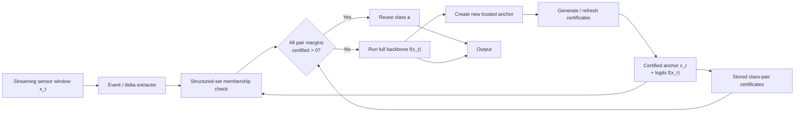
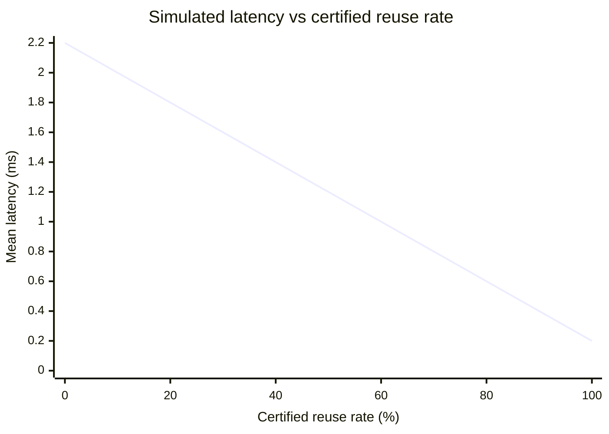

# Structured Event-Conditioned Certified Neural Inference

## Executive summary

**[S0] Context confidence: High**

Sau khi rà lại hướng hôm qua và đối chiếu với các công trình đến tháng 10/2026, câu hỏi nghiên cứu nên được chốt lại như sau:

> **Can structured, event-conditioned class-pair bounds certify that a neural backbone preserves its decision on temporally correlated inputs more often than global Lipschitz bounds, while remaining cheap enough to produce net inference savings?**

Điểm quan trọng là **không đặt “giảm 50% latency” làm target**. Thành công được đánh giá bằng việc phương pháp mới có nằm trên một *Pareto frontier* tốt hơn hay không: certificate chặt hơn, reuse được nhiều hơn, vẫn giữ quyết định của backbone, và tổng chi phí thực tế giảm.

**[D] Điểm chọn đề tài của tôi: khoảng 83/100**, không phải “83% xác suất thành công”. Rubric: novelty 25%, feasibility 20%, verifiability 20%, resource fit 20%, research impact 15%. Global-Lipschitz-only đạt khoảng 71/100; confidence-only khoảng 55/100. Lý do hướng đề xuất cao hơn là nó có một khoảng trống nghiên cứu tương đối cụ thể nhưng vẫn đủ gần các kỹ thuật đã có để triển khai được.

Tuy nhiên, deep research làm lộ ra một điều rất quan trọng: **“class-pair certificate” và “structured temporal bounds” riêng lẻ đều không còn mới.** LipCache tháng 8/2026 đã có tighter per-class-pair certified radius, nhưng certificate của nó bảo đảm **GuardNet**, không bảo đảm MainNet; chính tác giả nói MainNet-side guarantee chưa có và temporal/non-i.i.d. streaming là future work. citeturn5view0turn5view1 Song song, STBP 2026 đã khai thác structured spatio-temporal perturbations để làm bound chặt hơn cho video verification. citeturn12view0

Vì vậy đóng góp cần định vị chính xác là:

> **event-conditioned structured bounds + direct MainNet/backbone decision certification + sequential reuse + runtime-cost analysis.**

Đó mới là research gap đáng theo.

## Problem, scope và research gap

**[S1] Problem.** Với chuỗi cảm biến \(x_1,x_2,\ldots\), các cửa sổ liên tiếp thường tương quan mạnh. Chạy lại toàn bộ backbone \(f\) cho mọi cửa sổ có thể lặp lại nhiều computation. DeltaCNN cho thấy temporal redundancy thực sự có thể chuyển thành acceleration trên video bằng sparse frame differences, báo cáo speedup tới \(7\times\) trong các workload của họ; Skip RNN cũng cho thấy có thể học bỏ state updates trong chuỗi mà vẫn duy trì performance. Nhưng cả hai không chứng nhận rằng **decision hiện tại của backbone chắc chắn giống decision đã reuse**. citeturn6search0turn6search1

LipCache tiến gần hơn: nó dùng local classification margin và Lipschitz control để tạo certified cache regions, đạt speedup đo được tối đa \(1.65\times\) trong các image-classification experiment. citeturn3view0 Nhưng certificate của LipCache chỉ nói GuardNet prediction không đổi trong vùng cache. Paper nói rõ nó không chứng minh MainNet prediction không đổi trên toàn vùng; đồng thời experiments hiện tại là i.i.d., còn temporal redundancy, concept drift và streaming reuse được để lại cho future work. citeturn5view0turn5view1

Một giới hạn novelty thứ hai là STBP, accepted tại SAIV 2026, đã chứng minh rằng exploiting shared spatio-temporal structure có thể làm verification bound chặt hơn so với việc xem mọi dimension độc lập; họ báo cáo certified robust accuracy cao hơn tới \(1.7\times\) so với IBP ở cùng perturbation budget trong các experiment của họ. citeturn12view0 Time-series certification nói chung cũng đã tồn tại: Franco et al. tại UAI 2024 sử dụng conformalized randomized smoothing cho các perturbation đặc thù time series. citeturn12view1

**[C] Research gap sau khi thu hẹp:**

\[
\text{temporal event structure}
\rightarrow
\text{class-pair bound trực tiếp trên backbone}
\rightarrow
\text{safe reuse}
\rightarrow
\text{đo cost/reuse/latency end-to-end}.
\]

Không nên claim “first structured temporal verifier” hay “first class-pair certified radius”.

## Mô hình toán học và certificate

**[S2] Definitions.**

Cho một input window

\[
x\in\mathbb{R}^{d},
\]

với \(d=C_sT\), trong đó \(C_s\) là số sensor channels và \(T\) là số time samples.

Backbone:

\[
f:\mathbb{R}^{d}\rightarrow\mathbb{R}^{K},
\]

với \(f_k(x)\) là logit của class \(k\).

Tại một **anchor** \(x^r\) đã thực sự chạy backbone:

\[
a=\arg\max_k f_k(x^r).
\]

Với competitor \(j\neq a\), định nghĩa **class-pair margin**

\[
g_{aj}(x)=f_a(x)-f_j(x),
\]

và

\[
m_{aj}=g_{aj}(x^r)>0.
\]

`Margin`
= khoảng cách logit giữa class thắng \(a\) và class cạnh tranh \(j\).

Nếu mọi \(g_{aj}>0\), class \(a\) vẫn là argmax.

### Event-conditioned input set

Thay vì global ball

\[
\|x-x^r\|_p\le\epsilon,
\]

ta dùng một structured event:

\[
\mathcal S_e(x^r)
=
\left\{
x^r+D_eu:
\|u\|_\infty\le1
\right\},
\]

trong đó

\[
D_e=\operatorname{diag}(r_1^{(e)},\ldots,r_d^{(e)}).
\]

Mỗi \(r_i^{(e)}\) là mức biến thiên được phép tại sensor/time coordinate \(i\).

Ví dụ:

- `stable event`: tất cả \(r_i\) nhỏ;
- `periodic continuation`: một số channels có budget lớn hơn;
- `transition event`: budget lớn tập trung tại một đoạn thời gian;
- `sensor spike`: chỉ một nhóm coordinates được phép thay đổi mạnh.

Quan trọng: **event không cần được semantic classifier dự đoán đúng**. Runtime chỉ cần chứng minh input hiện tại thực sự thuộc \(\mathcal S_e\). Nếu detector gọi nhầm tên event nhưng membership check vẫn đúng, certificate vẫn sound.

### Event-conditioned class-pair error bound

Định nghĩa adverse change thật:

\[
B^*_{aj}(e)
=
\sup_{x\in\mathcal S_e}
\left[
m_{aj}-g_{aj}(x)
\right].
\]

Nó trả lời:

> Trong event region này, margin \(a\) so với \(j\) có thể giảm nhiều nhất bao nhiêu?

Điều kiện certificate là

\[
m_{aj}>B^*_{aj}(e)
\qquad\forall j\neq a.
\]

**Mệnh đề soundness.** Nếu điều kiện trên đúng thì

\[
\arg\max_k f_k(x)=a
\qquad
\forall x\in\mathcal S_e.
\]

**Chứng minh.**

Từ định nghĩa \(B^*\):

\[
m_{aj}-g_{aj}(x)\le B^*_{aj}.
\]

Suy ra

\[
g_{aj}(x)\ge m_{aj}-B^*_{aj}>0.
\]

Do đó

\[
f_a(x)>f_j(x)
\]

cho mọi \(j\neq a\). Vì thế \(a\) vẫn là argmax. \(\square\)

Đây là phần cốt lõi: **certificate không cần biết ground truth**. Nó chứng nhận equivalence với decision của backbone tại anchor.

### Bound tính được bằng CROWN/LiRPA

Exact \(B^*\) thường không tính được hiệu quả với neural network phi tuyến. CROWN xây dựng provable linear bounds cho neural-network outputs; auto-LiRPA mở rộng các kỹ thuật LiRPA như CROWN sang computation graph tổng quát. citeturn7search0turn7search1

Ta yêu cầu verifier xử lý trực tiếp specification

\[
g_{aj}(x)=f_a(x)-f_j(x).
\]

Giả sử CROWN cho affine lower bound

\[
g_{aj}(x)\ge
\alpha_{aj}^{\top}x+\beta_{aj}
\qquad
\forall x\in\mathcal S_e.
\]

Vì

\[
x=x^r+D_eu,\qquad \|u\|_\infty\le1,
\]

ta có certified lower margin

\[
\underline g_{aj}^{(e)}
=
\alpha_{aj}^{\top}x^r+\beta_{aj}
-
\|D_e\alpha_{aj}\|_1.
\]

Từ đó:

\[
\widehat B_{aj}^{(e)}
=
m_{aj}-\underline g_{aj}^{(e)}.
\]

Vì \(\underline g\) là lower bound sound:

\[
\widehat B_{aj}^{(e)}\ge B^*_{aj}.
\]

Do đó runtime certificate chỉ cần:

\[
\boxed{
\underline g_{aj}^{(e)}>0
\quad\forall j\neq a
}
\]

hay tương đương

\[
m_{aj}>\widehat B_{aj}^{(e)}.
\]

Đây là version nên implement.

### So với global Lipschitz

Một baseline đơn giản:

\[
|g_{aj}(x)-g_{aj}(x^r)|
\le
L_{aj}\|x-x^r\|_2.
\]

Vì event box nằm trong ball bán kính

\[
\epsilon_e=\|r^{(e)}\|_2,
\]

global certificate là

\[
m_{aj}>L_{aj}\epsilon_e.
\]

Với ReLU CNN, một upper bound đơn giản cho \(L_{aj}\) có thể xây từ product operator norms của các layer và class-pair output weights.

**[C] Tightness argument:** structured set chứa ít perturbations hơn global ball, nên *exact* worst-case adverse shift trên structured set không thể lớn hơn exact worst-case trên một containing ball:

\[
\mathcal S_e\subseteq\mathcal B
\Rightarrow
B^*_{aj}(\mathcal S_e)
\le
B^*_{aj}(\mathcal B).
\]

Nhưng không được kết luận rằng implementation CROWN luôn cho bound số học tốt hơn mọi Lipschitz implementation; approximation của verifier cũng ảnh hưởng kết quả. Đây chính là thứ experiment phải kiểm tra.

## System pipeline và thiết kế experiment

**[S3] Current/proposed system flow.**

**Single source of truth:** chỉ một input đã **thực sự chạy backbone** được trở thành trusted anchor.

**Do not:** lấy một reused window làm anchor mới vô điều kiện. Nếu liên tục làm

\[
x_0\rightarrow x_1\rightarrow x_2\rightarrow\cdots
\]

thì local changes nhỏ có thể tích lũy thành drift lớn. Certificate phải luôn tham chiếu về một trusted anchor, hoặc phải chứng minh riêng transitive composition.

### Dataset

**[D] Dataset chính nên đổi từ UCI HAR bản cũ sang bản mở rộng Smartphone-Based Recognition of Human Activities and Postural Transitions.** Dataset có 30 subjects, accelerometer + gyroscope 3 trục ở 50 Hz, sáu basic activities và sáu postural transitions; quan trọng nhất, version này cung cấp **raw inertial streams** và UCI nói rõ thay đổi đó nhằm hỗ trợ online tests. citeturn3view3

Input đề xuất:

\[
6\text{ channels}\times128\text{ samples}
\]

tức cửa sổ 2.56 s ở 50 Hz, stride 64 mẫu. Cấu hình 128 samples và 50% overlap cũng phù hợp với protocol UCI. citeturn3view3

Để kiểm tra generalization có thể thêm MHEALTH — 10 subjects, 12 activities, 50 Hz — và PAMAP2 — 9 subjects, nhiều activity streams từ ba IMU ở 100 Hz. citeturn2search3turn1search8

### Backbone đề xuất

Một verifier-friendly 1D-CNN nhỏ:

| Layer | Cấu hình |
|---|---|
| Input | \(6\times128\) |
| Conv1 | 6 → 32, kernel 5, ReLU |
| AvgPool | stride 2 |
| Conv2 | 32 → 64, kernel 5, ReLU |
| AvgPool | stride 2 |
| Conv3 | 64 → 64, kernel 3, ReLU |
| Global average pool | 64 features |
| Linear | 64 → \(K\) classes |

Khoảng **24.4k parameters** với \(K=12\). Đây là thiết kế đề xuất, không phải architecture từ UCI.

ReLU + affine operations giúp integration với CROWN/LiRPA đơn giản hơn. citeturn7search0turn7search1

### Protocol

**[S5] Evidence-driven protocol.**

Train/test phải chia **theo subject**, rồi giữ nguyên chronological ordering trong từng recording. Không randomize overlapping windows giữa train và test.

Mỗi phương pháp dùng đúng cùng backbone frozen.

Đo:

\[
\text{Agreement}
=
\frac{1}{N}
\sum_t
\mathbf1[\hat y_t^{system}=\hat y_t^{backbone}],
\]

\[
\text{CertifiedReuseRate}
=
\frac{\#\text{certified reused queries}}{N}.
\]

Ngoài ra báo cáo:

- median latency;
- p95 latency;
- backbone invocation rate;
- certificate-generation cost;
- per-query membership/check cost;
- bound width/tightness;
- accuracy đối với ground truth;
- violations trên các certified hits.

Mỗi latency benchmark warm-up trước, chạy lặp lại trên cùng CPU và báo cáo phân bố thay vì chỉ average. Confidence thresholds và event thresholds phải tune trên validation subjects, không tune trên test subjects.

### Mô phỏng latency

**[C] Đây chỉ là simulated cost model, không phải measurement.**

Giả sử:

\[
T_f=2.0\text{ ms}
\]

cho full backbone và

\[
T_c=0.2\text{ ms}
\]

cho event + certificate check.

Nếu certified reuse rate là \(r\):

\[
E[T]
=
T_c+(1-r)T_f.
\]

| Reuse \(r\) | Mean simulated latency | So với full 2 ms |
|---:|---:|---:|
| 0% | 2.20 ms | -10% |
| 20% | 1.80 ms | +10% |
| 40% | 1.40 ms | +30% |
| 60% | 1.00 ms | +50% |
| 80% | 0.60 ms | +70% |
| 100% | 0.20 ms | +90% |

Điểm cần lấy từ mô phỏng **không phải target 50%**. Break-even là:

\[
T_c+(1-r)T_f<T_f
\]

nên

\[
r>\frac{T_c}{T_f}.
\]

Với giả định trên:

\[
r>10\%.
\]

Tức chỉ cần certified reuse vượt 10% đã có lợi về mean latency trong mô hình giả định này.

Nhưng p95 có thể khác hoàn toàn: nếu hơn 5% request vẫn rơi vào slow fallback path thì p95 vẫn gần \(T_c+T_f\). Vì vậy **median + p95 + mean đều cần báo cáo**.

## So sánh phương pháp và tiêu chí chọn đề tài

**[S6] Alternatives.**

| Tiêu chí | Event-conditioned certified backbone | Global Lipschitz | Confidence-based reuse |
|---|---:|---:|---:|
| Novelty | Cao nếu gắn trực tiếp MainNet + streaming | Thấp–TB | Thấp |
| Feasibility | Khá | Rất cao | Rất cao |
| Formal verifiability | Rất cao | Rất cao | Thấp |
| Resource fit | Khá | Cao | Rất cao |
| Research impact | Cao nếu bound thực sự chặt | TB | Thấp–TB |
| Decision guarantee | Có | Có | Không |
| Expected reuse | Cần đo | Có nguy cơ thấp vì loose bound | Thường cao hơn |
| Certificate cost | TB–cao | Thấp | Gần như không |
| Key metric | reuse / bound tightness / latency | certified reuse | agreement / latency |

**Confidence baseline** nên dùng previous-anchor confidence hoặc margin cộng empirical distance threshold:

\[
p_a(x^r)>\tau_c,
\qquad
\|x_t-x^r\|<\tau_d.
\]

Thresholds được tune để tối đa reuse ở một target agreement. Softmax confidence không nên được xem là proof; neural-network confidence có thể miscalibrated, một vấn đề đã được documented rộng rãi trong calibration literature. citeturn7search6

Rubric chọn hướng:

| Hướng | Novelty 25 | Feasibility 20 | Verifiability 20 | Resource 20 | Impact 15 | Tổng |
|---|---:|---:|---:|---:|---:|---:|
| **Event-conditioned backbone certificate** | 90 | 70 | 90 | 80 | 85 | **83%** |
| Global-Lipschitz-only | 40 | 85 | 95 | 90 | 45 | **71%** |
| Confidence-only | 20 | 95 | 35 | 95 | 35 | **55%** |

**83% ở đây là decision score do rubric này tạo ra, không phải accuracy, probability of publication hay probability of success.**

**[S7] Recommendation:** chọn hướng đầu tiên, nhưng thesis/paper claim phải là:

> **Event-conditioned certification for direct backbone decision reuse in sequential time-series inference.**

Không claim class-pair margin là mới: LipCache đã có per-pair radius. citeturn5view0  
Không claim structured temporal verification là mới: STBP đã có. citeturn12view0

## Risks, implementation roadmap và kết luận

**[S9] Risks / verify.**

Rủi ro lớn nhất là **bound quá loose**: mathematical proof đúng nhưng certified reuse gần 0%. Khi đó research vẫn cho một negative result nhưng system acceleration thất bại. Cách kiểm chứng là plot distribution của

\[
\frac{\underline g_{aj}^{event}}
     {m_{aj}}
\]

và certified reuse theo từng event type.

Rủi ro thứ hai là **certificate đắt hơn inference**. CROWN/LiRPA được thiết kế cho provable perturbation analysis, nhưng verifier overhead không mặc nhiên nhỏ hơn một 24k-parameter CNN. citeturn7search1 Vì vậy cần tách hai mode: trước tiên online certificate để kiểm tra theory; sau đó precompute a ladder of safe event regions cho mỗi trusted anchor/template, để runtime chỉ còn event membership check. Mọi cost tạo lại certificate khi anchor thay đổi phải được tính vào end-to-end result.

Rủi ro thứ ba là novelty collision. LipCache đã trực tiếp nêu MainNet-side certification và streaming evaluation là phần chưa giải quyết, nhưng STBP cho thấy structured temporal verification đang là research direction active. citeturn5view0turn5view1turn12view0 Vì vậy contribution phải được chứng minh bằng ablation:

\[
\text{Global ball}
\rightarrow
\text{structured event set}
\rightarrow
\text{pair-specific bound}
\rightarrow
\text{reuse system}.
\]

**[S8] Implementation order:**

| Milestone | Deliverable | Go/no-go criterion |
|---|---|---|
| Backbone | 1D-CNN + chronological evaluation | Stable subject-held-out accuracy |
| Baselines | Global Lipschitz + confidence gate | Reproducible reuse/latency curves |
| Verifier | \(g_{aj}=f_a-f_j\) CROWN specification | Zero empirical certified violations |
| Event model | \(D_e\) structured perturbation sets | Tighter bounds than global baseline on meaningful fraction |
| Streaming | Anchor lifecycle + fallback | No cumulative reuse drift |
| Systems test | CPU median/p95/cert cost | Net savings at some operating region |
| Final analysis | Ablations + subject CIs | Event method dominates at least one meaningful Pareto region |

**Kết luận.** Sau khi kiểm tra literature mới nhất, tôi vẫn chọn **Structured Event-Conditioned Certified Neural Inference**, nhưng research question phải hẹp hơn đề xuất ban đầu. Ý tưởng mạnh không nằm ở “Lipschitz”, “class-pair” hay “temporal structure” riêng rẽ; cả ba đều đã có tiền lệ. Điểm đáng nghiên cứu là **dùng cấu trúc của event trong temporal stream để tạo certificate trực tiếp cho decision của backbone, rồi biến certificate đó thành một cơ chế computation reuse có lợi về runtime**. LipCache để hở đúng MainNet-side guarantee và streaming setting này, trong khi CROWN/LiRPA cung cấp machinery để xây proof, còn STBP cảnh báo rằng structured temporal verification đã là một vùng cạnh tranh. citeturn5view0turn5view1turn7search0turn7search1turn12view0

Tiêu chí quyết định cuối cùng không phải “có giảm 50% hay không”, mà là liệu phương pháp có đạt đồng thời:

\[
\boxed{
\text{sound certificate}
+
\text{tighter bound}
+
\text{higher certified reuse}
+
\text{positive net runtime saving}
}
\]

so với global Lipschitz và empirical confidence baseline. Nếu bốn yếu tố đó cùng xuất hiện trên UCI temporal data, đây là hướng có cơ sở rõ ràng để phát triển thành một nghiên cứu nghiêm túc.