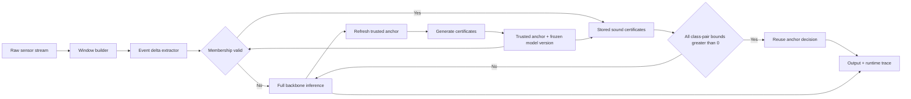

# Roadmap Suggestion — Structured Event-Conditioned Certified Neural Inference

> Thu muc: `/home/pro/Downloads/research/`
> Ngay: 2026-10-15
> Trang thai: 0/7 gates hoan thanh
> File goc: `report.md` (550 dong) = LEGACY_REFERENCE, giu nguyen, khong sua
> Working RQ (chua freeze novelty claim):
> Can structured, event-conditioned class-pair bounds certify that a neural backbone preserves its decision on temporally correlated inputs more often than global Lipschitz bounds, while remaining cheap enough to produce net inference savings?
> Thanh cong = Pareto frontier tot hon (certificate chat hon + reuse nhieu hon + giu decision backbone + tong chi phi giam), KHONG dat target cung 50% latency.

## 0. Hien trang va nguyen tac

- Hien tai chi co 1 file `report.md` monolithic, tron RQ + literature + theory + system + protocol + simulated latency.
- Citation turnX HONG toan bo, phai thay bang bibliography that truoc khi lam gi khac.
- So latency trong report la SIMULATED (E[T]=T_c+(1-r)T_f voi T_f=2ms, T_c=0.2ms), KHONG phai CPU benchmark.
- Backbone 24,428 params DUNG voi dieu kien: co bias moi layer, pooling khong params, khong BN, K=12. K=6 thi 24,038.

- Kho skills hien tai (~60 SKILL.md) lech frontend (pixijs/gsap/figma/design), 0 skill ML/verifier.
- Nguyen tac: phat hien gia thuyet sai som nhat (data audit truoc freeze theory), khong tach 10 files roi coi gia dinh la proven.
## 1. Sources da verify (dung cho refs.bib)

| # | Nguon | Claim dung duoc | Scope / luu y |
|---|---|---|---|
| 1 | LipCache, Xiang et al., arXiv:2608.13144 (13 Aug 2026) | per-sample certified reuse radius tu local margin + spectral norm; GuardNet-side consistency; reuse chi khi query trong ball, fallback MainNet; speedup toi 1.65x | Tren CIFAR/Tiny-ImageNet/SVHN image tasks. Abstract KHONG nhac future work MainNet-side/streaming, phai doc full PDF 8.5MB lay quote+page |
| 2 | SAIV 2026 Proceedings, Springer LNCS 16831 | Ton tai paper pp.3-35 Hybrid Robustness Verification for Spatio-Temporal NN (Varghese, Wicker, Lomuscio) | Trang proceedings chi list title, KHONG co so 1.7x, can full PDF |
| 3 | DeltaCNN, Parger et al., CVPR 2022 | sparse end-to-end CNN, khong retrain, outperform cuDNN, speedup toi 7x, marginal accuracy diff | Tren workload + hardware trong paper, video frames, KHONG co certificate |
| 4 | Franco et al., UAI 2024, PMLR v244:1371-1388 | conformalized randomized smoothing cho arbitrary transformations, time-series + automotive | Prior art time-series cert, khong phai bound reuse |
| 5 | HAPT, Reyes-Ortiz et al., UCI id=341 | 30 volunteers 19-48t, 6 basic + 6 transitions, acc+gyro 50Hz, window 2.56s/50% overlap/128 readings, raw signals cho online tests | Dataset chinh. Phai chot K=12 vs K=6 + quy tac nhan boundary windows |
| 6 | auto_LiRPA docs | API compute_bounds(..., C=..., method=...) voi C la specification matrix | CHUA VERIFY truc tiep, khong claim moi correlated set duoc ho tro, phai prototype |

BibTeX skeleton: lipcache2026, varghese2026stbp (SAIV), parger2022deltacnn (CVPR), franco2024conformalized (UAI/PMLR), reyesortiz2015hapt (UCI). Moi claim Xac nhan trong 02 phai co 1 entry + URL + page/quote.


## 2. Thu tu documents (dependency order, KHONG viet paper truoc thuc nghiem)

```
research/
|-- report.md             # LEGACY_REFERENCE, 1 commit Git rieng, khong sua
|-- roadmap suggestion.md # file nay = working plan
|-- 00_START_HERE.md
|-- GATES.md
|-- refs.bib
|-- 01_RQ_GAP.md
|-- 02_LITERATURE.md
|-- 03_DATA_AUDIT.md       # NEW, truoc freeze THEORY
|-- 04_THEORY.md
|-- 05_SYSTEM.md
|-- 06_DATA_PROTOCOL.md
|-- 07_EXPERIMENT_PLAN.md
|-- 08_ROADMAP_RISKS.md
|-- 09_RESULTS.md          # placeholder, chi so that + CI
|-- 10_PAPER_DRAFT.md
|-- 11_AUDIT/
|-- scripts/
|-- configs/
```

| # | Doc | Nguon tu report.md | Dieu kien DONE |
|---|---|---|---|
| 00 | 00_START_HERE.md | moi | reading order, SoT, lenh inventory skills, quy tac report=legacy |
| G | GATES.md | S8 | 7 gates G0-G6 + checklist copy duoc |
| R | refs.bib | S1 | 5 nguon muc 1, khong con turnX |
| 01 | 01_RQ_GAP.md | S0,D,S7 | RQ Pareto + claim thu hep: event-conditioned cert for direct backbone decision reuse in sequential time-series inference. KHONG claim first class-pair / first structured verifier |
| 02 | 02_LITERATURE.md | S1 | bang GuardNet vs MainNet, i.i.d vs streaming, toc do vs certified accuracy, phan biet novelty vs prior art |
| 03 | 03_DATA_AUDIT.md | NEW (S2.2,S5) | tra loi 3 cau: phan bo khoang cach windows lien tiep? event set bao phu windows that? label balance du cho tung activity/transition? |
| 04 | 04_THEORY.md | S2 | freeze math sau audit: S_e, B*, CROWN g_aj, tightness argument exact vs implementation |
| 05 | 05_SYSTEM.md | S3 | flowchart sach + ownership + version pin + trace |
| 06 | 06_DATA_PROTOCOL.md | dataset+backbone | window 6x128 stride64 50Hz, subject-split + chronological, K, count_params.py |
| 07 | 07_EXPERIMENT_PLAN.md | S5,S6 | metrics Agreement vs Accuracy, CertifiedReuse, median/p95, ablations Global->structured->pair->reuse |
| 08 | 08_ROADMAP_RISKS.md | S8,S9 | 7 milestones + go/no-go, 3 risks + cach do |
| 09 | 09_RESULTS.md | chua co | chi so that, CI theo subject, tach lookup-only vs end-to-end incl rebuild |
| 10 | 10_PAPER_DRAFT.md | ket luan | cuoi cung, limitations ro rang |

## 3. Toan hoc can sua (S2)

### 3.1 Diagonal D_e chua mo hinh hoa tuong quan thoi gian

Dinh nghia goc:

```
S_e(x^r) = { x^r + D_e u : ||u||_inf <= 1 }
D_e = diag(r_1, ..., r_d)
```

Day la anisotropic box: cho phep sensor A bien thien nhieu hon sensor B, nhung KHONG rang buoc hai thoi diem phai thay doi cung nhau.

Vi du event co quan he Dx2 = 0.8*Dx1: diagonal box cho phep moi to hop doc lap, ke ca to hop khong thoa quan he do.

Cong thuc tong quat (D_e khong cheo):

```
g_underline_aj(e) = alpha_aj^T x^r + beta_aj - ||D_e^T alpha_aj||_1
```

Vi min_{||u||_inf<=1} alpha^T D_e u = -||D_e^T alpha||_1.

Cong thuc trong report dung ||D_e alpha||_1 chi dung vi D_e cheo doi xung. Khi mo rong phai dung D_e^T alpha.

Mo rong de lay coverage (subspace chieu thap co measure 0, data that gan nhu khong bao gio nam exact trong do):

```
x = x^r + D_e u + v,  ||u||_inf <= 1,  |v_i| <= eps_i
```

Bound khi do cong them term: - sum_i eps_i |alpha_i| (tra gia tightness lay coverage).

Staging: giu diagonal box lam baseline dau tien; dua correlated event set vao hypothesis chinh, chi trien khai sau khi 03_DATA_AUDIT xac nhan data ung ho.

### 3.2 Overlap 50% KHONG dong nghia input similarity

Window 128 stride 64: 64 mau overlap nhung nam o toa do khac nhau trong input CNN, nen KHONG suy ra ||x_{t+1}-x_t||_inf ~= 0.

Phai do trong 03_DATA_AUDIT: phan bo ||x_{t+1}-x_t||_2,inf that + so voi margin m_aj. Conv+GAP co translation equivariance mot phan nhung shift 64/128 qua lon de coi invariant.

Neu dua phep dich thoi gian vao mo hinh, phai chung nhan quyet dinh so voi anchor goc, khong tu y coi shifted anchor cung nhan.

### 3.3 Backbone param count (da tinh tay verify)

```
Conv1d 6->32 k=5:  (5*6+1)*32   = 992
Conv1d 32->64 k=5: (5*32+1)*64  = 10304
Conv1d 64->64 k=3: (3*64+1)*64  = 12352
Linear 64->12:     (64+1)*12    = 780
Total K=12 = 24428. K=6 thi 24038.
```

Dung NEU: co bias moi layer, pooling khong params, khong BN, khong layer phu. Phai co scripts/count_params.py + shape test (B,6,128)->(B,K). GAP length sau 2 AvgPool stride2: 128->64->32, padding phai preserve length.

## 4. System flow chot (S3)



State ownership:

| Component | So huu |
|---|---|---|
| Window builder | Input window, timestamp, experiment ID |
| Event extractor | Event candidate va tham so can kiem tra |
| Membership checker | Ket qua input co thuoc vung duoc chung nhan |
| Anchor manager | Anchor goc, logits, model version |
| Verifier | Class-pair certificate |
| Runtime evaluator | Fallback/reuse decision, latency, trace |

Bat buoc de G3 sound that:

- Model version pin: anchor+logits gan voi checkpoint hash nao.
- Anchor invalidation rule: khi nao bo anchor cu, KHONG lay reused window lam anchor moi vo dieu kien (x0->x1->... tich luy drift).
- Trace log: moi reuse ghi anchor_id, event_id, margins.
- Khong co 3 cai nay thi zero violations cung khong audit duoc.

Phan biet in dam moi noi: verifier chung minh reuse CUNG PREDICTION voi backbone, KHONG chung minh DUNG ground truth. Agreement va Accuracy la 2 metric rieng.

Metric:

```
Agreement = (1/N) sum_t 1[y_system_t == y_backbone_t]
CertifiedReuseRate = #certified reused queries / N
```

Bao cao them: median latency, p95 latency, backbone invocation rate, certificate-generation cost, per-query membership cost, bound width/tightness, accuracy vs ground truth, violations tren certified hits. Latency warm-up truoc, lap lai tren cung CPU, bao cao phan bo thay vi chi average. Thresholds tune tren validation subjects, khong tune tren test.

## 5. Runtime-cost sua (S4)

Cong thuc cu E[T]=T_c+(1-r)T_f chi hop le khi T_c da phan anh moi overhead trung binh. Neu chi tinh membership check thi thieu.

Mo hinh day du:

```
E[T] = T_e + T_m + (1-r)*T_f + q*T_b
co loi khi r*T_f > T_e + T_m + q*T_b
```

Trong do: T_e = extract event, T_m = membership/lookup, T_f = backbone, r = reuse rate, q = so rebuild trung binh / cua so, T_b = thoi gian rebuild.

Baseline sensitivity: T_f=2ms, T_e+T_m=0.2ms, q=1-r (moi fallback rebuild 1 lan). SIMULATED, khong phai CPU benchmark. Nhan dinh chi can r>10% phu thuoc manh vao gia dinh bo qua rebuild.

Khi viet 07: bao cao T_b phan bo (mean/p95), tach 2 bang lookup-only vs end-to-end incl rebuild. p95 co the gan T_c+T_f neu >5% request roi slow path. Median + p95 + mean deu can.

## 6. 03_DATA_AUDIT phai tra loi truoc freeze THEORY

- Khoang cach windows lien tiep phan bo ra sao (||x_{t+1}-x_t||_2,inf + so voi margin m_aj)?
- Event set de xuat bao phu duoc windows that trong stream khong?
- Luong data cho tung activity + transition du danh gia rieng khong? Quy tac nhan boundary windows? K=12 hay K=6?
- Lay raw stream + nhan tu tung experiment HAPT, tao window theo thoi gian, ghi ro experiment ID, subject ID, label start/end. Split theo subject, giu chronological, khong random overlapping windows train/test.

## 7. Skills: cai nao bat buoc?

Thu tu uu tien cong cu:

| Uu tien | Cong cu / skill | Trang thai |
|---|---|---|
| P0 | Literature/BibTeX workflow | Bat buoc co quy trinh, skill tuy chon |
| P0 | PyTorch + auto_LiRPA | Can cho verifier prototype |
| P0 | Dataset audit scripts | Tu viet va kiem thu |
| P1 | Experiment tracking + reproducibility | Can truoc benchmark chinh thuc |
| P1 | Git + CI | Can de luu code va moi truong |
| P2 | vault-reorg-cycle | Huu ich cho docs migration dau tien (giu report.md nguyen, 1 commit, khong tu sua noi dung chua verify) |
| P3 | Figma/Canva presentation | Khong anh huong core nghien cuu |

Inventory tai cho:

```
find ~/.gemini/skills ~/.agents/skills -type f -name SKILL.md 2>/dev/null | sort
```

Tim skills thieu (tuy chon, khong bat buoc de lam ML research):

```
npx skills find arxiv literature review
npx skills find latex bibtex academic
npx skills find pytorch verification
npx skills find ml experiment reproducibility
npx skills find matplotlib statistics
```

## 8. Gates va thu tu trien khai cuoi cung (0/7)

- G0 Literature verified: claims chinh co bibliography that, phan biet novelty vs prior art.
- G1 Dataset feasible: xac nhan streaming order, split, event coverage, temporal deltas.
- G2 Backbone reproducible: config, seed, checkpoint, accuracy, macro-F1, param count.
- G3 Sound verifier: bounds hop le; accepted inputs thoa membership + tat ca class-pair margins > 0. zero violations la bang chung test, KHONG thay chung minh soundness (can ca math + test).
- G4 Event structure useful: structured cai thien certified reuse hoac tightness co y nghia vs baselines (Global Lipschitz + confidence gate).
- G5 Net runtime saving: co vung tham so end-to-end latency tot hon full inference, ke ca rebuild (r*T_f > T_e+T_m+q*T_b).
- G6 Research report: chi so that, CI, ablations Global->structured->pair->reuse, scripts, limitations.

Thu tu hanh dong:

1. P0: 01_RQ_GAP + 02_LITERATURE + refs.bib (thay turnX bang 5 nguon muc 1 + full PDF LipCache/STBP), giu report.md legacy + Git commit.
2. P0: 03_DATA_AUDIT + scripts do khoang cach windows, coverage, label balance. Chua can verifier.
3. P1: freeze 04_THEORY (cong thuc D_e^T + term v) + 05_SYSTEM (ownership + version pin + trace).
4. P1: 06_DATA_PROTOCOL + 07_EXPERIMENT_PLAN (Agreement vs Accuracy, median/p95, ablations).
5. P2: implement theo 08_ROADMAP_RISKS: Backbone -> Baselines -> Verifier (zero violations) -> Event D_e -> Streaming -> Systems test CPU that.
6. Stop: neu certified reuse ~= 0% hoac cert cost > inference, dung o negative result, khong ve 09 dep.

## 9. Ket luan

Giu huong Event-Conditioned Certification for Direct Backbone Decision Reuse, nhung chi freeze novelty claim sau literature audit + feasibility spike. Huong nay co gia thuyet kiem tra duoc, co doi chung, co gia tri ngay ca khi acceleration that bai. Nhung diagonal box, tuong quan thoi gian, chi phi verifier phai tach thanh gia thuyet doc lap, tranh gom ky thuat quen thuoc roi goi toan bo la novelty.

Do not: tach toan bo report thanh 10 files roi mac nhien coi moi gia dinh da duoc chung minh.

Hanh dong dau tien: hoan thien 01_RQ_GAP, 02_LITERATURE, refs.bib, 03_DATA_AUDIT, giu report.md lam tham chieu lich su. Sau do moi khoa 04_THEORY, xay verifier, do runtime CPU that.
